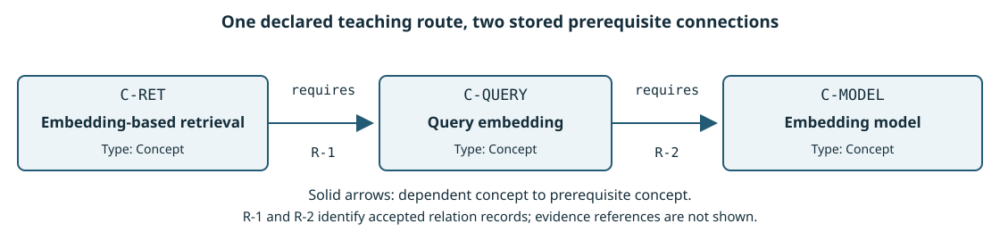
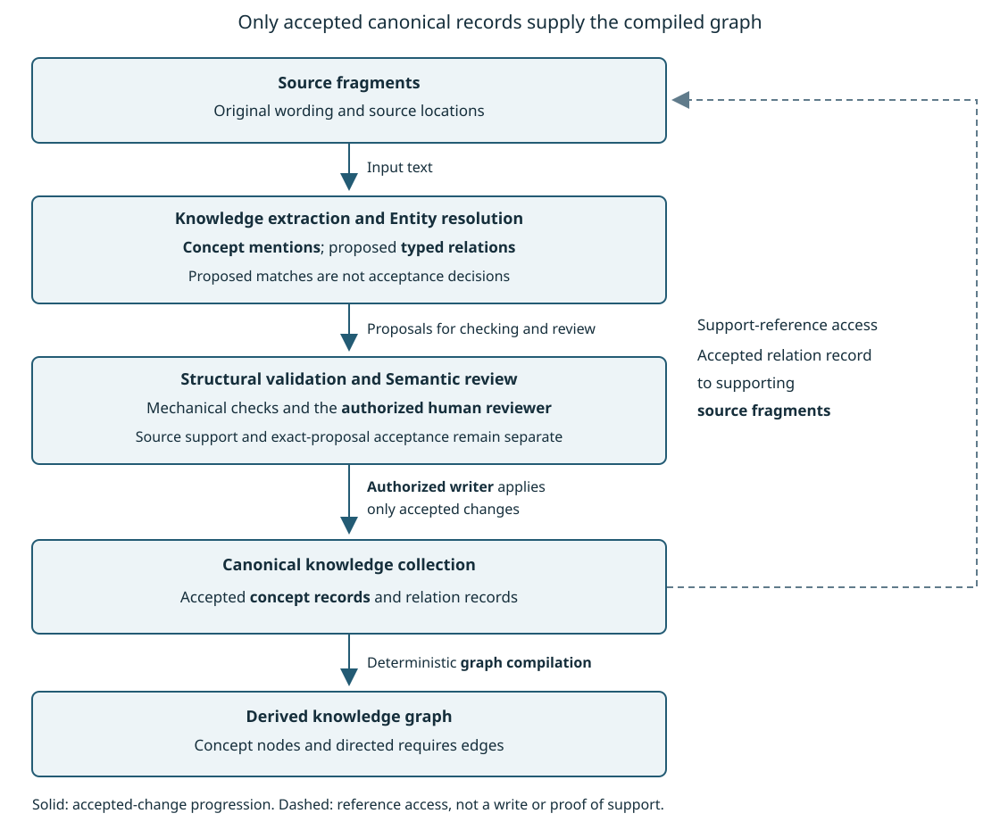
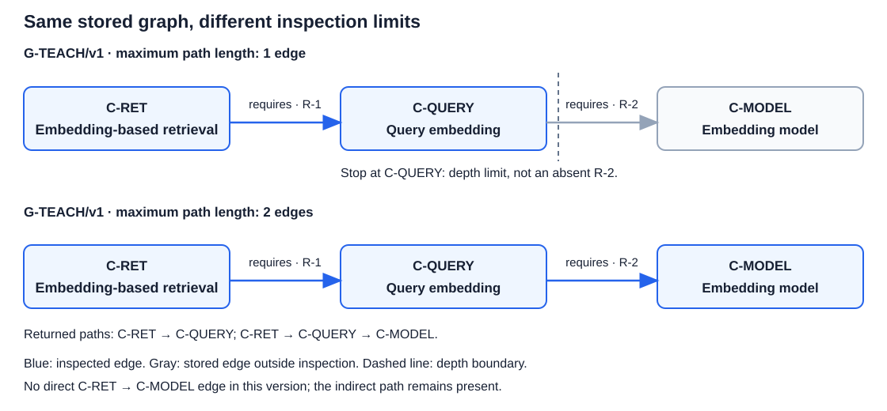
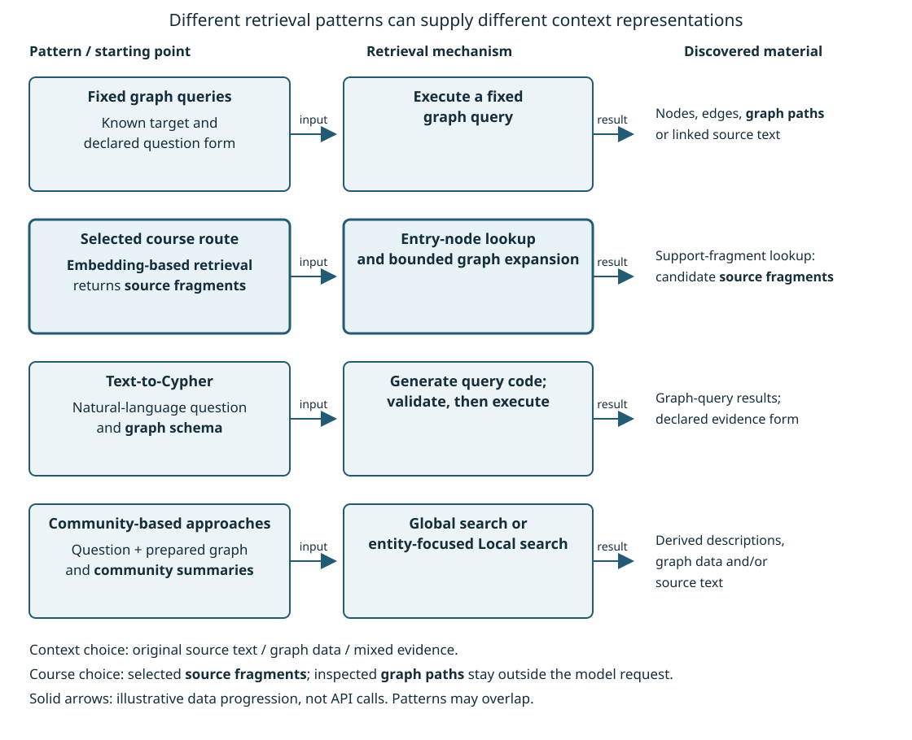
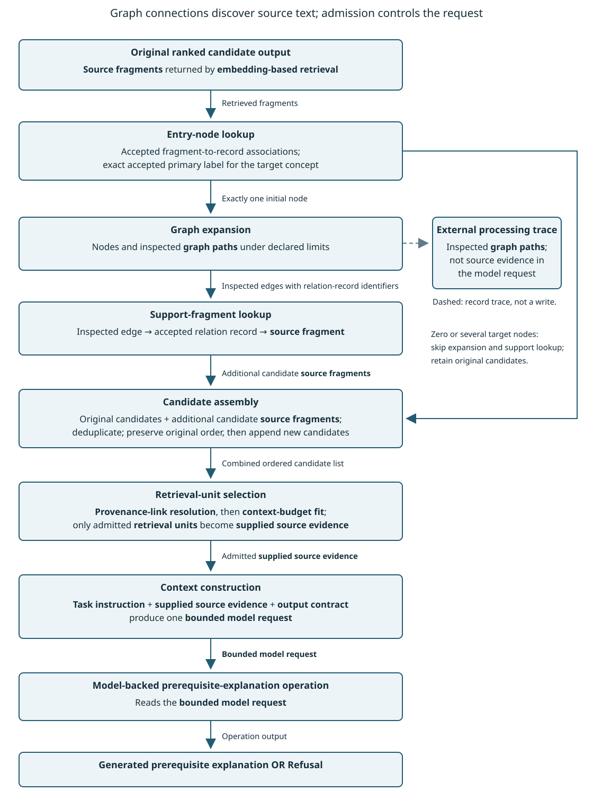
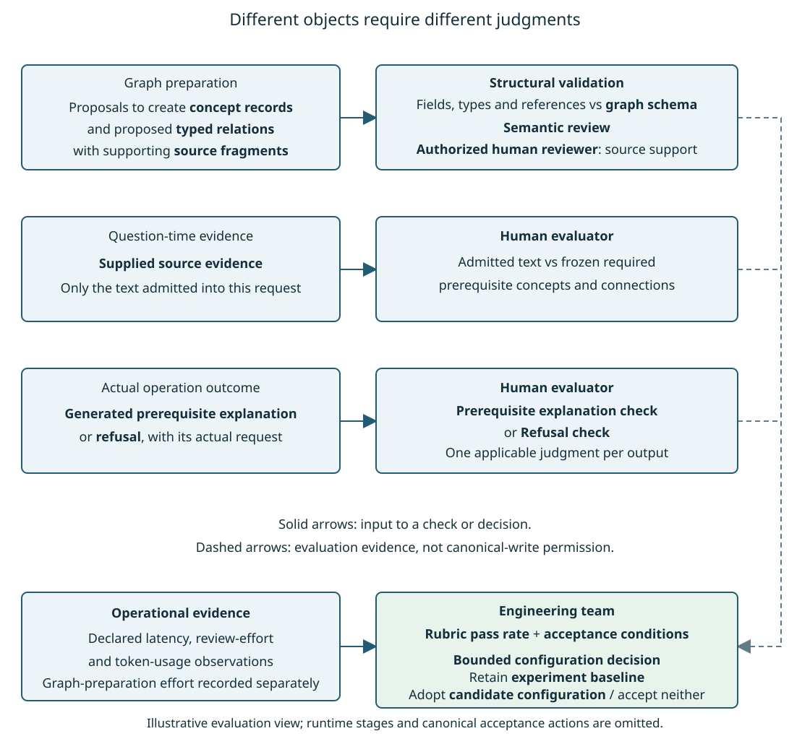

# Module 06: Knowledge Graphs and GraphRAG — Theory

> **Status:** Ready for Students — English theory and Ukrainian translation approved by the instructor on 2026-11-07

## 0. Engineering problem: which concepts must be understood before a target concept?

Consider a question in the learning knowledge system: “Which concepts are prerequisites for understanding the target concept, and how do the prerequisite connections follow from the sources?” A **retrieval operation** can return **source fragments** discussing the target concept. A similarity-ranked list of **source fragments**, however, does not explicitly represent which concept depends on which other concept. The retrieved text may contain the required explanation, but retrieval ranking alone supplies neither a stored prerequisite connection nor a sequence of connected prerequisites.

Module 05 explained how selected **retrieval units** become **supplied source evidence** inside a **bounded model request**. The **model-backed concept-proposal operation** uses the **bounded model request** to produce a **candidate concept definition** or **refusal**. A **human evaluator** judges the generated output against the declared **rubric**. Neither generation nor a favorable evaluation authorizes a change to the **canonical knowledge collection**.

Module 06 adds an explicit representation of accepted concepts and connections between the accepted concepts. A **concept record** is a **canonical knowledge record** describing one accepted concept in the **canonical knowledge collection**. Before a **candidate concept definition** can supply an accepted **concept record**, **structural validation** checks the proposal's structure, the **authorized human reviewer** performs **semantic review**, and the **authorized writer** stores only accepted changes. The graph used in Module 06 derives from accepted records rather than treating generated proposals as accepted knowledge.

### The additional representation

A **knowledge graph** is a representation in which nodes identify subjects and edges express relationships between the subjects. In the learning knowledge system, each node represents a **concept record**, and each edge represents an accepted **typed relation** between two concepts. A **typed relation** states the kind of connection, identifies both endpoints, and specifies direction where direction affects meaning. For the prerequisite example, an edge points from a dependent concept to a concept required to understand the dependent concept. Each accepted relation record identifies the **source fragments** supporting the relation; the derived graph edge retains a reference to that accepted relation record. Following an edge’s relation-record reference and then the stored supporting-fragment identifiers locates candidate **source fragments**. These support references are not **provenance links**. A **provenance link** retains its Module 04 meaning: the association from a **source fragment** to the stable identity, version, and exact location of the source material from which the **source fragment** was derived. The support references locate evidence; resolving a fragment’s **provenance link** checks the fragment’s source location. Neither kind of reference establishes source support for a claim.

The following constructed example stipulates prerequisite connections for illustration, rather than asserting dependencies between particular technical concepts:

- A **source fragment** supports the statement that Concept A requires understanding Concept B.
- Another **source fragment** supports the statement that Concept B requires understanding Concept C.
- After review and authorized storage, the accepted records supply the directed connections `A → B` and `B → C` in the **knowledge graph**.

A **graph path** is an ordered sequence of connected nodes and edges. The **graph path** `A → B → C` exposes the stored connection from Concept A through Concept B to Concept C. The supporting **source fragments** must still be inspected before explaining the prerequisite connections. The inspected **graph path** alone establishes neither source support nor completeness of the represented prerequisites of Concept A.

**GraphRAG** is retrieval-augmented generation in which graph structure helps select or organize evidence for a model request. The selected route uses **graph expansion**: an operation that follows stored relationships under declared direction and stopping limits to extend an initial selected-node set. **Graph expansion** returns nodes and inspected **graph paths**, not source text, and changes neither the stored **knowledge graph** nor the **text query**.

### Two evidence-preparation paths

The comparison concerns evidence preparation for the same prerequisite-explanation task, not a comparison between concept-definition generation and prerequisite-explanation generation. The two configurations differ in whether evidence preparation uses **graph expansion**:

- **Experiment baseline:** the **retrieval operation** returns **source fragments** as a **ranked candidate output**. **Retrieval-unit selection** admits **retrieval units** as **supplied source evidence**, and **context construction** prepares the **bounded model request**.
- **Candidate configuration:** evidence preparation adds a graph-assisted candidate-discovery stage before **retrieval-unit selection**. The numbered stages below show the order and the objects passed between operations.

The **candidate configuration** processes the original **ranked candidate output** and the prepared **knowledge graph** in the following order:

1. **Entry-node lookup** identifies the initial graph node for the named target concept. In this educational route, the question names the target concept by its accepted primary label. During graph preparation, the **authorized human reviewer** accepts each association between a **source fragment** identifier and a **concept record** identifier, and the **authorized writer** stores the accepted association. At question time, **entry-node lookup** follows these stored associations from the retrieved **source fragment** identifiers to existing **concept records**, retains only records whose accepted primary label exactly matches the target label in the question, and uses the retained record identifiers to locate the corresponding derived graph nodes. Repeated matches to the same node count as one node. The **concept record** and graph node are separate objects; their shared identifier identifies which record the node represents. These associations are not prerequisite edges or **provenance links**. The lookup neither resolves alternative labels nor creates or accepts records or associations. A target record elsewhere in the collection does not provide an initial node unless an accepted association connects that record to a retrieved **source fragment**.
2. If **entry-node lookup** identifies exactly one initial node, **graph expansion** returns reachable prerequisite nodes and inspected **graph paths** within declared limits. A support-fragment lookup follows the relation-record references of the inspected edges to their supporting **source fragment** identifiers and loads the corresponding candidate **source fragments**. Support-fragment lookup names this local lookup procedure, not another glossary concept. If **entry-node lookup** finds zero or several possible initial nodes, evidence preparation skips **graph expansion** and support-fragment lookup and retains only the original retrieved **source fragments**.
3. Candidate assembly combines the original retrieved **source fragments** with any additional **source fragments** returned by support-fragment lookup. Candidate assembly removes duplicate fragment identifiers and orders the combined candidates under a rule declared by the **engineering team**. The output is one ordered candidate list of **retrieval units**, not an assertion that the accepted **retrieval operation** ranked the added fragments. If support-fragment lookup returns no additional fragments, the original retrieved candidates remain available.
4. **Retrieval-unit selection** receives that ordered candidate list. Module 06 extends the Module 05 input boundary from one **ranked candidate output** to this combined ordered candidate list; the checks for **provenance-link resolution** and **context-budget fit** remain admission checks, not support or relevance judgments. Only admitted **retrieval units** become **supplied source evidence**. **Context construction** then assembles the **supplied source evidence**, **task instruction**, and Module 06 **output contract** into the **bounded model request**. If no candidates are admitted, no source evidence has been established; graph discovery alone does not justify an explanation.


Both configurations feed the same **model-backed prerequisite-explanation operation**. The **model-backed prerequisite-explanation operation** reads a **bounded model request** containing the prerequisite question within the **task instruction**, **supplied source evidence**, and the Module 06 **output contract**, and produces a **generated prerequisite explanation** or **refusal**. A **generated prerequisite explanation** identifies prerequisite concepts for the named target concept, explains the reported connections, and includes **claim citations** to selected **retrieval units**. For the **model-backed prerequisite-explanation operation**, a **claim citation** is a recorded link from one claim in the **generated prerequisite explanation** to the selected **retrieval unit** offered as source evidence for that claim. A **claim citation** does not itself establish that the cited **retrieval unit** supports the claim. A **refusal** is the recorded outcome in which the **model-backed prerequisite-explanation operation** does not produce a **generated prerequisite explanation** because the **supplied source evidence** is insufficient to complete the **task instruction** without inventing a source fact, or a selected **retrieval unit** carries an instruction that conflicts with the **task instruction**. These Module 06 uses extend the Module 05 output-specific definitions to claims and outcomes of the **model-backed prerequisite-explanation operation**; the Module 05 definitions still apply to the **model-backed concept-proposal operation**.

The output name identifies the attempted response type, not a successful evaluation: missing prerequisites or unsupported claims remain defects in a **generated prerequisite explanation**. The **model-backed prerequisite-explanation operation** neither creates nor accepts **concept records**.

A configuration without **graph expansion** may answer the same question from the retrieved text. **Graph expansion** may also lead only to **source fragments** already retrieved. The **engineering team** must therefore compare judged outputs under the same **evaluation cases**, **rubric**, and **acceptance conditions**; more nodes or paths do not establish better answers.

### Learning outcomes

The module develops five capabilities. The numbered outcomes follow the progression from representation to preparation, graph use, evidence preparation, and evaluation:

1. **LO1 — Represent concepts and connections.** Explain how identifiers, directed connections, and representation constraints describe accepted knowledge, and distinguish the selected representation from hierarchical classification and formal domain descriptions.
2. **LO2 — Explain source-to-graph preparation.** Trace how source statements become proposed connections, how mentions are matched to accepted concepts, and how review, authorized storage, and **provenance links** constrain graph construction.
3. **LO3 — Inspect bounded graph connections.** Trace prerequisite connections from a dependent concept, interpret a **graph path** and a missing stored connection, read a small graph-query pattern, and distinguish following stored edges from deriving a conclusion under formal rules.
4. **LO4 — Trace graph-assisted evidence preparation.** Explain the principal ways graph structure can support retrieval and trace the selected route from retrieved **source fragments** through **graph expansion** to the **bounded model request**.
5. **LO5 — Evaluate separate objects separately.** Distinguish structural checks from source-support judgments, evaluate evidence separately from the generated response, and compare the **candidate configuration** with the **experiment baseline** under shared **evaluation cases** and **acceptance conditions**.

### Route through the module

The following section map locates the five learning outcomes. The map states what each section will explain; the opening does not require mastery of the later sections’ mechanisms.

- **Section 1 — Knowledge modeling:** how concepts and directed connections are represented; which connections a representation permits; how a graph differs from a classification hierarchy and an explicit description of domain concepts and constraints.
- **Section 2 — Constructing source-backed graph knowledge:** how source statements yield proposed connections, how mentions are matched to accepted concepts, and how review and authorized storage precede graph construction.
- **Section 3 — Queries, paths, and prerequisites:** how a request for nodes, edges, or paths is expressed and executed; how traversal bounds affect an inspected result; how following stored edges differs from deriving conclusions under formal rules.
- **Section 4 — GraphRAG:** the overview of graph-assisted evidence-preparation approaches and the selected route from retrieved **source fragments** through **entry-node lookup**, **graph expansion**, support-fragment lookup, candidate assembly, and request construction.
- **Section 5 — Evaluation:** separate checks of represented connections, selected evidence, and generated responses, followed by comparison of the two evidence-preparation configurations.

The required route develops one prerequisite graph and one graph-assisted evidence path in depth. The later representation and retrieval overviews explain alternatives without requiring an implementation of every alternative.

**Further reading.** *Essential GraphRAG*, Section 1.4, “Knowledge graphs as the data storage for RAG applications,” printed pages 14–15, working-copy PDF pages 35–36, explains how graph connections can link structured information and source text. Figure 1.14 illustrates the combined representation; the source figure is not reproduced here. Page references are specific to the current working copy. The prerequisite example and configuration contracts above are course-authored applications, not reported experimental results from the book.

## 1. Knowledge modeling: representing concepts and prerequisite connections

The **engineering team** must store which concept requires understanding which other concept, not only a list of concept names. This section explains the selected graph representation for that task: what each node and edge stands for, which connection structures the representation admits, and how classification hierarchies and explicit domain descriptions differ from a prerequisite graph. The running example develops three accepted **concept records**, two accepted prerequisite relations, and the derived **graph path** shown in Figure 1.1, then separates **structural validation** from source-support judgment on the same proposals.

### Key concepts for this section

The following concepts identify the represented subjects, the representation rules, and the checks used later in the section:

- An **entity** is an identifiable subject being represented. An **entity** can be a person, an organization, or an abstract technical concept. In the **learning knowledge system**, the represented **entities** are accepted technical concepts.
- A **concept record** is the accepted description of one concept in the **canonical knowledge collection**. A graph node represents that **concept record**; the node is not the concept itself.
- A **typed relation** names the meaning of a connection and identifies both endpoints. A directed **typed relation** additionally distinguishes the starting endpoint from the ending endpoint. For the selected prerequisite relation, `requires` means that understanding the concept at the starting endpoint requires understanding the concept at the ending endpoint.
- A **graph schema** is the declared set of permitted node types, relation types, endpoint types, and required properties or constraints. The **graph schema** controls which structures an application admits. Instance data is the particular set of nodes, edges, and property values represented under those rules.
- A **taxonomy** organizes categories through broader–narrower classification. The classification states category inclusion, not a learning prerequisite.
- An **ontology** explicitly describes a domain's concepts, relations, and constraints together with their intended interpretation. An **ontology** can include a **taxonomy** and can also state non-hierarchy relations and constraints such as disjoint categories or cardinality limits.
- A **knowledge graph** connects identified subjects through meaningful relations. In the selected representation from Section 0, each edge retains a reference to its accepted relation record, whose supporting-fragment identifiers locate **source fragments**.
- A **labeled property graph** represents subjects as nodes and connections as individually identifiable edges, with key–value properties attached to nodes and edges.
- **Resource Description Framework (RDF)** is a standard graph data model that represents statements as subject–predicate–object triples.
- A primary label is the accepted human-readable name of a concept. A node type label classifies the node; the primary label is not the identifier and is not the node type label.
- A **graph path** is an ordered sequence of connected nodes and edges.
- **Structural validation** checks whether a proposal conforms to the required fields, types, and reference rules. The result establishes mechanical conformance, not source support or permission to store the proposal.
- **Semantic review** is the examination of a proposal by the **authorized human reviewer** against the supporting **source fragments**. The **authorized human reviewer** decides whether to accept the exact proposal; the **authorized writer** stores only accepted changes.

### 1.1 Subjects, graph nodes, and identifiers

A graph is a structure of nodes and edges connecting nodes. A node is a graph representation of an **entity**, not the subject itself. The **concept record** remains the accepted description of that concept in the **canonical knowledge collection**.

An identifier is a reference that distinguishes one represented object from others within a specified set of objects. In this section’s example, that set consists of the accepted **concept records** within one declared collection version. The selected representation uses the stable **concept record** identifier to identify the corresponding graph node. A type such as `Concept` classifies a node and does not uniquely identify that node. Renaming a concept without changing its identity must not disconnect the concept's existing relations. Conversely, two records with similar names do not become one concept merely because their names resemble each other.

An edge represents one connection between two nodes. Reversing the endpoints of a directed **typed relation** makes a different claim, not another spelling of the original claim.

A node or edge property is a named value describing that node or edge. A node's primary label can be a property, while an edge can retain the identifier of the accepted relation record from which the edge derives. The relation record is a **canonical knowledge record** preserving the **typed relation**, endpoint **concept record** identifiers, and supporting-fragment identifiers. In the selected representation, three values have distinct roles:

- A primary label names a concept for a human reader.
- An endpoint identifier references a **concept record** and its corresponding graph node.
- A supporting-fragment identifier locates a **source fragment** proposed as support for a **typed relation**. Locating the fragment does not establish that its text supports the relation.

### 1.2 **Graph schema**, **taxonomy**, **ontology**, and **knowledge graph**

A rule allowing `requires` between two concept nodes is part of the **graph schema**; a stored connection between two identified concepts is instance data.

A **taxonomy** organizes categories through broader–narrower classification. For example, a car is a kind of vehicle, and a sedan is a kind of car. The classification states category inclusion, not a learning prerequisite. **Query embedding** is not a kind of **embedding model**, even though understanding **query embedding** can require understanding an **embedding model**. A prerequisite graph can branch or form chains without becoming a **taxonomy**: the meaning of its edges, not the drawing's shape, determines whether the graph expresses classification.

An **ontology** explicitly describes a domain's concepts, relations, and constraints together with their intended interpretation. The following four statements illustrate kinds of content an **ontology** can express. The statements use a small library catalogue only as a teaching analogy:

- Hierarchy that is a **taxonomy**: every novel is a book, and every textbook is a book.
- A non-hierarchy relation: an author wrote a book. That relation is not broader–narrower classification.
- A disjointness constraint: in this catalogue, no work is both a novel and a reference manual.
- A cardinality constraint: each book has exactly one primary catalogue number in this catalogue.

A formal **ontology** language assigns precise meaning to such statements so that software can derive conclusions under the language's rules—for example, treating every novel as a book once the subclass relation is declared. A human-readable concept name alone supplies neither those rules nor permission to equate two represented subjects.

The same four statement kinds can be illustrated on the embedding concepts used later in this section, without claiming a complete subject-domain description:

- **Taxonomy** contrast: **query embedding** is not a subclass of **embedding model**.
- Non-hierarchy relation: understanding **query embedding** can require understanding an **embedding model**; that prerequisite meaning is not category inclusion.
- Constraint role of an **ontology**: a richer domain description could state that the categories Concept and SourceFragment share no members, or that a prerequisite endpoint must identify a concept rather than a fragment.
- Course limit: this module's selected **knowledge graph** uses an explicit **graph schema** and a declared prerequisite meaning; the selected representation does not require a formal **ontology** language or claim to describe the entire subject domain.

A **knowledge graph** connects identified subjects through meaningful relations. In the selected representation from Section 0, each edge retains a reference to its accepted relation record, whose supporting-fragment identifiers locate **source fragments**. A **knowledge graph** may use a **graph schema**, incorporate a **taxonomy**, and use an **ontology** to describe domain meaning. **Knowledge graph**, **graph schema**, **taxonomy**, and **ontology** are therefore not competing database products.

### 1.3 Graph representations and their associated languages

The representation decision asks how to encode identified subjects, connections, and connection-specific evidence references. Two established approaches answer that question differently.

**Resource Description Framework (RDF)** represents statements as subject–predicate–object triples. The subject identifies what the statement concerns, the predicate identifies an **RDF** property, meaning the relation between subjects and objects, and the object identifies a related subject or supplies a literal value such as text or a number. For example, a subject identifier, a predicate for its name, and a text value form one triple. Here the **RDF** property is the relation identified by the predicate, not the text value supplied as the object.

Shared identifiers and vocabularies support exchange across independently maintained datasets. Describing one particular statement's evidence requires an explicit modeling mechanism; describing a reusable predicate is not the same as describing every individual statement using that predicate.

A **labeled property graph** represents subjects as nodes and connections as individually identifiable edges, with key–value properties attached to nodes and edges. Node type labels classify nodes, while relation types classify edges; a node's type label is distinct from the concept's primary label. For example, two `Concept` nodes can be joined by a `requires` edge whose property refers to one accepted relation record. Separate edges can represent separate assertions about the same endpoints. A **labeled property graph** is a representation approach, not a database product or a guarantee that an asserted relation is supported.

Table 1.1 separates languages for describing domain meaning from languages for requesting graph data. Choosing one category does not perform the responsibility of another category.

**Table 1.1 - Modeling and query languages associated with graph representations**

| Technology | Category and purpose | What the technology does not establish |
|---|---|---|
| **RDF Schema (RDFS)** | A vocabulary-description language for **RDF**, supplying classes (categories of represented subjects), subclass relations (every member of the narrower class is also a member of the broader class), and property descriptions. Domain describes the classes of the subjects in triples using the property; range describes the classes of the objects in triples using the property | Domain and range descriptions are not automatically application rules that reject malformed records |
| **Web Ontology Language (OWL)** | An **ontology** language for expressive class and property descriptions with formal interpretation; here a property denotes a relation between represented subjects or between a subject and a data value, not a property-graph value | Deriving a conclusion under declared statements does not verify those statements against a source |
| **SPARQL** (SPARQL Protocol and RDF Query Language) | A query language for selecting and combining data from **RDF** graphs | A matching result does not prove source support for the matched statements |
| **Cypher** | A query language used with property graphs to request nodes, edges, and paths by patterns | A query language is neither an **ontology** nor the stored graph |

The **engineering team** selects a property-graph-oriented representation for the prerequisite graph because explicit directed edges represent the declared prerequisite relations and edge-specific references identify their accepted relation records. The **engineering team** defines and enforces the **graph schema**. When deriving or rebuilding the graph, the **engineering team** preserves each node's **concept record** identifier and each edge's reference to its accepted relation record.

The selected property-graph-oriented representation requires no particular graph database. A team needing exchange with an established **RDF** vocabulary or formal **ontology** interpretation would have additional reasons to select **RDF** and the relevant language support. Neither representation is universally sufficient by itself; **RDF** can also represent statement-specific evidence through additional modeling.

### 1.4 One small concept and prerequisite graph

The following constructed example specializes the abstract Concept A, B, and C from Section 0. The concept meanings come from Module 04, Sections 3.1 and 5.1: **embedding-based retrieval** ranks candidates using a **query embedding**, and the declared **embedding model** produces a **query embedding** from a **text query**. For this illustration, a course-authored teaching note explicitly stipulates the corresponding understanding prerequisites. The note supplies stipulated source text for this teaching example; it does not assert that the technical concepts determine a unique learning order or that every prerequisite has been enumerated.

Table 1.2 identifies the three stipulated accepted **concept records**. Their identifiers belong to this teaching example; the table does not report a write performed in a real **canonical knowledge collection**.

**Table 1.2 - Concept records represented by the example's graph nodes**

| Stable **concept record** identifier | Primary label | Derived node type |
|---|---|---|
| `C-RET` | **Embedding-based retrieval** | `Concept` |
| `C-QUERY` | **Query embedding** | `Concept` |
| `C-MODEL` | **Embedding model** | `Concept` |

The course-authored teaching note is the source material identified as `S-TEACH`, version `v1`, and titled “Prerequisite teaching note.” Its two sentences supply the complete **source fragments** used in this example:

- `F-1`: “In this teaching route, understanding **embedding-based retrieval** requires understanding a **query embedding**.” The **provenance link** identifies `S-TEACH`, version `v1`, sentence 1.
- `F-2`: “In this teaching route, understanding a **query embedding** requires understanding the **embedding model** that produces the **query embedding**.” The **provenance link** identifies `S-TEACH`, version `v1`, sentence 2.

The quoted sentences are stipulated course-authored source text, not quotations from external sources. A supporting-fragment reference such as `F-1` locates a **source fragment**; the fragment's **provenance link** locates the sentence in `S-TEACH/v1`. Neither reference connects a dependent concept to a prerequisite concept.

The **engineering team** declares the following **graph schema** rules for this example. The rules describe representation and reference requirements, not judgments that the cited text supports each proposed dependency:

- Each node has type `Concept`, one stable **concept record** identifier unique within the declared collection version, and a primary label. The identifier must refer to an existing accepted **concept record**.
- The permitted prerequisite relation type is `requires`. The starting endpoint references the dependent **concept record**; the ending endpoint references the prerequisite **concept record**. Both endpoints must resolve to `Concept` nodes.
- Each accepted relation record has its own identifier, relation type, starting and ending **concept record** identifiers, and at least one supporting-fragment identifier. Every supporting-fragment identifier must resolve to a **source fragment** with a **provenance link**.
- Each derived edge retains the identifier of its accepted relation record. Rebuilding the **knowledge graph** must preserve the endpoint identities and direction declared by that relation record.

Table 1.3 gives the two stipulated accepted relation records. Acceptance here is an example input; Section 2 explains how proposals reach acceptance and authorized storage.

**Table 1.3 - Accepted prerequisite relations and their supporting fragments**

| Relation record identifier | Type | Starting **concept record** identifier | Ending **concept record** identifier | Supporting **source fragment** identifier |
|---|---|---|---|---|
| `R-1` | `requires` | `C-RET` | `C-QUERY` | `F-1` |
| `R-2` | `requires` | `C-QUERY` | `C-MODEL` | `F-2` |

Figure 1.1 shows the derived nodes and edges supplied by Tables 1.2 and 1.3. The arrow direction matters because the prerequisite question starts at a dependent concept and follows stored connections toward prerequisites.



**Figure 1.1 - Derived prerequisite graph for the constructed teaching example.** Original course illustration, not copied or traced from a book figure. Solid arrows represent `requires`, directed from dependent concept to prerequisite concept. Each edge label gives the identifier of the accepted relation record; the edge retains that identifier, not the record itself. The figure shows only the two stipulated prerequisite relations, not a complete prerequisite inventory or the separate support and **provenance links**.

The **graph path** from `C-RET` through `C-QUERY` to `C-MODEL` identifies two stored prerequisite steps. The **graph path** does not create a third accepted direct edge from `C-RET` to `C-MODEL`. Explaining the indirect connection requires preserving both intermediate steps and inspecting `F-1` and `F-2`. An absent direct edge therefore differs from an absent indirect connection, and neither absence alone establishes that a prerequisite does not exist in the subject domain.

### 1.5 Structural conformance is not source support

The **graph schema** makes a mechanical question answerable: do the proposed fields, types, and references satisfy the declared representation rules? **Structural validation** answers that question. **Semantic review** asks a different question: do the cited **source fragments** support the proposed **typed relation**, including both concepts, direction, and the teaching-route qualification? The **authorized human reviewer** makes the acceptance decision during **semantic review**; the **authorized writer** stores only accepted changes. When **structural validation** confirms that a fragment reference resolves, that result does not establish that the fragment supports the proposed **typed relation**.

Table 1.4 applies the two questions separately to three proposals. Each proposal has the required relation-record fields; only the varying endpoints and supporting-fragment reference are shown. The negative proposals are intentionally incorrect teaching examples, not accepted graph edges.

**Table 1.4 - Separate structural and source-support judgments for proposed relations**

| Proposal | Structural judgment under the declared **graph schema** | Source-support judgment against the cited **source fragment** | Permitted outcome |
|---|---|---|---|
| `P-1`: `C-RET` requires `C-QUERY`, citing `F-1` | Conforms: both endpoint identifiers reference accepted **concept records** and resolve to `Concept` nodes, and the supporting-fragment reference resolves | `F-1` explicitly states the dependency in the declared teaching route | Eligible for acceptance by the **authorized human reviewer**; conformance alone does not authorize storage |
| `P-2`: `C-RET` requires `F-1`, citing `F-1` (intentionally incorrect endpoint) | Fails: `F-1` identifies a **source fragment**, not an endpoint **concept record** | `F-1` supports a dependency on **query embedding**, not on the **source fragment** itself | The **authorized human reviewer** must not accept `P-2`; the **authorized writer** must not store `P-2` as an accepted relation record |
| `P-3`: `C-QUERY` requires `C-RET`, citing `F-1` (intentionally reversed claim) | Conforms: both endpoint identifiers reference accepted **concept records** and resolve to `Concept` nodes, and the supporting-fragment reference resolves | Not supported by `F-1`: the cited sentence states that understanding **embedding-based retrieval** requires understanding a **query embedding** in the declared teaching route; it does not state that understanding a **query embedding** requires understanding **embedding-based retrieval** | The **authorized human reviewer** must reject `P-3` because `F-1` does not support the proposed direction and must not infer from that rejection that understanding **query embedding** can never require understanding **embedding-based retrieval** in any teaching route |

`P-3` exposes a limit of type checks. Because the two endpoints have the same node type, reversing their identifiers can still satisfy the **graph schema**. **Structural validation** checks the representation; the **authorized human reviewer** must check whether the starting concept really is the dependent concept asserted by the source. Reversing a claim is therefore not necessarily detectable as a structural defect.

> **Further reading.** *Knowledge Graphs and LLMs in Action*, Section 1.1, “Knowledge graphs” (printed pages 4–6; working-copy PDF pages 34–36, including Figure 1.1 on printed page 5/PDF page 35), adds a heterogeneous healthcare example. Sections 1.6–1.6.1, “Knowledge graph technologies” and “Taxonomies and ontologies” (printed pages 14–15; PDF pages 44–45), extend the overview to richer domain descriptions. Sections 3.2–3.2.1, “Understanding knowledge graph technologies” and “RDF or LPG? A goal-driven discussion” (printed pages 46–48; PDF pages 76–78), compare representation choices through application goals; Figure 3.6 on printed page 48/PDF page 78 separates endpoint identifiers from annotation properties.
>
> The [W3C RDF 1.1 Concepts and Abstract Syntax](https://www.w3.org/TR/rdf11-concepts/), Sections 1.1–1.4, develops triples, identifiers, and literal values; [RDF Schema 1.1](https://www.w3.org/TR/rdf-schema/), Sections 1–3, develops classes and property descriptions. Detailed **RDF** exchange modeling, **RDFS**, and formal **ontology** descriptions with **OWL** become useful when an application must exchange shared vocabularies or derive domain classifications rather than only inspect stored prerequisites. Implementing those technologies is optional; distinguishing their roles remains part of this section's required overview.
>
> *Essential GraphRAG*, Section 1.4, “Knowledge graphs as the data storage for RAG applications” (printed pages 14–15; working-copy PDF pages 35–36), adds an example connecting structured information with source text in Figure 1.14 on printed page 14/PDF page 35. The additional examples and implementation depth in this block are optional enrichment and are not required for Laboratory 06 or Module 06 assessment. The book page references are edition-specific; none of the source figures is reproduced.

**Section conclusion.** The selected property-graph representation distinguishes concepts, accepted **concept records**, derived nodes, accepted relations, and evidence references. The reader can interpret Tables 1.2–1.4 and Figure 1.1: identifier, primary label, and node type remain separate; **taxonomy** is not the same as `requires`; an **ontology** can add hierarchy, non-hierarchy relations, and constraints beyond the course **graph schema**; and **structural validation** does not establish source support. Section 2 develops the preparation process that turns **source fragments** into accepted stored records and then into the compiled **knowledge graph**.

## 2. Constructing source-backed graph knowledge

The **engineering team** starts with prerequisite statements in **source fragments**, but needs accepted relation records before compiling the **knowledge graph**. The running example traces one proposed **typed relation** from its supporting source sentence to an accepted relation record and a derived graph edge.

### Key concepts for this section

The following concepts identify the source occurrences, the operations used to construct the **knowledge graph**, and the checks that precede canonical storage:

- A **concept mention** is a particular occurrence of a word or phrase in a **source fragment** referring to a concept. The occurrence of “**query embedding**” in `F-1` and an occurrence of “**query embedding**” in `F-2` are different **concept mentions**, even when both refer to the concept described by `C-QUERY`. A **concept mention** is neither that concept nor the accepted **concept record**.
- **Knowledge extraction** identifies structured information in source content. For the prerequisite **knowledge graph**, **knowledge extraction** identifies **concept mentions** and proposes the connections expressed by the **source fragments**. Unlike a **retrieval operation**, **knowledge extraction** interprets the content of the input **source fragments** rather than selecting existing **retrieval units**. Extracted descriptions remain proposals, not accepted canonical records.
- **Relation extraction** is the part of **knowledge extraction** that identifies a proposed connection between the concepts referred to in text. The description must preserve the connection's meaning, direction, and supporting **source fragment**. A label pair alone is insufficient: the proposed connection must acquire endpoint references to existing **concept records** or proposals to create **concept records** before becoming a proposed **typed relation** ready for the checks below.
- **Named entity recognition (NER)** identifies occurrences of names in text and assigns categories such as person or organization. A generic **named entity recognition** model trained for person and organization categories is not automatically a detector of technical **concept mentions** such as “**query embedding**.” For the prerequisite example, **knowledge extraction** must identify technical **concept mentions**, including concepts expressed without proper names.
- **Entity resolution** examines a **concept mention**, the surrounding **source fragment**, and the available **concept records** to identify the intended concept. **Entity resolution** does not authorize a canonical change.

    **Entity resolution** assigns each **concept mention** one of the following three outcomes. The outcomes are alternatives, not successive stages:

    - Match to an existing **concept record**: the source context and the existing **concept record** identify the same concept. The outcome references that existing record's identifier; the outcome does not require a new **concept record**.
    - Proposal to create a **concept record**: the source identifies a concept sufficiently to justify describing a new concept, but no available **concept record** represents that concept. The proposal remains subject to **structural validation** and **semantic review**; the absence of an existing match alone does not authorize storage.
    - Unresolved **concept mention**: the available source context and **concept records** provide insufficient information either to identify one existing match or to justify a proposal to create a **concept record**. Several existing records may remain plausible, or the wording may not identify the intended concept. The unresolved state supplies no accepted endpoint and authorizes neither a new **concept record** nor a merge of existing **concept records**.

- **Label normalization** standardizes the wording of a **concept mention** under a declared string-comparison convention, for example converting `QUERY EMBEDDING` to lowercase. The original wording and source location remain available; a standardized label does not establish concept identity.
- **Named entity disambiguation** uses context to associate a recognized name occurrence with the appropriate **entity** in a reference knowledge base. The term emphasizes resolving ambiguity among possible referents.
- **Structural validation** checks whether a proposal conforms to the required fields, types, and reference rules. The result establishes mechanical conformance, not source support or permission to store the proposal.
- **Semantic review** is the examination of a proposal by the **authorized human reviewer** against the supporting **source fragments**. The **authorized human reviewer** checks the proposed meaning and decides whether to accept the exact proposal; the **authorized writer** stores only accepted changes.
- **Graph compilation** is the deterministic construction of a derived **knowledge graph** from accepted **concept records** and relation records in the **canonical knowledge collection**. **Graph compilation** preserves record identifiers, relation direction, and support references; **graph compilation** does not decide which proposals to accept.

### 2.1 From source text to proposed connections

An **engineering team** can begin with already structured data or with text. Table 2.1 contrasts the interpretation required by the two inputs; neither input removes the need to preserve identities and inspect the meaning of a connection.

**Table 2.1 - Two starting points for graph preparation**

| Starting input | Work required to construct the **knowledge graph** | Limitation |
|---|---|---|
| Structured rows containing explicit subject identifiers and connections | Map the supplied fields and connection direction to the declared **graph schema** | An explicit identifier or well-formed row does not establish that the underlying assertion is supported |
| **Source fragments** expressing concepts and connections in prose | Identify relevant word occurrences, interpret the stated connection, and connect the proposed endpoints to concept identities | Wording may be ambiguous, a connection may be omitted, or a proposed connection may lack support in the text |

The **engineering team** selects model-backed **knowledge extraction** for the running example. A language model reads the **source fragments**, identifies **concept mentions**, and proposes connections expressed by the text. Using a language model allows the **engineering team** to describe the required technical concepts and relation types in the request rather than require a separate trained recognition model for the example.

*Knowledge Graphs and LLMs in Action*, Sections 5.2–5.3, develops **named entity recognition**, **relation extraction**, and model-backed **knowledge extraction**. *Essential GraphRAG*, Sections 6.1–6.2, distinguishes obtaining structured descriptions from importing the descriptions into a graph. The selected example does not establish that model-backed **knowledge extraction** is preferable for every dataset.

The **engineering team** supplies the language model used for **knowledge extraction** with the relevant **source fragments**, the allowed concept and relation types, the declared prerequisite direction, and the required output fields. The request for **knowledge extraction** requires each proposed connection to retain the supporting-fragment reference. Requesting a **structured output** constrains representation; requesting a supporting-fragment identifier makes a claim inspectable. Neither request establishes that the identified text supports the generated connection.

### 2.2 Matching **concept mentions** to **concept records**

**Label normalization** can help locate possible **concept record** matches, but the standardized string does not determine concept identity. The **authorized human reviewer** must still inspect the source context and proposed match during **semantic review**. Preserving the original wording and the source occurrence location allows the proposed match to be checked rather than replacing the evidence with a cleaned label.

*Knowledge Graphs and LLMs in Action*, Section 6.1.4 and Chapter 7, uses **entity resolution** and **named entity disambiguation** for overlapping identity-matching tasks. Module 06 selects **entity resolution** as the single operation for the three outcomes above; the required route does not add a second disambiguation implementation or a post-import merging procedure.

**Entity resolution** during construction of the **knowledge graph** differs from **entry-node lookup** in Section 0. **Entity resolution** establishes proposed matches between source occurrences and concepts before accepted storage. Question-time **entry-node lookup** uses already accepted fragment-to-record associations and the question's target label to locate a derived node. **Entry-node lookup** does not repair ambiguous **concept mention** matches.

### 2.3 From proposed **typed relations** to the compiled **knowledge graph**

The **engineering team** constructs the **knowledge graph** using a set of **source fragments**, the available accepted **concept records**, and the declared **graph schema**.

The following numbered stages express dependency order. Each stage processes the applicable individual proposals; acceptance of one proposal does not accept the batch. An affected connection stops before storage when an endpoint identity remains unresolved, the proposal fails **structural validation**, or the **authorized human reviewer** rejects the proposed **typed relation**. Independent proposals may continue:

1. **Knowledge extraction.** The language model used for **knowledge extraction** identifies **concept mentions** and describes proposed connections with the corresponding source locations and supporting-fragment references. An unqualified co-occurrence of two concepts is not sufficient evidence for `requires`; the source must support the prerequisite meaning and direction.
2. **Entity resolution.** **Entity resolution** examines each **concept mention**. A proposed **typed relation** references existing **concept records** or proposals to create **concept records**, rather than bare label strings. If an endpoint remains unresolved, the **engineering team** retains the unresolved outcome for that source occurrence and does not advance the affected connection as a resolved proposal. Other connections are processed independently.
3. **Structural validation.** **Structural validation** checks the proposed fields, relation type, direction representation, endpoint references, and supporting-fragment references against the declared requirements. A reference to a proposal to create a **concept record** is not an identifier of an existing accepted record. Before storage as an accepted relation record, both endpoints must identify existing accepted **concept records**, as required by Section 1.4. The **engineering team** stops processing a structurally failing proposal before **semantic review** and storage.
4. **Semantic review.** The **authorized human reviewer** performs **semantic review** of the concept matches, any proposals to create **concept records**, and each proposed **typed relation** against the cited **source fragments**. The **authorized human reviewer** checks both endpoint concepts, the prerequisite direction, and source qualifications. A structurally conforming but unsupported proposal is rejected. Acceptance concerns the exact reviewed proposal, not every output of the configuration used for **knowledge extraction**.
5. Apply accepted changes through the **authorized writer**. The **authorized writer** creates only accepted **concept records** and accepted relation records in the **canonical knowledge collection**. When a relation depends on a newly accepted concept, the **authorized writer** creates the accepted **concept record** before writing the relation record that references the new record's identifier. An existing match reuses the existing **concept record**. The relation record retains supporting-fragment identifiers; the references do not turn the referenced source text into a **concept record**.
6. **Graph compilation.** The **engineering team** runs **graph compilation** over the accepted **concept records** and accepted relation records. **Graph compilation** produces the corresponding concept nodes and directed `requires` edges while preserving record identifiers and support references. Rebuilding from the same accepted records under the same rules for **graph compilation** reproduces the represented nodes and edges; **graph compilation** neither generates new proposals nor accepts changes to the **canonical knowledge collection**.

During **semantic review**, the **authorized human reviewer** also accepts the associations between **source fragments** and the matched **concept records** required by Section 0's **entry-node lookup**. The **authorized writer** stores only the accepted fragment-to-record associations. A fragment-to-concept association identifies a concept discussed by a fragment; a supporting-fragment reference identifies text offered as support for a relation. Neither association replaces the fragment's **provenance link** to source-material identity, version, and location.

Figure 2.1 separates proposals, accepted storage, and the compiled representation. The distinction matters because a graph built directly from unchecked model output would not satisfy the course's canonical acceptance boundary.



**Figure 2.1 - Preparation of the selected source-backed knowledge graph.** Original course composition. Solid arrows show the main input-to-output progression for changes that reach acceptance; the labeled write arrow names the **authorized writer**. The dashed arrow shows access from accepted relation records to supporting **source fragments**, not a second write or a claim that the fragments prove the relations. Item-level stopping branches are described in the numbered procedure and are not drawn. Fragment-to-source **provenance links** are also omitted. Human authority and canonical storage follow the course contract, not a universal pipeline prescribed by the source books.

### 2.4 Preparing one prerequisite connection

The running example reconstructs the acceptance and storage of the relation records stipulated in Section 1 before **graph compilation**. The three **concept records** `C-RET`, `C-QUERY`, and `C-MODEL` already exist, with the meanings and labels specified in Table 1.2. The `S-TEACH/v1` sentences and `F-1`–`F-2` **provenance links** remain unchanged. The **knowledge extraction** descriptions, **entity resolution** outcomes, and **semantic review** decisions below are stipulated teaching artifacts, not observed model responses or a reported storage run.

Table 2.2 identifies the five occurrences of the three concept labels from Table 1.2 in `F-1` and `F-2`, together with the stipulated proposed matches. Separate source occurrences remain separate **concept mentions** even when the occurrences refer to one existing **concept record**.

**Table 2.2 - Source occurrences and proposed matches in the prerequisite example**

| Occurrence reference | Source location and wording | Proposed existing **concept record** match |
|---|---|---|
| `M-1` | `F-1`, “**embedding-based retrieval**” | `C-RET` |
| `M-2` | `F-1`, “**query embedding**” | `C-QUERY` |
| `M-3` | `F-2`, first occurrence of “**query embedding**” | `C-QUERY` |
| `M-4` | `F-2`, “**embedding model**” | `C-MODEL` |
| `M-5` | `F-2`, second occurrence of “**query embedding**” | `C-QUERY` |

**Structural validation** checks the source-occurrence references and references to the existing **concept records** before **semantic review**. The **authorized human reviewer** accepts the stipulated matches after comparing the source wording with the existing **concept records**. The three **concept mentions** matched to `C-QUERY` do not justify three new **concept records**. The **authorized writer** stores the accepted fragment-to-record associations without creating duplicate concept identities.

For the single connection developed here, **relation extraction** interprets `F-1` as a prerequisite statement. **Entity resolution** supplies `C-RET` and `C-QUERY` as the proposed endpoint references. The resulting proposed **typed relation** has type `requires`, starting endpoint `C-RET`, ending endpoint `C-QUERY`, and supporting-fragment identifier `F-1`. **Structural validation** confirms conformance to Section 1.4's representation and reference requirements. During **semantic review**, the **authorized human reviewer** checks that `F-1` supports that direction specifically within the declared teaching route.

After acceptance, the **authorized writer** creates relation record `R-1` with starting endpoint `C-RET`, ending endpoint `C-QUERY`, and the supporting-fragment reference. **Graph compilation** derives the edge `C-RET → C-QUERY` and retains the reference to `R-1`. The worked increment compiles the accepted relation recorded as `R-1`, not the complete two-edge illustration in Figure 1.1. Relation record `R-2` would require the corresponding processing and acceptance of the connection stated in `F-2`; the existence of `R-1` does not authorize `R-2`.

The reversed proposal `P-3` from Table 1.4 illustrates a different result on the same input. `C-QUERY` requires `C-RET`, citing `F-1`, can pass the endpoint-type checks, but `F-1` does not state that direction. The **authorized human reviewer** rejects `P-3`; the **authorized writer** stores no accepted relation record for `P-3`, and **graph compilation** creates no edge from `P-3`.

A separate constructed input illustrates unresolved wording without changing `S-TEACH/v1`. Source material `S-AMBIG/v1`, titled “Incomplete exercise note,” contains the single sentence “The embedding is needed before the next exercise.” **Source fragment** `F-3` consists of that sentence, and the **provenance link** for `F-3` identifies `S-AMBIG/v1`, sentence 1. The occurrence of “embedding” is a **concept mention**, but the sentence does not establish whether the intended concept is **query embedding** or another kind of embedding.

The stipulated **entity resolution** outcome for that **concept mention** is unresolved. The available wording does not justify matching the occurrence to `C-QUERY` or proposing a new **concept record** merely named “Embedding.” The **engineering team** retains that unresolved outcome; the **authorized writer** creates neither a new **concept record** nor an accepted prerequisite relation from that unresolved occurrence. The unresolved item does not invalidate the separately accepted `R-1`.

> **Further reading.** *Essential GraphRAG*, Sections 6.1–6.2, “Extracting structured data from text” and “Constructing the graph” (printed pages 71–86; working-copy PDF pages 92–107), develops a contract-extraction and import example. Figure 6.2 on printed page 73/PDF page 94 separates extraction from graph import, while Figure 6.6 on printed page 86/PDF page 107 combines source text and structured objects. The implementation adds depth when a project must import document-specific fields; the course does not adopt the book's direct import as permission to bypass canonical review.
>
> *Knowledge Graphs and LLMs in Action*, Sections 6.1.1–6.1.4 (printed pages 118–122; PDF pages 148–152), develops source-linked occurrences, **label normalization**, and context-based **entity resolution**. Figure 6.2 on printed page 118/PDF page 148 separates source documents, extracted occurrences, and final entities; Figure 6.3 on printed page 121/PDF page 151 illustrates contextual matching signals. The additional matching techniques become useful when abbreviated or variant names recur across heterogeneous documents.
>
> Sections 7.1–7.2 of the same book (printed pages 129–135; PDF pages 159–165), including Figure 7.2 on printed page 132/PDF page 162, develop **named entity disambiguation** against a reference knowledge base. Section 8.1 (printed pages 180–182; PDF pages 210–212) explains limitations motivating additional domain knowledge. The disambiguation approaches add depth for terminology-rich domains with several plausible referents. All additional implementation and domain-specific depth in the Further reading block is optional enrichment, not required for Laboratory 06 or Module 06 assessment. Page references are specific to the current working copies; source figures are not reproduced.

**Section conclusion.** The constructed example ends with accepted relation record `R-1` and the derived edge `C-RET → C-QUERY`. The edge retains the identifier of `R-1`, whose supporting-fragment reference locates **source fragment** `F-1`. Proposed **typed relations** that fail the required checks or lack acceptance do not supply graph edges. Section 3 explains how to query the accepted connections and interpret bounded **graph paths**.

## 3. Querying relations and interpreting paths

This section explains how to query a **knowledge graph** and interpret the returned nodes and connections. The prerequisite example shows which connections a query finds within a fixed number of steps and how a missing stored connection differs from a continuation not inspected because the step limit was reached.

### Key concepts for this section

The following concepts describe the request to the **knowledge graph**, the operation that follows connections, and the interpretation of the returned structure:

- A **graph query** is a request to select or compute information from a declared graph, using conditions on nodes, edges, or their connections. A **graph query** can return nodes, edges, **graph paths**, or computed values such as a count. The request is distinct from the operation used to evaluate the request and from the returned data. In the running example, a read-only **graph query** requests prerequisite connections starting at one identified concept node.
- **Graph traversal** is an operation that visits graph nodes by following stored edges under declared direction, relation-type, and stopping rules. **Graph traversal** receives the graph and starting nodes and produces the visited structure required by the **graph query**. Following an outgoing `requires` edge in the running example moves from a dependent concept to a prerequisite concept; following the arrow in reverse asks a different question.
- A **graph path** is a sequence of nodes connected by specific edges, in sequence. A reported **graph path** must preserve the intermediate nodes and edges, not just the starting and ending nodes. For this section's prerequisite queries, the sequence follows the direction of `requires`; the path length is the number of edges, not the number of nodes. A two-edge **graph path** contains three nodes.
- **Logical inference** derives a conclusion from stated premises under declared inference rules. The conclusion need not be explicitly stored. Deductive **logical inference** preserves truth when the premises are true and the rules are sound; applying a rule does not independently establish the truth of the premises. **Graph traversal** can help an inference engine find premises, but following stored edges alone does not specify a rule that licenses a new domain assertion.
- **Cypher** is a graph query language that describes patterns of nodes and relationships in a property graph and specifies what to return. Reading one pattern makes a structural request inspectable; using **Cypher** does not require generating the query with a language model.

### 3.1 What a **graph query** can request

The question determines which part of the stored structure matters. Table 3.1 distinguishes common requests and the different information each request preserves. The categories can be combined: a **graph query** can filter paths and then count the matching endpoints.

**Table 3.1 - Graph-query requests and their information boundaries**

| Request | Information returned | Interpretation limit |
|---|---|---|
| Neighborhood request: find concepts connected directly to a selected node by `requires` | Matching adjacent nodes and, when requested, their connecting edges | Direct neighbors do not enumerate indirect prerequisites |
| Path request: follow `requires` from a selected node within a declared maximum path length | Matching **graph paths** containing intermediate nodes and edges | The returned paths cover the declared direction, relation type, and limits, not every possible connection |
| Filtering: retain nodes or **graph paths** satisfying a condition | The matching subset, for example paths ending at **embedding model** (`C-MODEL`) | Excluding a path from the result does not remove the path's edges from the stored graph |
| Aggregation: compute a value over matches | A count or other declared summary, for example the number of distinct reached concepts | The count alone does not preserve the connecting edges or their supporting-fragment references |

**Cypher** serves the selected property-graph representation. **SPARQL**, introduced in Section 1, serves queries over **RDF** graphs. Both language families support structured requests; the representation and requested result determine the appropriate pattern. The selected example uses one fixed **Cypher** pattern and does not require a second language implementation or a particular database installation.

*Knowledge Graphs and LLMs in Action*, Sections 3.4–3.5, illustrates direct relationship queries, filtering, aggregation, and queries using hierarchical relationships. *Essential GraphRAG*, Sections 4.1–4.3, distinguishes vector-similarity retrieval from structured query generation. Query generation and query evaluation are separate operations: generated code must still be checked, and a hand-written query can request the same graph structure. Section 4 develops the broader retrieval patterns.

For the prerequisite task, the **engineering team** selects a read-only path request. A list of endpoints would omit the intermediate connections that the explanation must preserve. Aggregation may summarize the result later, but does not replace the **graph paths** needed to inspect the prerequisite connections.

### 3.2 Declaring a bounded **graph traversal**

A query's inspection boundary must be explicit before interpreting an empty result or a missing endpoint. The **engineering team** declares the following settings for the running example; the items are configuration choices, not execution stages:

- **Knowledge graph** version: `G-TEACH/v1`, the stipulated compiled graph containing exactly the three nodes in Table 1.2 and the two directed edges derived from `R-1` and `R-2` in Table 1.3. The graph is derived from the stipulated accepted records; `G-TEACH/v1` is not a new source-material version. Section 2's worked increment explained `R-1` separately, so that increment is not itself evidence of a complete two-edge compilation run.
- Starting node: `C-RET`, representing **embedding-based retrieval**. The other nodes are `C-QUERY`, representing **query embedding**, and `C-MODEL`, representing **embedding model**.
- Allowed relation type and direction: follow only outgoing `requires` edges, from dependent concept to prerequisite concept.
- Maximum path length: compare one edge with two edges. Each query returns every matching initial sequence of one or more edges within its own declared limit, not only paths reaching the maximum length.
- Cycle handling: a cycle follows edges back to an already visited node. Do not extend a **graph path** to a node already present in that same path. Distinct paths may still reach the same endpoint. This rule prevents repeatedly circulating within a path without discarding a different route to the same concept.
- Stopping and output: stop extending a path at the maximum length or when the current node has no outgoing `requires` edge to a node not already in that path. Return the node identifiers and accepted relation-record identifiers for each reported **graph path**, ordered by increasing path length; break ties by the sequence of node identifiers.

The query evaluator, the software that executes the **graph query**, applies those settings to the declared graph. At a reached node below the maximum length, the query evaluator examines outgoing `requires` edges and extends the current path along each eligible edge. A branch can therefore produce several paths. A maximum path length bounds depth, not the number of possible branches; a larger graph may also require declared resource limits.

The small example has no additional resource cutoff and contains no cycle. Cycle handling is a general query policy, not an observed defect in `G-TEACH/v1`.

When the query evaluator reaches the depth limit, the result alone says nothing about outgoing edges beyond that limit. Establishing that a particular direct edge is absent requires a separate inspection of the relevant outgoing edges in the declared graph version. Neither stopping nor observing a missing stored edge proves that a prerequisite is absent from the subject domain.

### 3.3 Reading a small **Cypher** pattern

The following **Cypher** query expresses the two-edge path request. For this illustrative encoding, the node property `id` stores the **concept record** identifier and the edge property `relation_record_id` stores the accepted relation-record identifier required by Section 1. These property names map the existing representation to the query; they do not introduce new concept identities. The query is a readable example, not a reported database execution.

```cypher
MATCH p = (start:Concept {id: 'C-RET'})-[:requires*1..2]->(prerequisite:Concept)
WHERE all(n IN nodes(p) WHERE single(m IN nodes(p) WHERE m = n))
RETURN [n IN nodes(p) | n.id] AS concept_ids,
       [r IN relationships(p) | r.relation_record_id] AS relation_record_ids
ORDER BY length(p), concept_ids
```

The query's clauses and notation have the following roles, in reading order:

1. `MATCH` requests graph structure matching the pattern. Parentheses describe nodes; `:Concept` selects the node type label, and `{id: 'C-RET'}` selects the starting node by identifier. The **graph schema** supplies uniqueness within the declared version.
2. `-[:requires*1..2]->` requests one or two consecutive `requires` edges in the outgoing direction. The variable `p` names the whole matched **graph path**, including any intermediate node. The ending node is named `prerequisite`; naming that variable does not assert a new accepted relation.
3. `WHERE` retains only paths in which each node occurs once. `nodes(p)` supplies the path's node sequence; `all` checks each node, and `single` requires exactly one occurrence of that node in the sequence. The condition implements the declared no-repeated-node policy rather than assuming all query engines impose that policy automatically.
4. `RETURN` constructs a node-identifier sequence and a relation-record-identifier sequence for each retained **graph path**. `relationships(p)` supplies the edges in path order, preserving access to each edge's accepted relation record.
5. `ORDER BY` sorts the returned paths by edge count, then by the node-identifier sequence. Result ordering does not establish a new ranking of prerequisite importance.

Changing `*1..2` to `*1..1` expresses the one-edge comparison with the same direction, output fields, and cycle-handling condition. Neither query creates a node, changes an edge, or writes a new relation record. The example teaches interpretation of the pattern, not a complete **Cypher** programming course.

### 3.4 Interpreting the example's results

The following outputs are stipulated results for the fully declared teaching graph, not observations from a live graph database. The inputs remain the accepted example records and `S-TEACH/v1`; no additional prerequisite statement is introduced.

Table 3.2 compares the two path-length limits with a separate direct-edge inspection. The distinction matters because the same missing endpoint can have different explanations under different requests.

**Table 3.2 - Bounded path results and a separate missing-direct-edge result in G-TEACH/v1**

| Request on `G-TEACH/v1` | Returned structure | Permitted interpretation |
|---|---|---|
| Start at `C-RET`; maximum one edge | Node sequence `C-RET → C-QUERY`; relation-record sequence `R-1` | The query reaches **query embedding**. The query stops at `C-QUERY` because the depth limit is reached; this result does not inspect the continuation through `R-2` |
| Start at `C-RET`; maximum two edges | Two rows: `C-RET → C-QUERY` with `R-1`; `C-RET → C-QUERY → C-MODEL` with `R-1, R-2` | The query also reaches **embedding model** through **query embedding**. At `C-MODEL`, the declared graph has no outgoing `requires` edge; there is no further eligible extension in this version |
| Inspect outgoing `requires` edges from `C-RET` for an ending node `C-MODEL` | No matching direct edge; the complete outgoing `requires` set from `C-RET` contains only the edge derived from `R-1` | A direct `C-RET → C-MODEL` edge is absent in this version. The separate two-edge path remains present |

Figure 3.1 shows why the one-edge limit and the missing direct edge are different boundaries. The figure retains the same three concept identities in both views so that changing the query limit cannot be mistaken for changing the stored graph.



**Figure 3.1 - Two inspection limits on the same stipulated prerequisite graph.** Original course composition. Solid arrow direction is the stored `requires` direction, from dependent concept to prerequisite concept; `R-1` and `R-2` identify the accepted relation records. Blue marks inspected edges; gray marks a stored edge outside the one-edge query's inspection. The vertical dashed line marks a query-depth boundary, not a stored edge. Neither view contains a direct edge from `C-RET` to `C-MODEL`. The figure exhaustively shows the two edges of `G-TEACH/v1`, not all prerequisites in the subject domain; supporting-fragment and **provenance links** are omitted.

The two-edge **graph path** preserves the evidence-reference chain without replacing the source text. The edge derived from `R-1` retains access to supporting **source fragment** `F-1`; the edge derived from `R-2` retains access to `F-2`. Each fragment's **provenance link** identifies the corresponding sentence of `S-TEACH/v1`. Explaining the indirect prerequisite connection requires the qualifications and direction of both source statements, not just the endpoint pair `C-RET, C-MODEL`.

The query evaluator does not create a direct edge from `C-RET` to `C-MODEL` after finding the two-edge **graph path**. A request returning no paths would also require interpretation against the declared graph version, starting node, direction, relation type, and limits. For example, an absent starting node differs from an existing starting node with no matching outgoing edge. Neither outcome by itself establishes that the target concept has no prerequisites.

### 3.5 **Graph traversal** is not automatically **logical inference**

A stored connection and a rule-derived conclusion have different bases. **Graph traversal** follows the explicit edges selected by the query. **Logical inference** requires premises and rules specifying what conclusion follows; an inference engine may use **graph traversal** to obtain those premises. The distinction concerns the justification of the result, not a prohibition on combining the operations.

Consider a separate illustrative deductive argument using the same technical vocabulary. The stipulated premises are “Every **query embedding** is an **embedding**” and “`q` is a **query embedding**,” where `q` names one example vector. Under the rule that membership in a subclass entails membership in its superclass, the conclusion is “`q` is an **embedding**.” The conclusion follows from the stated classification premises and rule; these premises are not additional `requires` edges in `G-TEACH/v1`.

A `requires` chain has no automatic classification meaning. In particular, `C-RET → C-QUERY → C-MODEL` does not mean that **embedding-based retrieval** is a kind of **embedding model**. Nor does finding the path establish that `requires` is a universally transitive domain relation. A separate domain rule could assign an interpretation to indirect dependencies, but that rule and its scope would have to be declared and justified. The selected query reports the stored steps without adding such a rule.

*Knowledge Graphs and LLMs in Action*, Sections 2.4–2.5 and 3.5, discusses inference strategies and ontology-aware queries. The course preserves the distinction between a structural query result and acceptance of new canonical knowledge: even a rule-derived conclusion does not bypass **semantic review** or the **authorized writer**. The read-only prerequisite request grants no authority to change the **canonical knowledge collection**.

> **Further reading.** *Knowledge Graphs and LLMs in Action*, Sections 3.4–3.5, “Querying the data” and “Reasoning over the KG” (printed pages 59–63; working-copy PDF pages 89–93), adds filtering and aggregation in Listings 3.25–3.26 and ontology-aware queries in Listings 3.27–3.28. Figure 3.11 on printed page 60/PDF page 90 shows a direct-neighborhood result. The additional query depth is useful when an application must combine several conditions or interpret domain hierarchies rather than report one bounded prerequisite path. Sections 2.4–2.5 (printed pages 27–33; PDF pages 57–63) develop reasoning strategies beyond the required traversal/inference distinction.
>
> *Essential GraphRAG*, Sections 4.1–4.3 (printed pages 46–52; working-copy PDF pages 67–73), develops generation of **Cypher** queries from natural-language questions, including **graph schema** descriptions, example queries, and terminology mappings. Figure 4.1 on printed page 46/PDF page 67 separates the question, graph description, and generated query. This additional implementation depth becomes useful when an application must accept varied natural-language requests instead of a fixed query pattern. Generation does not itself validate the generated code or authorize its execution.
>
> The richer query implementations, formal inference mechanisms, and query-generation implementations in this block are optional enrichment, not required for Laboratory 06 or Module 06 assessment. Understanding the query categories, the displayed **Cypher** pattern, bounded **graph traversal**, and the distinction from **logical inference** remains required. Page references are edition-specific; source figures are not reproduced.

**Section conclusion.** On `G-TEACH/v1`, the two-edge query connects **embedding-based retrieval** (`C-RET`) to **embedding model** (`C-MODEL`) through **query embedding** (`C-QUERY`), preserving `R-1` and `R-2`. The one-edge query stops before that continuation, while a separate inspection confirms the absence of a direct `C-RET → C-MODEL` edge. The reader can interpret these different outcomes without asserting a domain-level absence or creating a new accepted relation. Section 4 uses the inspected **graph paths** and their support references to identify candidate **source fragments** for question answering.

## 4. **Graph-assisted retrieval** and the **GraphRAG** landscape

This section explains how graph connections help find evidence for a model request and how the chosen evidence affects what the model can use. The running example follows the prerequisite connections from **embedding-based retrieval** (`C-RET`) to the supporting **source fragments**, then compares evidence selection with and without **graph expansion**. Finding an additional fragment and admitting that fragment into the request are separate results.

### Key concepts for this section

The following concepts distinguish the complete generation approach, evidence discovery, and the generated output. The reused concepts retain their earlier meanings:

- **GraphRAG** is retrieval-augmented generation in which graph structure helps select or organize evidence for a model request. The evidence can contain original text, graph data, or a declared combination. **GraphRAG** does not identify one product or require one fixed retrieval mechanism.
- **Graph-assisted retrieval** is the retrieval component that uses graph connections or properties to identify candidate evidence. **Graph-assisted retrieval** does not by itself construct the complete request or generate an answer.
- **Entry-node lookup** uses accepted associations from retrieved **source fragments** to **concept records**, together with the question's accepted target label, to identify an initial graph node. Unlike **entity resolution**, **entry-node lookup** does not establish new concept matches.
- **Graph expansion** follows stored edges under declared direction and stopping rules to extend an initial selected-node set. The output contains nodes and inspected **graph paths**, not source text; the stored **knowledge graph** remains unchanged.
- **Text-to-Cypher** uses a natural-language request and a description of the **graph schema**, potentially with examples and terminology mappings, to generate a **Cypher** query. The generated query is code requiring checks before execution, not a verified answer or an accepted relation.
- **Community detection** identifies groups of nodes with relatively dense internal connections under a declared graph algorithm. A detected community is a structural grouping, not automatically an accepted topic classification or a prerequisite relation.
- A **community summary** is a generated description of the entities and connections belonging to a detected community. A **community summary** is derived text, not an original **source fragment** or independent verification of the summarized claims.
- **Local search**, in the Microsoft GraphRAG approach discussed here, assembles context around entities identified for an entity-focused question. **Global search** uses community-level descriptions to support broad questions across a collection. These names identify approaches in that implementation family, not universal meanings of every local or global graph operation.
- The **model-backed prerequisite-explanation operation** reads a **bounded model request** and returns a **generated prerequisite explanation** with **claim citations**, or **refusal**, under the Module 06 **output contract**. A **generated prerequisite explanation** is an attempted explanation of the named target's prerequisite connections, not a favorable evaluation or a **candidate concept definition**.

Support-fragment lookup and candidate assembly are local procedure names introduced in Section 0; the procedure names do not identify additional kinds of graph records. The external processing trace is the application's diagnostic record of inspected **graph paths**, unresolved target links, and related lookup outcomes kept outside the **bounded model request**. The application writes that record during retrieval processing. The record is neither a fourth request field nor a **provenance link**, and it does not authorize changes to the **canonical knowledge collection**.

### 4.1 Choosing what enters the model's context

Graph use does not determine one universal context representation. *Knowledge Graphs and LLMs in Action*, Section 13.4.3, distinguishes returning a connecting subgraph, using graph connections to select documents, and combining graph information with documents. Table 4.1 compares these evidence representations. The alternatives concern the material supplied for generation, not whether a graph database is installed.

**Table 4.1 - Evidence representations for graph-assisted generation**

| Evidence representation | Material supplied to the model | Task fit and accepted cost |
|---|---|---|
| Original text selected using a graph | Selected documents or **source fragments**, with identifiers and source locations | Fits a source-grounded explanation that must cite and preserve the wording's qualifications. The model must reconstruct connections expressed across the supplied texts |
| Graph data | A declared representation of nodes, relations, properties, or **graph paths** returned by a query | Can expose exact connections for a structural question. A graph representation may omit source wording, exceptions, or qualifications; a stored connection alone does not establish source support |
| Mixed evidence | Original text together with explicitly identified graph data or derived descriptions | Can make both source wording and explicit structure available. The **engineering team** must declare the roles of each kind of evidence, preserve traceability, and account for the additional context and possible inconsistencies |

In *Essential GraphRAG*, Section 7.3.2, **local search** illustrates mixed evidence: the retrieved context contains text chunks, relationship descriptions, entity descriptions, and **community summaries**. In *Knowledge Graphs and LLMs in Action*, Listing 13.5 illustrates graph-enhanced document selection: a fixed query locates associated documents and the tool returns document text. Neither mechanism establishes that every task should use the same context representation.

The **engineering team** chooses the context representation against three aspects of the application task. The following aspects guide the choice, rather than form an execution sequence:

- Domain knowledge: whether the required meaning resides in explicit stored relations, source wording, or their combination. Qualifications expressed only in prose must not disappear when the graph is used.
- Requested result: whether the question requires a structural connection, a source-grounded explanation, or a broader synthesis across the collection.
- Application requirements: source traceability, the declared **context budget**, and the cost of preparing and checking additional representations.

Explicit graph data may help the model organize a chain that source text expresses across several fragments. The contribution depends on the question, the relations represented, and the information preserved or lost in graph construction. A task requiring an exact stored connection differs from a task requiring a source's explanation of that connection. A **community summary** can also omit details needed for a particular claim. Adding structure or generated descriptions therefore creates a configuration choice to evaluate, not an automatic improvement.

For the course's prerequisite-explanation route, the **engineering team** selects original **source fragments** as the evidence supplied to the model. The **graph paths** guide evidence discovery and remain in the external processing trace. The choice preserves the Module 05 request boundary and keeps each **claim citation** attached to source text containing the teaching-route qualification. The choice does not claim that mixed evidence is inferior: comparing context representations would be a separate experiment beyond this section's selected route.

### 4.2 Retrieval patterns are not a single pipeline

The context representation in Table 4.1 and the method used to discover that context are separate design choices. Figure 4.1 maps four overlapping retrieval patterns. The selected route uses a fixed bounded query after text retrieval; the other patterns explain where different question types or information structures can require another mechanism.



**Figure 4.1 - Retrieval-pattern overview and the selected course route.** Original course composition; solid arrows show illustrative data transformations, not deployment calls. The highlighted row is the course's fragment-first route. Rows are overlapping patterns, not exhaustive or mutually exclusive categories; a fixed query can also serve a vector-seeded route. Evidence representation is a separate choice: the selected route supplies source text, while other configurations may supply graph data or mixed evidence.

The four patterns have different purposes and costs:

- Fixed **graph queries** request declared structures, such as prerequisite paths from one node. Fixed patterns make the requested structure inspectable but cover the question forms for which the queries were designed.
- Vector-seeded **graph expansion** uses an initial retrieval result to locate graph nodes, then follows connections to discover additional candidates. The selected route begins with **source fragments** and accepted fragment-to-record associations. The Microsoft **local search** example instead searches entity-description embeddings; the entry objects must not be confused.
- **Text-to-Cypher** supports varied natural-language requests by generating a query using the **graph schema**. The approach adds query-generation failures, including incorrect schema mappings or inappropriate requested operations. Generated code requires validation and declared execution permissions before use; code generation does not authorize a write.
- Community-based approaches precompute **community summaries** and use the descriptions during retrieval and generation. In Microsoft's **global search**, model calls produce question-specific intermediate points from community descriptions and then synthesize a response. **Local search** combines entity-centered structured information and associated text. The additional derived descriptions and model calls introduce preparation, context, and verification costs.

Fixed **graph queries** and vector-seeded **graph expansion** combine in the selected route. The course does not require implementing query generation, community construction, or an agent that chooses tools. *Essential GraphRAG*, Sections 4.1–4.3 and 7.2–7.3, supplies the query-generation and community-search mechanisms; *Knowledge Graphs and LLMs in Action*, Section 13.4.3, supplies graph-linked document-selection examples. The particular prerequisite route and authority boundaries remain course-authored applications of those mechanisms.

### 4.3 From retrieved fragments to additional candidate evidence

Figure 4.2 separates graph structure from source evidence in the selected route. Graph preparation has already supplied `G-TEACH/v1`, the accepted fragment-to-record associations, and the accepted relation records. Asking a question does not repeat **knowledge extraction**, **entity resolution**, or **semantic review**.



**Figure 4.2 - The selected graph-assisted evidence path.** Original course composition; solid arrows show the principal input-to-output progression. The labeled right-hand branch retains original candidates when **Entry-node lookup** produces an unresolved target link. The dashed arrow records inspected paths in the external processing trace outside the request; the dashed arrow is neither a write nor a **provenance link**. The diagram omits graph preparation and evaluator-only material, and shows no authorization to modify canonical records.

The application performs the following stages in dependency order. The input is a prerequisite question naming one accepted primary label, the original **ranked candidate output**, and the prepared graph and references. A stage produces the input of the next applicable stage; unsuccessful **Entry-node lookup** takes the stated fallback rather than stopping generation automatically:

1. **Entry-node lookup** follows accepted associations from retrieved fragment identifiers to **concept record** identifiers. The application keeps records whose accepted primary label exactly matches the question's target label, locates the corresponding nodes, and counts repeated references to one node once. Exactly one matched node permits the next stage; zero or several matched nodes instead produce an unresolved target link in the external processing trace. For an unresolved target link, the application skips stages 2–3 and continues at stage 4 with original candidates only.
2. **Graph expansion** applies Section 3's outgoing `requires` direction, no-repeated-node policy, and maximum two-edge path length to the identified node. The output is an expanded node set and inspected **graph paths**, including node and accepted relation-record identifiers. The application retains this structural output outside the **bounded model request**.
3. Support-fragment lookup follows the inspected edges' accepted relation-record references, then the records' supporting-fragment identifiers, and loads the corresponding candidate **source fragments**. This procedure does not resolve a fragment's **provenance link** or establish that the fragment supports a generated claim.
4. Candidate assembly removes duplicate fragment identifiers and orders the combined candidates under a declared rule. For this illustration, the **engineering team** preserves original retrieval order and then appends additional fragments in the deterministic path order from Section 3, scanning relation records in path order and keeping each newly encountered fragment once. This conservative course rule preserves the original ranking; the rule is not attributed to either book or presented as an optimal relevance ranking.
5. **Retrieval-unit selection** processes the combined ordered list, checking **provenance-link resolution** before **context-budget fit**. The application admits only complete units passing both checks, records the first failed criterion for each excluded unit, and continues to later candidates. The Module 05 checks are reused; the combined input need not itself be a **ranked candidate output** produced by the **retrieval operation**.
6. **Context construction** assembles the admitted **supplied source evidence**, **task instruction**, and Module 06 **output contract**. The **model-backed prerequisite-explanation operation** then produces a **generated prerequisite explanation** or **refusal**. The **human evaluator** judges that output separately; no stage in this sequence authorizes changes to the **canonical knowledge collection**.

Duplicate removal concerns fragment identity, not similar wording. The same identifier reached by two paths contributes one candidate, while different fragments containing overlapping text remain different candidates. No additional candidate receives an invented vector **similarity score**. Candidate assembly and evidence admission do not establish a **relevance judgment** or source support for a generated claim.

### 4.4 A discovered fragment may or may not enter the request

The example keeps `S-TEACH/v1`, `G-TEACH/v1`, and the records from Sections 1–3 unchanged. The question names **Embedding-based retrieval** as the accepted primary label of `C-RET`. The accepted associations connect `F-1` to `C-RET` and `C-QUERY`, and `F-2` to `C-QUERY` and `C-MODEL`. Only a retrieved fragment's associations can supply the initial node; finding `C-RET` elsewhere in the graph is not sufficient.

Two stipulated initial retrieval results illustrate the same assembly and admission rules. These results are teaching inputs, not measured rankings or separate evaluation results:

- **Result A:** the original **ranked candidate output** contains only `F-1`. **Entry-node lookup** identifies `C-RET`. The two-edge traversal reports `C-RET → C-QUERY` through `R-1` and `C-RET → C-QUERY → C-MODEL` through `R-1, R-2`. Support-fragment lookup finds `F-1` and `F-2`; duplicate removal leaves combined candidate order `F-1, F-2`.
- **Result B:** the original **ranked candidate output** contains `F-1, F-3`. **Entry-node lookup** and the inspected paths are unchanged, but original-order-first assembly produces `F-1, F-3, F-2`. `F-3` retains its `S-AMBIG/v1` wording and unresolved concept occurrence from Section 2; admission of `F-3` would not create a concept node or an accepted relation.

The **engineering team** declares a **context budget** of 238 characters of fragment text for both configurations in both illustrations. Counts include spaces and punctuation, but not quotation marks, Markdown emphasis, fragment identifiers, or source locators. The exact Section 1–2 strings contain 105 characters in `F-1`, 133 in `F-2`, and 49 in `F-3`. All three **provenance links** are stipulated to resolve under the same declared collection snapshot for these admission illustrations. The budget is illustrative, not a required laboratory limit or a measured model-token allowance.

Table 4.2 shows admission in processing order. Each row identifies the initial retrieval result and the configuration role; budget remainders do not carry from one row to another.

**Table 4.2 - Evidence admission with and without graph expansion under one declared budget**

| Initial result and configuration | Candidate order and admission | **Supplied source evidence** | Remaining **context budget** |
|---|---|---|---|
| A — **experiment baseline**, no **graph expansion** | Admit `F-1` (105 characters) | `{F-1}` | 133 characters |
| A — **candidate configuration**, with **graph expansion** | Admit `F-1` (105), then `F-2` (133) | `{F-1, F-2}` | 0 characters |
| B — **experiment baseline**, no **graph expansion** | Admit `F-1` (105), then `F-3` (49) | `{F-1, F-3}` | 84 characters |
| B — **candidate configuration**, with **graph expansion** | Admit `F-1` (105), then `F-3` (49); exclude `F-2` (133), which exceeds the remaining 84 | `{F-1, F-3}` | 84 characters |

For Result A, **graph expansion** makes `F-2` available and admission adds `F-2` to **supplied source evidence**. The model can receive both original prerequisite statements, including the connection from **query embedding** to **embedding model**. For Result B, the same discovered `F-2` fails **context-budget fit**; graph discovery leaves **supplied source evidence** unchanged. The example demonstrates candidate discovery and admission limits, not a measured improvement in answer quality or an instruction to retune the budget after observing an answer.

### 4.5 Request construction preserves the evidence boundary

For Result A's **candidate configuration**, the **bounded model request** carries the selected text of `F-1` and `F-2`, their identifiers, and their **provenance links**. The inspected `R-1/R-2` paths remain in the external processing trace. Table 4.3 binds the same three required request fields used in Module 05 to the new prerequisite-explanation task; no fourth evidence field is introduced.

**Table 4.3 - Request fields for the graph-assisted prerequisite-explanation illustration**

| Required field | Contents and boundary |
|---|---|
| **Task instruction** | Explain the prerequisite connections for **Embedding-based retrieval** in the declared teaching route, within the two-edge scope. Preserve the intermediate concepts and source qualifications; use only **supplied source evidence**. Return **refusal** if the evidence is insufficient to complete the task without inventing a source fact, or if a selected **retrieval unit** carries an instruction conflicting with the **task instruction** |
| **Supplied source evidence** | The complete text of `F-1` and `F-2`, each with its fragment identifier and **provenance link**. No graph-path text, unselected fragment, or generated community description enters this field |
| **Output contract** | Either one **generated prerequisite explanation** identifying prerequisite concepts, explaining the reported connections, and attaching **claim citations** to selected **retrieval units**, or one structured **refusal** identifying the applicable blocking condition. The output name does not assert a favorable **rubric** judgment |

The Module 05 **excluded request fields** remain outside the request. The closed set contains:

1. evaluator-only expected results;
2. **relevance judging bases**;
3. evaluator-only rubrics or judging instructions;
4. unselected **retrieval units**;
5. hidden answers.

An unresolved target link is not a third **refusal** condition. The application first falls back to original candidates and applies the same admission and request-construction rules; the **model-backed prerequisite-explanation operation** must still follow the evidence-insufficiency and conflicting-instruction conditions. A successful lookup likewise does not prevent a **refusal** when the admitted text cannot support the task.

The **human evaluator** subsequently checks coverage and source support, including whether each **claim citation** identifies a selected fragment supporting the claim. Section 5 owns those judgments and the comparison under shared **acceptance conditions**. This section establishes which evidence can reach generation, not which configuration should be adopted.

> **Further reading.** *Knowledge Graphs and LLMs in Action*, Section 13.4.3, “Graph RAG” (printed pages 347–351; working-copy PDF pages 377–381, ending before Section 13.4.4), develops subgraph retrieval, graph-enhanced document selection, and combined retrieval. Figure 13.3 on printed page 348/PDF page 378 illustrates traceability to documents; Listing 13.5 on printed pages 350–351/PDF pages 380–381 implements document selection. This additional depth is useful when designing evidence representations or reusable document-selection tools. The agent-tool orchestration in Figure 13.4 and the subsequent Section 13.4.4 belong to later agent study, not a required loop here.
>
> *Essential GraphRAG*, Sections 4.1–4.3 (printed pages 46–52; PDF pages 67–73, ending before Section 4.4), develops **Text-to-Cypher** using a schema, examples, terminology mappings, and output instructions. Figure 4.1 on printed page 46/PDF page 67 separates the inputs from generated query code. The additional implementation depth is useful when fixed query patterns no longer cover the supported question forms.
>
> The same book's Sections 7.2.3–7.2.4 (printed pages 96–103; PDF pages 117–124, ending before Section 7.3) develop entity/relationship summarization and **community detection** with generated community descriptions. Sections 7.3.1–7.3.2 (printed pages 104–115; PDF pages 125–136, ending before the chapter summary) develop **global search** and **local search**. Figures 7.3–7.5 locate community structure, question-specific synthesis, and entity-centered mixed context. This depth is useful for cross-document themes or entity-focused queries requiring several information kinds.
>
> Implementing these additional query-generation, summarization, search, or agent mechanisms is optional enrichment, not required for Laboratory 06 or Module 06 assessment. Understanding the alternatives and the selected evidence boundary remains required. Pagination is edition-specific; source figures are not reproduced.

**Section conclusion.** The selected route uses `C-RET → C-QUERY → C-MODEL` and the support references of `R-1/R-2` to discover `F-2` without sending graph-path text to the model. With initial Result A, admission changes **supplied source evidence** from `{F-1}` to `{F-1, F-2}`. With initial Result B, the same discovered fragment cannot fit and the supplied set remains `{F-1, F-3}`. The reader can distinguish discovery, admission, request construction, and generation while explaining why text-only, graph-data, and mixed context are task-dependent alternatives. Section 5 evaluates evidence and generated outputs separately before any **bounded configuration decision**.

## 5. Evaluating the graph-assisted route

This section explains the **criteria** for assessing the contribution of **graph expansion** to **generated prerequisite explanations** and for justifying the additional operational cost.

### Key concepts for this section

Ragas is an evaluation framework that provides implementations of **metrics** for RAG systems. The following **metric** descriptions use the definitions documented by Ragas; using the Ragas framework is not required in this module.

The following concepts distinguish the objects being evaluated and the authority of the resulting decision. The **human evaluator** checks separately whether the admitted **supplied source evidence** supports every required concept and connection, and whether the **generated prerequisite explanation** expresses every required concept and connection. Availability of those source-supported concepts and connections in the request does not establish completeness of the **generated prerequisite explanation**. Reused concepts retain their earlier meanings:

- An **evaluation case** is a versioned record of a task input, evaluator-only expected behavior or judging basis, provenance, risk group, development or held-out membership, and reviewer metadata. Here the record identifies the prerequisite question and shared collection scope; each evidence-path configuration constructs its own request from that **evaluation case**.
- A **rubric** states the **criteria** that the **human evaluator** applies to a generated output. The Module 06 **rubric** has the **Prerequisite explanation check** and the **Refusal check**. The **reference** and judging instructions remain outside the **bounded model request**.
- The **Prerequisite explanation check** judges one **generated prerequisite explanation** for inclusion of every frozen required concept and connection, and verifies every factual claim against the selected **retrieval unit** identified by its **claim citation**. Extra concepts must be source-supported and within the declared task scope. Matching the **reference**'s wording is unnecessary.
- The **Refusal check** judges whether one **refusal** correctly identifies insufficient **supplied source evidence** or a conflicting instruction carried by a selected **retrieval unit**, under the two conditions in Section 4. An unresolved target link is not a third condition.
- **Context recall**, in the **reference**-based Ragas formulation used for this overview, is the share of claims in an evaluator-only **reference** that the retrieved context supports. The denominator comes from the **reference**, not the generated answer. The estimate concerns source support for the claims in that **reference**, not all knowledge in the domain.
- **Faithfulness** is the share of the generated answer's claims supported by the retrieved context in the Ragas formulation. A fully supported but incomplete answer can have high **faithfulness**. The measure does not establish that the answer expresses every claim required by the **reference** or that the source itself is true.
- **Answer correctness** compares a generated answer with a **reference** answer. *Essential GraphRAG* illustrates statement-level agreement and omissions; Ragas additionally documents a weighted combination of factual agreement and **semantic similarity**. The chosen implementation and **reference** must therefore be declared. **Answer correctness** is not automatically the course's binary **rubric** judgment.
- The **rubric pass rate** is the number of judged outputs passing their applicable check divided by all judged outputs produced by one configuration. Judged failures remain in the denominator. The **rubric pass rate** is calculated separately for the **experiment baseline** and **candidate configuration**, and is undefined when a configuration has no judged outputs.
- **Acceptance conditions** are the predeclared rules for deciding whether a configuration is eligible for use. The **engineering team** applies quality, blocking-failure and operational limits separately to each configuration before making a **bounded configuration decision**. The decision selects an evidence path for the declared task; the decision does not authorize canonical changes.

The three named Ragas measures provide an evaluation overview, not three additional mandatory implementations. The required course route uses the two **rubric** checks and the **rubric pass rate**. Automated judges can estimate support or agreement incorrectly; the **human evaluator** remains responsible for the judgments used in the course example.

### 5.1 Separate the evaluated objects

Passing **structural validation** and **semantic review** does not establish that the admitted **supplied source evidence** supports every concept and connection required by an **evaluation case**, or that a **generated prerequisite explanation** passes the **Prerequisite explanation check**. Figure 5.1 locates the judgments needed to avoid treating success at one boundary as success at every boundary.



**Figure 5.1 - Evaluation boundaries for the selected graph-assisted route.** Original course composition. Solid arrows identify inputs to checks or to the decision; dashed arrows carry evaluation evidence to the **engineering team**. The diagram separates preparation judgments from question-time judgments and omits the **retrieval** stages detailed in Figure 4.2. No arrow authorizes a change to the **canonical knowledge collection**; accepted changes still require the Section 2 authority path.

Table 5.1 identifies the question asked at each boundary and the stronger conclusion that the judgment does not establish. The rows are evaluation dimensions, not a procedure that must run anew for every question.

**Table 5.1 - Distinct evaluation objects and limits of their judgments**

| Evaluated object | Responsible role or operation and judging basis | Limit of the judgment |
|---|---|---|
| Proposals to create **concept records** and proposed **typed relations** | **Structural validation** checks fields, endpoint references and allowed types against the **graph schema** | Mechanical conformance does not establish support in source text |
| Proposed **typed relations** and concept matches | The **authorized human reviewer** performs **semantic review** against designated **source fragments** | Acceptance of exact proposals does not establish that the admitted **supplied source evidence** supports every concept and connection required by a later question |
| **Supplied source evidence** | The **human evaluator** compares admitted text with the frozen prerequisite concepts and connections required by the **evaluation case** | Source support for every frozen prerequisite concept and connection in the admitted text does not guarantee that the **generated prerequisite explanation** passes the **Prerequisite explanation check** |
| **Generated prerequisite explanation** or **refusal** | The **human evaluator** applies the appropriate **rubric** check to the actual output and its actual request | One passing output does not establish compliance with the **latency** limit in the declared **acceptance conditions** or achievement of the declared user-workflow outcome |
| Complete compared evidence-path configurations | The **engineering team** checks the **rubric pass rate** calculated separately for each configuration and **operational evidence** against shared **acceptance conditions** | A **bounded configuration decision** applies only within the declared comparison and authorizes no canonical write |

The source's **benchmark** approach in *Essential GraphRAG*, Section 8.1, links questions to expected results and includes **evaluation cases** exercising different functions and failures. A **graph query** can generate an expected structural result from a database, as Figure 8.3 of that book illustrates. However, using the evaluated graph to supply the only **reference** cannot independently detect an unsupported relation already stored in that graph. For this route, the **human evaluator** freezes the required concepts and connections from designated source text, with the collection version and task scope recorded.

### 5.2 Source support for required concepts and connections, explanation completeness and response judgment

For a **reference**-based **context recall** estimate, the **reference** supplies the claims to check. For **faithfulness**, the generated answer supplies the claims to check. Confusing those populations hides omissions: a generator can omit a missing prerequisite and still produce only supported statements. The distinction follows Ragas's official **metric** descriptions; the sentence-attribution description in *Essential GraphRAG*, Section 8.2.1, must not be read as making support for the generated answer’s claims a test of whether the retrieved context supports every claim in the **reference**.

Consider a **generated prerequisite explanation** stating only that **embedding-based retrieval** requires understanding a **query embedding**, supported by `F-1`. Every claim in that **generated prerequisite explanation** can be supported even though the two-edge task also requires the connection from **query embedding** to the **embedding model**. Conversely, the admitted **supplied source evidence** in a request containing `F-1` and `F-2` can support both required connections while the **generated prerequisite explanation** reverses a connection or omits a **claim citation**. Source support for the required concepts and connections in the admitted text and the judgment of the generated output can therefore disagree in either direction.

The **human evaluator** applies the following checks in precedence order to one actual operation outcome. The input includes the **evaluation case**, frozen **reference**, request and generated output; the output is the applicable check's pass/fail judgment with reasons:

1. Identify whether the output attempts a **generated prerequisite explanation** or emits a **refusal**. A failing attempted explanation remains a **generated prerequisite explanation**, not a **refusal**. If no operation outcome exists, or the returned content cannot be identified as either permitted outcome type, record an execution failure and stop response judging. An identifiable attempted explanation with missing fields or citations instead fails the **Prerequisite explanation check**.
2. For a **generated prerequisite explanation**, apply the **Prerequisite explanation check**. Require the **reference**'s concepts and connections within scope, preservation of the teaching-route qualification, and a supporting **claim citation** for every factual claim. A resolvable fragment reference alone is insufficient: the cited admitted text must support the claim. Record failure if any requirement is absent.
3. For a **refusal**, apply the **Refusal check**. Require the stated blocking condition to hold in the actual request. When the selected text supplies the required connections and contains no conflicting instruction, a **refusal** claiming insufficiency fails.

The branch selected in step 1 determines which later check applies; the **human evaluator** does not choose whichever check would yield a pass. An unsupported claim blocks the producing configuration under the **acceptance conditions**, independently of other outputs. A **refusal** can pass when the actual request is insufficient even though the **reference** identifies what a complete explanation would require. The **reference** is evaluator-only; generation must not borrow missing source facts from the **reference**.

For each configuration, the **engineering team** calculates:

$$
\text{rubric pass rate}
=\frac{N_{\text{explanation pass}}+N_{\text{refusal pass}}}{N_{\text{judged outputs}}}
$$

The numerator counts **generated prerequisite explanations** passing the **Prerequisite explanation check** plus **refusals** passing the **Refusal check**. The denominator contains every such output produced by that configuration and judged by the **human evaluator**, including judged failures. No outputs from the other configuration enter that denominator.

An execution failure or an output awaiting judgment is reported separately and never hidden by the **rubric pass rate**. A comparison with a required **evaluation case** missing, a malformed output, or an outstanding judgment is incomplete and cannot justify adoption or retention. The illustration below stipulates one judged output per configuration per **evaluation case**, no retries, and no missing, malformed or unassessable outputs. A wider experiment must declare treatment of retries and incomplete **evaluation cases** before execution rather than retain only favorable attempts.

### 5.3 Freeze the comparison before examining outputs

The question is whether the graph-assisted evidence path should replace the path without **graph expansion**, not whether to change the generator model. The **shared experiment protocol** freezes the following comparison inputs:

- Source and graph: `S-TEACH/v1` and `G-TEACH/v1`, with accepted fragment-to-record associations and relation support references.
- Initial **retrieval**: the same **retrieval** settings and original candidate list specific to each **evaluation case** for both configurations. The illustration supplies those lists rather than executing a **retrieval** **benchmark**.
- Generation: one stipulated generator identifier `M-06` for both configurations, with the same model settings. No model invocation is reported; the complete stipulated outputs below supply the comparison evidence.
- Request construction: the Section 4.5 **task instruction** and **output contract**, the same **retrieval-unit admission criteria** and 238-character **context budget**, and the same **excluded request fields**.
- Evaluation: the same two versioned **evaluation cases**, frozen **reference**, **rubric**, and **acceptance conditions**, recorded before inspecting the stipulated outputs.

Section 4's original-order-first candidate assembly and two-edge **graph traversal** remain unchanged. The only treatment difference is use of the declared graph-assisted discovery stages.

The **engineering team** records five families of **acceptance conditions** before examining held-out results. The numbered items identify the fixed set of conditions, not execution stages:

1. Minimum **rubric pass rate** required for adoption of the **candidate configuration** or retention of the **experiment baseline**.
2. Blocking failures: any unsupported factual claim in a **generated prerequisite explanation**, or a **generated prerequisite explanation** emitted despite a conflicting instruction in a selected **retrieval unit**, prevents use of the producing configuration regardless of the producing configuration’s **rubric pass rate**.
3. Maximum permitted **latency** of the complete question-time evidence-and-generation path, from receipt of the **evaluation case** input to the operation outcome, under each configuration.
4. Maximum permitted human-review effort per operation outcome under each configuration.
5. Permitted **token**-usage or **quota** impact under each configuration, with the evidence source declared. Character counts in the **context budget** do not measure **tokens**.

Graph-construction and maintenance effort is recorded separately from question-time **latency**: the graph is prepared once for a declared version, not reconstructed for every question. A deployment decision must account for that preparation burden over its intended use, rather than hiding the burden or counting the full preparation once per question. The constructed example holds an already prepared graph fixed and makes no claim that recurring use recovers its construction cost.

The **engineering team** first checks whether the comparison evidence is complete. Incomplete evidence yields no decision. With complete evidence, the **engineering team** excludes configurations failing any **acceptance condition** and uses the following mutually exclusive decision branches:

- Only the **experiment baseline** qualifies: retain the **experiment baseline**.
- Only the **candidate configuration** qualifies: adopt the **candidate configuration**.
- Neither configuration qualifies: accept neither.
- Both configurations qualify: the predeclared preference in this illustration selects the higher **rubric pass rate**; a tie retains the **experiment baseline**.

A person holding both evaluator and engineering responsibilities must still record the response judgments separately from the **bounded configuration decision**.

### 5.4 Worked comparison on two **development cases**

The following **evaluation case** inputs, responses, timings and limits are stipulated teaching data, not outputs or measurements from a live model. Both **evaluation cases** use the accepted primary target label **Embedding-based retrieval** (`C-RET`) and the Section 4.5 **task instruction** and **output contract**. The task asks for the prerequisite connections within the two-edge teaching scope, not an exhaustive domain prerequisite list.

The complete shared source text is repeated here so the judgments can be inspected:

- `F-1`: “In this teaching route, understanding **embedding-based retrieval** requires understanding a **query embedding**.” Its **provenance link** identifies `S-TEACH/v1`, sentence 1.
- `F-2`: “In this teaching route, understanding a **query embedding** requires understanding the **embedding model** that produces the **query embedding**.” Its **provenance link** identifies `S-TEACH/v1`, sentence 2.

The evaluator-only **reference** contains the following two required connections:

- **Embedding-based retrieval** (`C-RET`) requires **query embedding** (`C-QUERY`), supported by `F-1`.
- **Query embedding** (`C-QUERY`) requires **embedding model** (`C-MODEL`), supported by `F-2`.

A passing full explanation preserves the intermediate concept and the teaching-route scope. The **reference** permits expressing the indirect prerequisite through the two supported connections; the **reference** does not invent a direct accepted `C-RET → C-MODEL` edge.

Table 5.2 records the two **evaluation cases**. Both versioned **evaluation case** records have development membership, the stipulated risk group `prerequisite-coverage`, provenance to this section and `S-TEACH/v1`, and reviewer metadata naming the designated **human evaluator**. Original **retrieval** lists and successful **provenance-link resolution** are stipulated inputs. Neither **evaluation case** is held-out evidence.

**Table 5.2 - Evidence discovery and admission for the two evaluation cases under the shared comparison**

| **Evaluation case** | Original candidates and task | **Supplied source evidence** in the **experiment baseline** request | **Supplied source evidence** in the **candidate configuration** request |
|---|---|---|---|
| `EC-06-1/v1` | Original order `F-1`; explain both prerequisite connections within the two-edge scope | `{F-1}`; 105 characters admitted, 133 remaining | **Entry-node lookup** identifies `C-RET`; **graph paths** through `R-1/R-2` guide support-fragment lookup to `F-1,F-2`; admit `{F-1,F-2}`, 238 characters, 0 remaining |
| `EC-06-2/v1` | Original order `F-1,F-2`; the same question and scope | `{F-1,F-2}`; 238 characters, 0 remaining | Support-fragment lookup for the same **graph paths** returns only already retrieved **source fragments**; candidate assembly removes duplicates and leaves `{F-1,F-2}`, 238 characters, 0 remaining |

Each request contains exactly the Section 4.5 **task instruction**, the row's complete admitted text with fragment identifiers and **provenance links**, and the Section 4.5 **output contract**. No **reference**, judging instructions or **graph path** text enters generation. The second **evaluation case** is not Section 4 Result B: Result B discovered `F-2` but excluded `F-2` on budget; `EC-06-2/v1` discovers no new fragment identity at all.

The four complete stipulated operation outputs are the following labelled entries. Bracketed fragment identifiers represent **claim citations** attached to the preceding claims:

- **Experiment baseline**, `EC-06-1/v1`, output `OUT-BASE-1`: “In this teaching route, understanding **embedding-based retrieval** requires understanding a **query embedding**. [F-1]” This intentionally incomplete **generated prerequisite explanation** demonstrates failure to include every required connection in the **generated prerequisite explanation**; the output is not a recommended response.
- **Candidate configuration**, `EC-06-1/v1`, output `OUT-CAND-1`: “In this teaching route, understanding **embedding-based retrieval** requires understanding a **query embedding**. [F-1] Understanding a **query embedding** requires understanding the **embedding model** that produces the **query embedding**. [F-2]”
- **Experiment baseline**, `EC-06-2/v1`, output `OUT-BASE-2`: “In this teaching route, understanding **embedding-based retrieval** requires understanding a **query embedding**. [F-1] Understanding a **query embedding** requires understanding the **embedding model** that produces the **query embedding**. [F-2]”
- **Candidate configuration**, `EC-06-2/v1`, output `OUT-CAND-2`: “In this teaching route, understanding **embedding-based retrieval** requires understanding a **query embedding**. [F-1] Understanding a **query embedding** requires understanding the **embedding model** that produces the **query embedding**. [F-2]”

Table 5.3 applies the frozen **reference** and **rubric** to those actual stipulated outputs. The **human evaluator** records which required connections the admitted **supplied source evidence** supports separately from which required concepts and connections the **generated prerequisite explanation** expresses.

**Table 5.3 - Required connections supported by admitted supplied source evidence and response judgments for the stipulated outputs**

| Output | Required connections supported by admitted **supplied source evidence** | **Human evaluator** judgment under the **Prerequisite explanation check** | Numerator / denominator contribution |
|---|---|---|---|
| `OUT-BASE-1` | One of two: `F-1` supports the first connection only | Fail: the cited claim is supported, but the required `C-QUERY → C-MODEL` connection is missing. The insufficient request required **refusal** instead of an incomplete attempted explanation | 0 / 1 |
| `OUT-CAND-1` | Both: `F-1,F-2` support the two **reference** connections | Pass: all required concepts and connections are expressed, each factual claim has a supporting citation, and the teaching-route qualification is preserved | 1 / 1 |
| `OUT-BASE-2` | Both | Pass under the same checks | 1 / 1 |
| `OUT-CAND-2` | Both | Pass under the same checks | 1 / 1 |

For the **experiment baseline**, the **rubric pass rate** is $(1+0)/2=0.50$: one passing **generated prerequisite explanation**, no passing **refusals** and two judged outputs. For the **candidate configuration**, the **rubric pass rate** is $(2+0)/2=1.00$. Both denominators include every stipulated output from the respective configuration. A correct insufficiency **refusal** on `EC-06-1/v1` would pass the **Refusal check**, but that hypothetical output is not substituted for `OUT-BASE-1` in the calculation.

`OUT-BASE-1` illustrates why source support alone misses incomplete answers: its sole claim is supported, yet the **Prerequisite explanation check** fails. The unchanged **supplied source evidence** and identical stipulated outputs on `EC-06-2/v1` show no response benefit on that **evaluation case**. Neither observation estimates a population-wide effect of **GraphRAG**.

The illustrative **acceptance conditions** are frozen as follows. Values are course-stipulated policy inputs, not recommended production thresholds:

1. Minimum **rubric pass rate**: 0.50 for either configuration.
2. Any unsupported factual claim in a **generated prerequisite explanation**, or any **generated prerequisite explanation** emitted despite a conflicting instruction in a selected **retrieval unit**, blocks adoption or retention for the producing configuration. The conflicting-instruction condition remains applicable even though neither **evaluation case** contains such an instruction.
3. Maximum question-time **latency**: 2.5 seconds per **evaluation case**, under the complete boundary declared in Section 5.3.
4. Maximum human-review effort: 5 minutes per output.
5. Maximum **token** usage: 400 **tokens** per **evaluation case**, counted across the declared question-time model calls, independently of fragment-character counts.

Table 5.4 provides the stipulated **operational evidence**. **Latency** covers **retrieval**, the applicable graph stages, admission, request construction and generation; graph preparation is excluded as declared earlier. **Token** counts include input and output **tokens** for all question-time model calls. In this illustration query inputs are supplied directly and **Entry-node lookup** and **graph traversal** use no model calls.

**Table 5.4 - Stipulated operational evidence under the shared limits**

| Configuration | **Latencies** for `EC-06-1/v1`, `EC-06-2/v1` | Human-review effort per output | **Token** usage per **evaluation case** | Blocking unsupported-claim or conflicting-instruction failure |
|---|---|---|---|---|
| **Experiment baseline** | 1.0 s, 1.1 s | 2 min, 3 min | 180, 230 | None in the two stipulated outputs |
| **Candidate configuration** | 2.6 s, 2.7 s | 3 min, 3 min | 230, 230 | None in the two stipulated outputs |

Both configurations reach the illustrative minimum **rubric pass rate** and remain inside the review-effort and **token** limits. The **candidate configuration** exceeds the **latency** limit per **evaluation case** in both **evaluation cases**. The **engineering team** therefore retains the **experiment baseline** for this bounded illustration despite the **candidate configuration**'s higher **rubric pass rate**. Retention does not change the failed **Prerequisite explanation check** judgment for `OUT-BASE-1`; the failed response remains recorded. The development-only example demonstrates a decision rule, not readiness for deployment, held-out generalization or recovery of graph-preparation cost.

### 5.5 Diagnose relation defects without collapsing the boundaries

Section 1's intentionally incorrect proposal `P-2`, `C-RET requires F-1`, fails **structural validation** because `F-1` is a fragment identifier rather than a **concept record** endpoint. A proposed reverse dependency from **query embedding** (`C-QUERY`) to **embedding-based retrieval** (`C-RET`), citing `F-1`, can satisfy endpoint and type rules but lacks support in the cited sentence. **Semantic review** must reject the unsupported reverse claim. Neither proposal becomes a new accepted edge in `G-TEACH/v1` here.

The following causal distinctions explain why an erroneously accepted relation does not necessarily cause a **generated prerequisite explanation** to fail the **Prerequisite explanation check**. The distinctions describe possible downstream effects, not an execution procedure or an automatic propagation rule:

- **Graph expansion** changes the inspected **graph paths** only if the bounded **graph traversal** visits the erroneous edge for the named target. An unreachable or unvisited erroneous edge does not change the inspected **graph paths** for that **evaluation case**.
- Support-fragment lookup can return an already present fragment, a new fragment or an unresolved support reference. Candidate assembly can enlarge the candidate set only when lookup returns a new resolved **source fragment** identity.
- **Retrieval-unit selection** excludes a new candidate when its **provenance link** does not resolve or the candidate exceeds the remaining **context budget**. An admitted **source fragment** can still fail to support the erroneous relation; admission does not establish source support.
- The **model-backed prerequisite-explanation operation** may ignore irrelevant text, return **refusal**, or produce a **generated prerequisite explanation** containing an unsupported connection. The **human evaluator** judges the actual operation outcome under the applicable **rubric** check. An error in graph preparation alone does not establish a failed response check.

A **generated prerequisite explanation** can fail the **Prerequisite explanation check** even when graph preparation satisfies the declared requirements for **structural validation** and **semantic review** and the admitted **supplied source evidence** supports every frozen required concept and connection. The **human evaluator** checks the supplied text and citations rather than accepting a claim because the claim resembles a graph edge. Evaluation never authorizes a repair to the **canonical knowledge collection**; a proposed correction returns to the Section 2 acceptance path.

> **Further reading.** *Essential GraphRAG*, Sections 8.1–8.2 (printed pages 118–126; edition-specific working-copy PDF pages 139–147, ending before Section 8.3), develops **benchmark** design, **reference** construction, automated Ragas evaluation and per-**case** analysis. Figure 8.1 on printed page 117/PDF page 138 maps component and complete-pipeline evaluation. Figures 8.2–8.3 on printed page 119/PDF page 140 contrast static **references** with query-generated expected results. This depth is useful when building a larger **benchmark** covering several **retrieval** mechanisms or changing database contents; a **reference** derived from a database still needs an independently justified judging basis for source truth.
>
> The official Ragas documentation for [Context Recall](https://docs.ragas.io/en/stable/concepts/metrics/available_metrics/context_recall/), [Faithfulness](https://docs.ragas.io/en/stable/concepts/metrics/available_metrics/faithfulness/) and [Answer Correctness](https://docs.ragas.io/en/stable/concepts/metrics/available_metrics/answer_correctness/) specifies the respective **reference**/context/answer inputs and **metric** formulations. This methodological depth becomes useful when selecting and calibrating an automated evaluator; pin the implementation version, judge configuration and **reference** before comparing scores. A numerical score is not a guarantee of source support or a direct substitute for the declared course **rubric**.
>
> Implementing Ragas, query-generated **references** or a multi-tool **benchmark** is optional enrichment, not required for Laboratory 06 or Module 06 assessment. Understanding the evaluation boundaries and the selected two-check comparison remains required. Source figures are not reproduced.

**Section conclusion.** On the two stipulated **development cases**, **graph expansion** changes admitted **supplied source evidence** only for `EC-06-1/v1`; the **rubric pass rate** rises from 0.50 to 1.00 for the stipulated outputs. The **candidate configuration** nevertheless fails the frozen **latency** limit, so the **bounded configuration decision** retains the **experiment baseline** without erasing its recorded response failure. The reader can distinguish graph conformance, relation support, source support for the required concepts and connections in the admitted text, response judgment and configuration eligibility. The module's closing material consolidates those capabilities and connects the evidence-producing route to Laboratory 06; operational commands and submission details remain laboratory-design decisions.

## 6. Failure modes to check before a graph-assisted configuration is used

The following review checklist consolidates the failure boundaries established in Sections 1–5. Each item names a failure, the object or operation that causes the failure, and the check that exposes the failure. The numbering identifies checklist items, not execution stages:

1. **Confusing a label with concept identity:** a repeated or normalized label is treated as proof that two **concept mentions** refer to one **concept record**. Sections 1.1 and 2.2 require stable record identifiers and inspection of the source context; string similarity alone does not establish an **entity resolution** outcome.
2. **Accepting a structurally conforming but unsupported relation:** a proposed **typed relation** has permitted endpoint types but reverses the source-supported prerequisite direction. Sections 1.5 and 2.3 separate **structural validation** from **semantic review** by the **authorized human reviewer**. The cited **source fragments**, not conformance alone, must support the connection.
3. **Treating proposals or compiled edges as accepted storage:** **knowledge extraction** output or an edge in a derived **knowledge graph** is treated as permission to create a canonical relation record. Section 2.3 requires acceptance of the exact proposal and accepted changes applied through the **authorized writer**; **graph compilation** derives graph structure from accepted records, not authority to accept proposals.
4. **Interpreting a traversal stop as domain absence:** a prerequisite beyond the declared depth limit is reported as nonexistent. Sections 3.2–3.4 distinguish an uninspected continuation, an absent direct edge in a declared graph version, and the subject domain. A bounded **graph query** cannot turn any of those observations into an exhaustive domain claim.
5. **Treating reachability as a new accepted fact:** the inspected **graph path** `C-RET → C-QUERY → C-MODEL` is presented as a direct accepted edge or as sufficient support for a generated claim. Sections 3.4–3.5 preserve the two accepted connections and distinguish **graph traversal** from **logical inference**; Section 4.5 requires the supporting text and **claim citations**.
6. **Guessing an initial graph node:** **entry-node lookup** chooses one node when zero or several nodes satisfy the accepted association and exact-label rule. Sections 0 and 4.3 require recording the unresolved target link, skipping the graph-discovery stages and retaining the original candidates. An unresolved target link is not an additional **refusal** condition.
7. **Admitting evidence because graph discovery found it:** a newly discovered **source fragment** enters the **bounded model request** without **provenance-link resolution** or **context-budget fit**. Sections 4.3–4.5 require candidate assembly followed by **retrieval-unit selection**. A candidate can be excluded even when an inspected edge identifies the candidate's support reference.
8. **Equating evidence support with explanation completeness:** admitted **supplied source evidence** supports the required connections, but the **generated prerequisite explanation** omits a required connection. Sections 5.1–5.2 require separate inspection of the admitted text and the generated output against the frozen **reference**. A correctly formed **claim citation** does not close either judgment.
9. **Moving the judging basis into generation:** the **reference** or **rubric** enters the request as if the judging material were **supplied source evidence**. Section 4.5 preserves the three request fields and the **excluded request fields**; Section 5.4 keeps the expected connections outside generation while judging the actual stipulated outputs.
10. **Selecting a configuration from response quality alone:** a higher **rubric pass rate** overrides a blocking failure or a resource limit. Sections 5.3–5.4 require complete comparison evidence and satisfaction of every **acceptance condition** before applying the declared preference. A **bounded configuration decision** neither generalizes beyond the evaluated scope nor authorizes a canonical write.

## 7. Discussion questions

The questions require reconstruction of the module's representations, operations and evidence boundaries. Answers must identify the relevant object, responsible role and permitted conclusion. The questions follow LO1–LO5 from Section 0: two questions address each of LO1–LO4, and three address LO5, including a constrained configuration decision. No question requires implementing an optional technique or executing Laboratory 06.

**Representing concepts and connections — LO1.** Questions 1 and 2 examine what the selected representation states and which objects the representation must keep distinct.

1. Why does a **knowledge graph** constrained by a **graph schema** not automatically constitute a **taxonomy** or a formal **ontology**? Explain the distinct role of each term and locate **RDF** and a **labeled property graph** within the representation alternatives of Section 1.
2. In the running example, what distinct objects do `C-RET`, the graph node representing **embedding-based retrieval**, relation record `R-1`, and **source fragment** `F-1` identify? Explain the direction of `requires` and distinguish a supporting-fragment reference from a **provenance link**.

**Explaining source-to-graph preparation — LO2.** Questions 3 and 4 examine identity matching and the separate grounds for accepting a proposed connection.

3. Table 2.2 contains three **concept mentions** matched to the existing **query embedding** **concept record** `C-QUERY`. Why must the matches not create three new **concept records**? Contrast an existing-record match, a proposal to create a **concept record**, and an unresolved **concept mention**, including the consequence for an affected relation endpoint.
4. A proposal states that **query embedding** (`C-QUERY`) requires **embedding-based retrieval** (`C-RET`) and cites `F-1`. Both endpoint records exist and the proposed fields conform to the **graph schema**. Which check can pass, which judgment must reject the proposed connection, and which role controls acceptance before the **authorized writer** may store a relation record?

**Inspecting bounded graph connections — LO3.** Questions 5 and 6 examine what the declared query requests and what the returned structure establishes.

5. For **embedding-based retrieval** (`C-RET`) in `G-TEACH/v1`, which **graph paths** does the one-edge query return, and which additional path does the two-edge query return? Why do neither a one-edge stop nor the separately observed absence of a direct `C-RET → C-MODEL` edge establish that **embedding model** is not a prerequisite in the subject domain?
6. In Section 3.3's **Cypher** pattern, what do the path-length bound and the `WHERE` condition constrain, and which identifiers does `RETURN` preserve? Why is following the stored `requires` edges not, by itself, **logical inference** or permission to write a new direct relation record?

**Tracing graph-assisted evidence preparation — LO4.** Questions 7 and 8 examine the difference between locating graph structure and admitting text to a request.

7. What does the selected route do when **entry-node lookup** finds zero or several possible initial nodes? Trace the candidates that remain available and explain why the unresolved lookup alone does not require **refusal**. Which conditions actually require **refusal** from the **model-backed prerequisite-explanation operation**?
8. In Section 4 Result B, support-fragment lookup discovers `F-2`, yet **retrieval-unit selection** does not admit `F-2`. Explain the candidate-assembly rule, the admission reason and the resulting **supplied source evidence**. How does this result differ from `EC-06-2/v1`, where graph discovery returns no new fragment identity?

**Evaluating separate objects separately — LO5.** Questions 9–11 examine the judging basis, the limits of individual **metrics**, and configuration eligibility under operational constraints.

9. Why does `OUT-BASE-1` fail the **Prerequisite explanation check** even though its sole factual claim has support in `F-1`? Distinguish the connections supported by the admitted text from the connections expressed in the response, explain the required **refusal** behavior for that insufficient request, and state why the actual failed output still contributes exactly one judged output to the configuration's denominator.
10. Which claims supply the denominator of **context recall**, and which claims supply the denominator of **faithfulness**? Explain why a favorable value of either **metric** alone establishes neither a complete supported **generated prerequisite explanation** nor satisfaction of the configuration's **acceptance conditions**.
11. Use the complete stipulated comparison in Section 5.4. The **experiment baseline** has one passing output out of two; the **candidate configuration** has two passing outputs out of two. The minimum **rubric pass rate** is 0.50, but maximum **latency** is 2.5 seconds per **evaluation case**. Which decision is forced by Tables 5.3–5.4: retain the **experiment baseline**, adopt the **candidate configuration**, or accept neither? Cite both numerators and denominators, the **latency** observations, human-review effort, **token** usage and the blocking-failure condition. Explain why the decision neither converts `OUT-BASE-1` into a passing response nor establishes deployment readiness.

## 8. Connection to Laboratory 06 and Module 07

Laboratory 06 integrates the representation, graph preparation, bounded inspection, evidence preparation and evaluation developed in Sections 1–5. The task begins from a declared **canonical knowledge collection** version and designated source material, not from an assumption that generated connections are accepted knowledge.

The laboratory connects the five capabilities to inspectable evidence. The following items identify capability-to-evidence relationships, not an approved command sequence:

1. Represent concepts and connections through declared identifiers, endpoint types, relation meaning and direction under a **graph schema**.
2. Explain graph preparation through detected **concept mentions**, proposed **typed relations**, **entity resolution** outcomes, separate structural and source-support judgments, accepted changes and the derived **knowledge graph**.
3. Inspect bounded connections through recorded **graph query** settings, returned **graph paths**, and explicit distinctions between missing stored structure and an uninspected continuation.
4. Prepare model evidence through the original retrieved candidates, the **entry-node lookup** outcome, any additional candidates, admission and exclusion reasons, and the constructed **bounded model request**.
5. Compare evidence-path configurations through the actual **generated prerequisite explanations** or **refusals**, the **human evaluator**'s judgments, separate **rubric pass rates**, **operational evidence**, and the **engineering team**'s **bounded configuration decision**.

The laboratory owns execution and the evidence package that supports the defended decision. Exact commands, record schemas, **evaluation case** counts, configuration alternatives, installation choices and submission files belong to the laboratory design; this theory fixes none of those operational details.

Module 07 extends the study to agents and multi-agent systems. The relevant extension is control over operations: which permitted operation to invoke for a task and how to use the returned result, rather than treating the fixed evidence-preparation sequence as the only possible workflow. The present graph-assisted route supplies a bounded component for that later study, not an already evaluated agent system.

For the prerequisite task, the component input remains the named-target question under the declared collection and graph versions. The evidence-path configuration constructs the **bounded model request**; the **model-backed prerequisite-explanation operation** returns a **generated prerequisite explanation** or **refusal**. The **human evaluator**'s **reference** and judging instructions remain outside generation. The **observation boundary** is the operation outcome produced by the complete question-time evidence-and-generation path, not the later end-to-end user-workflow outcome. Section 5.3 measures **latency** from receipt of the **evaluation case** input to that operation outcome.

A later workflow may use that output to choose a subsequent action. The operation outcome, the subsequent action or artifact, and the end-to-end user-workflow outcome are different observation objects. Neither the Module 06 **rubric** judgment nor a favorable **bounded configuration decision** establishes the quality of those later outcomes or authorizes changes to the **canonical knowledge collection**. Accepted changes still require the **authorized human reviewer** and **authorized writer** boundaries of Section 2.

## 9. Section-to-source map

Table 9.1 records the source basis of every structural element and separates literature-supported mechanisms from course-specific contracts and constructed teaching artifacts. The map records attribution, not compulsory external reading; the required explanations appear in the preceding sections. Exact optional-depth locations and edition-specific page ranges remain in the corresponding Further reading blocks.

**Table 9.1 - Source basis and course-authored contribution of each structural element**

| Structural element | Source basis | Course-authored contribution |
|---|---|---|
| Opening — Section 0 | *Essential GraphRAG*, Section 1.4; accepted Modules 04–05 for the preceding retrieval and generation contracts | Prerequisite question, concept/record/graph distinctions, two evidence-preparation paths, five learning outcomes and authority boundaries |
| Section 1 | *Knowledge Graphs and LLMs in Action*, Sections 1.1, 1.6–1.6.1 and 3.2–3.2.1; W3C *RDF 1.1 Concepts and Abstract Syntax*, Sections 1.1–1.4, and *RDF Schema 1.1*, Sections 1–3; *Essential GraphRAG*, Section 1.4 | Selected concept-record and relation-record representation, `requires` convention, constructed `S-TEACH/v1` source, stipulated accepted records and separate structural/support judgments |
| Section 2 | *Essential GraphRAG*, Sections 6.1–6.2; *Knowledge Graphs and LLMs in Action*, Sections 5.2–5.3 and 6.1, with additional matching depth in Sections 7.1–7.2 and 8.1 | Three identity-matching outcomes, proposal-level stop boundaries, exact-candidate human acceptance, authorized canonical storage, fragment-to-record associations and deterministic **graph compilation** |
| Section 3 | *Knowledge Graphs and LLMs in Action*, Sections 3.4–3.5, with further reasoning depth in Sections 2.4–2.5; *Essential GraphRAG*, Sections 4.1–4.3 for query-generation depth | Fixed prerequisite-query settings, the readable **Cypher** pattern, stipulated `G-TEACH/v1` results, cycle policy, path ordering and missing-edge/depth-stop distinctions |
| Section 4 | *Essential GraphRAG*, Sections 4.1–4.3 and 7.2–7.3; *Knowledge Graphs and LLMs in Action*, Section 13.4.3 | Fragment-first route, exact-label **entry-node lookup**, support-fragment lookup, original-order-first candidate assembly, budget examples and source-text-only request evidence |
| Section 5 | *Essential GraphRAG*, Sections 8.1–8.2; official Ragas Context Recall, Faithfulness and Answer Correctness documentation; accepted Module 03 and Module 05 evaluation contracts | Separate evaluation objects, task-specific two-check **rubric**, evaluator-only **reference**, complete stipulated development outputs, separate rates, operational limits and **bounded configuration decision** |
| Section 6 | Course-authored synthesis of Sections 1–5 | Failure checklist linked to the sections that establish the checks |
| Section 7 | Course-authored synthesis of Section 0's learning outcomes and Sections 1–5 | Discussion questions and constrained decision using the complete Section 5.4 illustration |
| Section 8 | Course-authored synthesis of the accepted course sequence and Sections 1–5 | Capability-to-evidence bridge, laboratory-design boundary and distinction between the present component and later agent workflows |
| Section 9 | The source traces above and the sections' Further reading blocks | Consolidated attribution map separating mechanisms, course contracts and teaching data |
| Section 10 | Bibliographic records and the module's actual illustration inventory | Source list, legal-access pointers and provenance of the original course illustrations |

## 10. Sources and illustration provenance

The following sources support the module and its optional avenues for deeper study. The book links point to the course reading list for legal access; no private working copy is required to understand the material:

1. Tomaž Bratanič and Oskar Hane. *Essential GraphRAG: Knowledge Graph-Enhanced RAG*. Manning, 2025. ISBN `9781633436268`. Selected sections from Chapters 1, 4, 6, 7 and 8. [Legal access options and official companion](../../references/READING_LIST.md).
2. Alessandro Negro, Vlastimil Kůs, Giuseppe Futia and Fabio Montagna. *Knowledge Graphs and LLMs in Action: Build AI Systems Using Connected Data*. Manning, 2025. ISBN `9781633439894`. Selected sections from Chapters 1–3, 5–8 and 13. [Legal access options and official companion](../../references/READING_LIST.md).
3. Chip Huyen. *AI Engineering: Building Applications with Foundation Models*. First edition. O'Reilly Media, 2025. Print ISBN `9781098166304`. Chapter 6 supplies the RAG baseline developed in Modules 04–05; Module 06 reuses those accepted course contracts rather than attributing the selected graph route to that chapter. [Legal access options and official companion](../../references/READING_LIST.md).
4. W3C. [*RDF 1.1 Concepts and Abstract Syntax*](https://www.w3.org/TR/rdf11-concepts/), Sections 1.1–1.4; [*RDF Schema 1.1*](https://www.w3.org/TR/rdf-schema/), Sections 1–3. Web specifications without working-copy PDF pagination.
5. Ragas documentation. [Context Recall](https://docs.ragas.io/en/stable/concepts/metrics/available_metrics/context_recall/), [Faithfulness](https://docs.ragas.io/en/stable/concepts/metrics/available_metrics/faithfulness/) and [Answer Correctness](https://docs.ragas.io/en/stable/concepts/metrics/available_metrics/answer_correctness/). The **metric** overview uses these documented distinctions; no Ragas implementation is required. An implementation must fix its package version and judge configuration before numerical comparisons.

The module contains the following original course illustrations. The list records the figure numbers and the explanatory role of each file:

- **Figure 1.1**, `images/concept-prerequisite-graph.svg`: the stipulated concept nodes and accepted directed prerequisite edges, with accepted relation-record identifiers.
- **Figure 2.1**, `images/source-to-accepted-graph.svg`: proposed connections, human acceptance, authorized canonical storage and the derived graph, with support-reference access shown separately.
- **Figure 3.1**, `images/bounded-prerequisite-paths.svg`: the same stored graph under two inspection depths, distinguishing an uninspected continuation from an absent direct edge.
- **Figure 4.1**, `images/graphrag-pattern-overview.svg`: overlapping **graph-assisted retrieval** patterns and the selected fragment-first route.
- **Figure 4.2**, `images/graphrag-evidence-route.svg`: the selected question-time evidence path, unresolved-target fallback and external path trace.
- **Figure 5.1**, `images/graphrag-evaluation-boundaries.svg`: separate preparation judgments, evidence and response judgments, and the **bounded configuration decision**.

No source figure or table was copied into this module. The Further reading blocks retain exact optional-reading references to the source illustrations: *Essential GraphRAG* Figures 1.14, 4.1, 6.2, 6.6, 7.3–7.5 and 8.1–8.3, and *Knowledge Graphs and LLMs in Action* Figures 1.1, 3.6, 3.11, 6.2–6.3, 7.2 and 13.3–13.4. The original course diagrams express the relationships needed by the selected route without reproducing those source compositions. Every table in the module is a course-authored composition with its own columns and stipulated values or explanatory distinctions.
