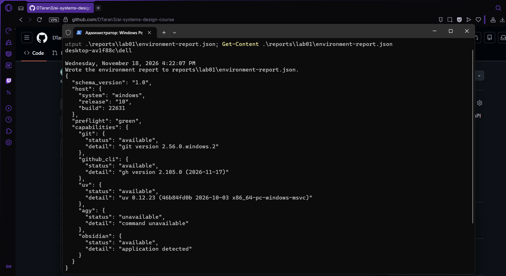
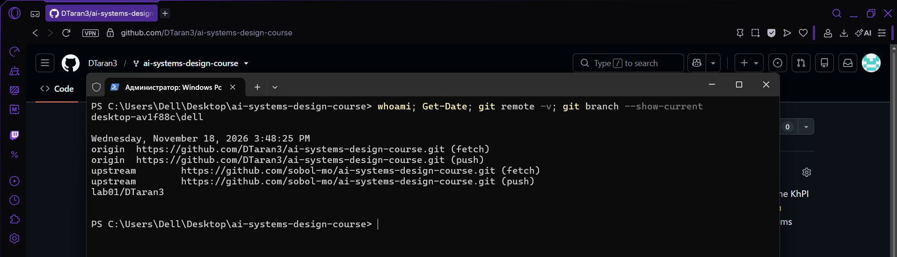
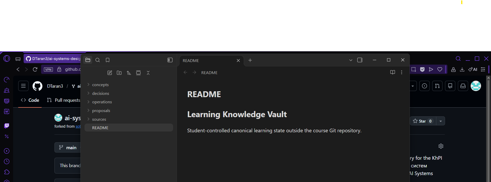
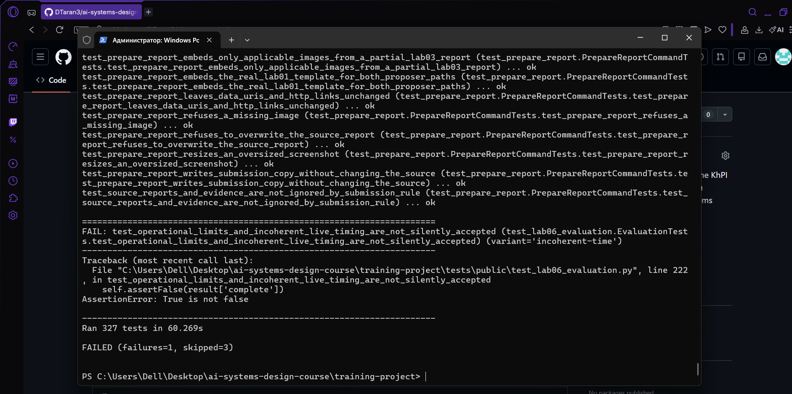
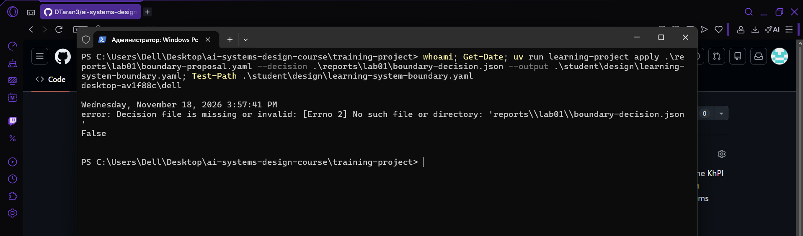
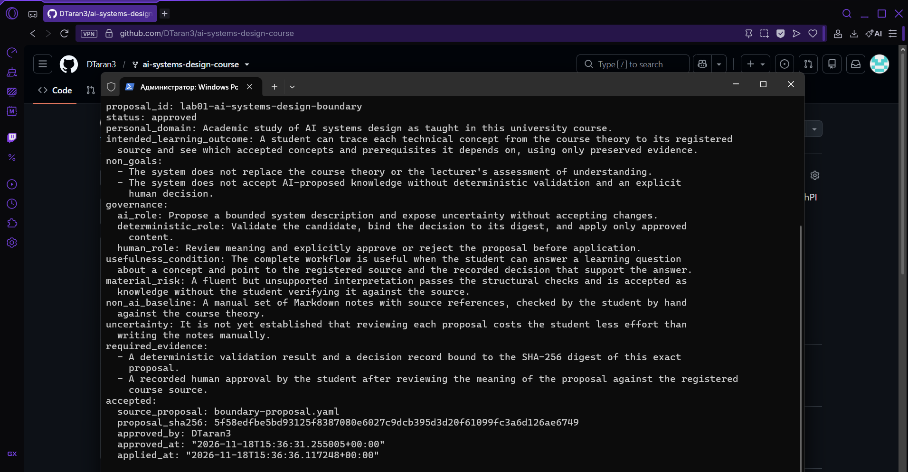

# Лабораторна робота 01

## Ідентифікація подання

- URL форку: https://github.com/DTaran3/ai-systems-design-course
- Назва гілки: lab01-submission
- Повний хеш коміту: c51edcc4d3acd04bd1cde2a41ba9b7d6caaae8cb

## Мета роботи

Створити й перевірити відтворювану робочу інфраструктуру для наданої наскрізної навчальної системи знань: студентський форк із розділеними ролями `origin` і `upstream`, робочу станцію з перевіреними можливостями, зовнішнє сховище Markdown-файлів із зареєстрованим джерелом теорії модуля 01 та прийнятий контракт межі системи, походження, людське затвердження та застосування якого можна перевірити. Окремо потрібно показати, що пропозиція (кандидат) не має повноважень змінювати прийнятий проєкт, доки не відбулися детермінована перевірка та явне рішення студента.

## Хід виконання

Нижче наведено контрольні точки в порядку кроків лабораторної роботи. Кожну контрольну точку підтверджує знімок екрана, що розміщений у відповідному змістовному розділі звіту; відповідність вказано в кожному підрозділі. Усі команди виконано 18.11.2026 у Windows PowerShell від імені облікового запису `desktop-av1f88c\dell`.

### Контрольна точка 1. Віддалені репозиторії та особиста гілка

Клон форку студента оновлено: до наявного `origin` (`https://github.com/DTaran3/ai-systems-design-course.git`) додано `upstream` (`https://github.com/sobol-mo/ai-systems-design-course.git`), після чого виконано отримання змін з обох віддалених репозиторіїв. Роботу виконано на робочій локальній гілці `lab01/DTaran3` (її назву видно на знімку `01-git-remotes.png`), створеній від `main` і доведеній до поточного стану `upstream/main` без злиття-комітів; змін у `main` не вносилося. Результат подано на наявній особистій гілці `lab01-submission` форку: її вміст замінено повною версією наступними комітами без переписування історії. Результат `git remote -v` і назву гілки зафіксовано на знімку `01-git-remotes.png` (розділ «Власність репозиторію»). Підставою для продовження було те, що `origin` вказує на форк студента, а `upstream` — на репозиторій курсу.

### Контрольна точка 2. Можливості робочої станції

Командою `learning-project doctor` перевірено чотири обов’язкові можливості (Git, GitHub CLI, `uv`, Obsidian). Результат зафіксовано на знімку `02-workstation-capabilities.png` (розділ «Середовище»): `preflight` — `green`, версії — Git 2.56.0.windows.2, GitHub CLI 2.105.0, `uv` 0.12.23, Obsidian виявлено. Першу перевірку було виконано до встановлення GitHub CLI; вона повідомляла `preflight: red`. Установлення виконано офіційним інсталятором, оскільки `winget` у системі недоступний (див. розділ «Середовище»), після чого перевірку повторено.

### Контрольна точка 3. Публічні тести

Публічні тести проєкту запущено командою `uv run python -m unittest discover -s tests/public -v`. Результат зафіксовано на знімку `03-public-tests.png` (розділ «Детерміновані перевірки»). Детальний опис результату та спостережених відхилень наведено в тому розділі. Підставою для продовження було те, що тести лабораторної роботи 01 (`test_lab01_*`, `test_prepare_report`) завершуються успішно, а єдина невдала перевірка належить до модуля 06 і не стосується меж цієї лабораторної роботи.

### Контрольна точка 4. Шлях пропонувача

Типового пропонувача (Antigravity CLI, команда `agy`) на робочій станції не виявлено: `doctor` повідомляє для `agy` статус `unavailable`, `command unavailable`. Тому використано задокументований ручний запасний шлях: кандидата `reports/lab01/boundary-proposal.yaml` оформлено без сеансу агента-пропонувача, зі збереженням `status: proposed`. Помилки доступу, служби чи квоти, яку можна було б зафіксувати знімком, не виникало, тому знімок `04-manual-fallback.png` не створювався (див. розділ «Шлях пропонувача»).

### Контрольна точка 5. Зовнішнє сховище

Зовнішнє сховище Markdown-файлів розташовано поза репозиторієм у `C:\Users\Dell\Desktop\Pshi`. У ньому наявні нейтральний `README.md` і запис джерела `sources/module-01-ai-engineering-foundations.md` із повним хешем коміту курсу. Результат зафіксовано на знімку `05-external-vault.png` (розділ «Зовнішнє сховище Markdown-файлів»).

### Контрольна точка 6. Відмова передчасного застосування

Спробу `apply` до створення рішення виконано командою з кроку 6. CLI відмовився виконувати застосування через відсутній файл рішення, а файл `student/design/learning-system-boundary.yaml` не створено (`Test-Path` повернув `False`). Результат зафіксовано на знімку `06-premature-apply-refused.png` (розділ «Детерміновані перевірки»). Це підтвердило, що застосування без рішення неможливе.

### Контрольна точка 7. Прийнятий контракт

Пропозицію перевірено командою `validate`, розглянуто за дев’ятьма запитаннями (розділ «Семантичний розгляд»), після чого студент зафіксував рішення `decide --approve` і виконав `apply`. Прийнятий контракт `student/design/learning-system-boundary.yaml` зафіксовано на знімку `07-accepted-contract.png` (розділ «Детерміновані перевірки»).

## Середовище

Робочою станцією є Windows (збірка 22631), Windows PowerShell. Git — портативна збірка 2.56.0.windows.2 у каталозі `C:\Users\Dell\Desktop\PortableGit`; `uv` 0.12.23; GitHub CLI 2.105.0; Obsidian виявлено в `%LOCALAPPDATA%\Programs\Obsidian`. Машинозчитуваний результат наведено в `reports/lab01/environment-report.json`.

Конфігурацію WinGet застосувати не вдалося: команда `winget` у системі не розпізнається (повідомлення про відсутність командлета, функції чи програми). Тому двократне застосування конфігурації не виконувалося, а файл `provision.log` не створено. Замість цього GitHub CLI встановлено офіційним MSI-інсталятором з cli.github.com, а наявність інших засобів перевірено командами `git --version`, `uv --version` і `gh --version`. Перший запуск `doctor` повідомляв `preflight: red` (GitHub CLI недоступний); після встановлення GitHub CLI та оновлення `PATH` повторний запуск повідомив `preflight: green`. Antigravity CLI (`agy`) недоступний; цей засіб не входить до чотирьох обов’язкових можливостей.

Рисунок — `02-workstation-capabilities.png`

## Власність репозиторію

`origin` вказує на форк студента `https://github.com/DTaran3/ai-systems-design-course.git` і є єдиним віддаленим репозиторієм для надсилання змін. `upstream` вказує на репозиторій курсу `https://github.com/sobol-mo/ai-systems-design-course.git` і використовується лише для отримання публікацій викладача. Особиста гілка подання — `lab01-submission` (її назва відрізняється від `lab01/<student-id>` з методички, оскільки оновлено наявну гілку форку). Роботу виконано на локальній гілці `lab01/DTaran3`, створеній від `main`; поточний стан курсу (коміт `04bf4da53314d71e7d93ba9c76de621cfbfbee8b`) підтягнуто з `upstream/main`. Вміст `lab01-submission` замінено повною версією наступними комітами без переписування історії. Файли лабораторної роботи розміщено лише в `training-project/reports/lab01/` і `training-project/student/design/`; шляхи, що належать `upstream`, не редагувалися.

Рисунок — `01-git-remotes.png`

## Зовнішнє сховище Markdown-файлів

Сховище розташовано поза репозиторієм Git (`external to repository`) за адресою `C:\Users\Dell\Desktop\Pshi` і не потрапляє до `git status`. Воно містить `README.md` із позначенням, що це канонічний навчальний стан під контролем студента поза репозиторієм курсу, та запис джерела `sources/module-01-ai-engineering-foundations.md` з YAML-передмовою (`record_type`, `source_id`, `title`, `course_path`, `course_commit`). Поле `course_commit` містить повний хеш коміту курсу `04bf4da53314d71e7d93ba9c76de621cfbfbee8b`, на який вказує запис, не копіюючи теорію в редаговане місце. Захист поза пристроєм для цього каталогу не налаштовано: сховище лежить у звичайному каталозі Робочого столу, а не в каталозі, синхронізованому з хмарою. Цей обмежений стан зафіксовано як відомий ризик (див. розділ «Відновлення»). Сховище також містить записи, створені під час лабораторної роботи 02 (`concepts`, `decisions`, `operations`, `proposals`); у межах лабораторної роботи 01 вони не створювалися й не змінювалися.

Рисунок — `05-external-vault.png`

## Шлях пропонувача

Типовий пропонувач Antigravity CLI не використано: команда `agy` на робочій станції недоступна (`doctor` від 18.11.2026 повідомляє для `agy` статус `unavailable`). Інша підписка на агента для цієї лабораторної роботи не використовувалася. Тому застосовано задокументований ручний запасний шлях: кандидата в `reports/lab01/boundary-proposal.yaml` оформлено без сеансу агента-пропонувача й не видано за результат роботи ШІ. Файл скопійовано зі стартової пропозиції `training-project/boundary-proposal.yaml` (оригінал не редагувався), усі заповнювачі замінено змістовними значеннями, `schema_version` не змінено, `status: proposed` збережено, використано новий `proposal_id` — `lab01-ai-systems-design-boundary`. Перед продовженням готовий файл перевірено за завданням пропонувача з кроку 7. Помилки доступу, служби чи квоти не виникало, тому очищеного свідчення відмови немає; рядок із зображенням `04-manual-fallback.png` вилучено, а причину його відсутності пояснено в цьому розділі. Допустимість ручного запасного шляху оцінюється викладачем під час запланованої демонстрації.

## Семантичний розгляд

Структурну перевірку `validate` пройдено до початку розгляду. Відповіді на дев’ять запитань кроку 8 записано до виконання `decide`.

1. Так. Пропозиція не змінює навчальну систему знань, визначену наданими контрактами, а `personal_domain` (академічне вивчення проєктування систем ШІ в межах цього курсу) використано лише як можливе пізніше обмежене розширення. Висновок: вимогу виконано.
2. Так. Запланований результат описує спостережувану здатність: простежити кожне технічне поняття до зареєстрованого джерела й побачити, від яких прийнятих понять і передумов воно залежить, спираючись лише на збережені свідчення. Це не формулювання «використати ШІ». Висновок: вимогу виконано.
3. Так. Нецілі виключають заміну теорії курсу та оцінювання викладачем і забороняють приймати пропозиції ШІ без детермінованої перевірки та явного рішення людини, тож система не розростається до промислової експлуатації чи процесу з високими наслідками. Висновок: вимогу виконано.
4. Так. ШІ обмежено пропонуванням і поданням невизначеності без прийняття змін, детермінований процес відповідає за перевірку, прив’язку рішення до дайджесту та застосування лише затвердженого вмісту, а повноваження затверджувати залишено за студентом. Звіт відрізняє цей запланований звичайний розподіл від ручного запасного шляху, на якому кандидата оформлено без агента (розділи «Шлях пропонувача» та «Розподіл повноважень»). Висновок: вимогу виконано.
5. Так. Умову корисності можна перевірити на збережених свідченнях: студент має відповісти на навчальне запитання про поняття й назвати зареєстроване джерело та записане рішення, які підтримують відповідь. Висновок: вимогу виконано.
6. Так. Ризик описує правдоподібну відмову повного процесу: вільний за формою, але непідтверджений інтерпретацією проходить структурні перевірки й приймається як знання без звірки студента з джерелом. Висновок: вимогу виконано.
7. Так. Базова лінія — ручні Markdown-нотатки з посиланнями на джерела та ручною звіркою з теорією курсу — є справді простішою і вже закриває частину результату (простежуваність до джерела). Висновок: вимогу виконано.
8. Так. Потрібні свідчення охоплюють і детерміновану поведінку (результат перевірки та рішення, прив’язане до SHA-256 дайджесту пропозиції), і семантичний розгляд (затвердження студентом після звірки змісту із зареєстрованим джерелом курсу). Висновок: вимогу виконано.
9. Так. Невизначеність називає те, що ще не встановлено: чи витрати на розгляд кожної пропозиції менші за зусилля ручного ведення нотаток. Висновок: вимогу виконано.

За результатами розгляду кандидата не відхилено, штучного відхилення не створювалося.

## Розподіл повноважень

У звичайній системі ШІ має повноваження пропонувати, але не затверджувати, оскільки згенерований вміст є лише кандидатом: він може бути правдоподібним, але хибним або непідтвердженим джерелом. Структурна коректність, прив’язка рішення до дайджесту та контрольоване застосування належать детермінованому робочому процесу, який не залежить від якості тексту. Змістове затвердження залишається за студентом, який відповідає за те, що потрапляє до прийнятого стану. Саме тому `apply` відмовляється працювати без рішення, а рішення прив’язане до SHA-256 дайджесту точного вмісту пропозиції. На ручному запасному шляху цей запланований розподіл не змінюється: кандидата оформлено без агента, але пропозиція так само проходить `validate`, розгляд за дев’ятьма запитаннями, `decide` і `apply`, а повноваження затвердження виконує студент. Відсутність агента означає лише те, що автором кандидата є не пропонувач із набору курсу, а не те, що перевірки або людське затвердження скасовано.

## Корисність і базова лінія без ШІ

ШІ може бути корисним, коли студентові треба швидко перетворити текст джерела на структурований кандидат (нормалізовану інтерпретацію, пов’язані поняття, можливі передумови, відкриті запитання) і побачити невизначеності, які ручні нотатки пропускають. Проте простіша базова лінія без ШІ — ручні Markdown-нотатки з посиланням на джерело, перевірені студентом за текстом теорії, — уже забезпечує простежуваність до джерела й залишається повністю під контролем студента. Тому система виправдана лише тоді, коли розгляд пропозицій дешевший за ручне ведення нотаток; саме це зафіксовано як невизначеність у пропозиції.

## Особиста предметна сфера як пізніше розширення

Значення `personal_domain` — академічне вивчення проєктування систем ШІ в межах цього курсу — є лише можливим пізнішим обмеженим розширенням, а не іншою системою. Запланований навчальний результат зберігає фіксовану навчальну систему знань: ідентичність системи визначають надані контракти (`SYSTEM_BRIEF.md`, `REQUIREMENTS_BASELINE.md`, `VAULT_STRUCTURE.md`), а сфера лише обмежує, до яких джерел і понять застосовується той самий керований процес.

## Проєктний компроміс

Обрано збереження зовнішнього сховища як звичайних Markdown-файлів поза репозиторієм Git, що дає незалежність від Obsidian і приватність змінного канонічного стану, але ціною супроводжуваності: сховище не відновлюється з Git і потребує окремого захисту від утрати робочої станції. Поки захист поза пристроєм не налаштовано, вихід із ладу диска означає втрату канонічного знання, яку репозиторій не компенсує.

## Детерміновані перевірки

Публічні тести запущено командою `uv run python -m unittest discover -s tests/public -v`. Перший запуск завершився з 6 невдалими перевірками з 327. П’ять із них (тести `test_lab06_reporting`) зумовлені налаштуванням `core.autocrlf=true` у системному файлі `PortableGit\etc\gitconfig`, яке змінює закінчення рядків у тимчасових репозиторіях тестів; для процесу тестів його вимкнено через змінні середовища `GIT_CONFIG_COUNT`, `GIT_CONFIG_KEY_0`, `GIT_CONFIG_VALUE_0` без зміни конфігурації Git. Ще одна (`test_lab04_stage_c1`) потребує необов’язкового пакета `lab04`; його підключено запуском `uv run --extra lab04`. Після цього лишається одна невдала перевірка — `test_operational_limits_and_incoherent_live_timing_are_not_silently_accepted` (модуль 06, `test_lab06_evaluation`, варіант `incoherent-time`): `Ran 327 tests, FAILED (failures=1, skipped=3)`. За змістом тесту він порівнює записаний час запитання `0` із виміряним часом виконання; на Windows грубий таймер `time.monotonic()` може давати нульову різницю, тому умова не спрацьовує. Ця перевірка стосується матеріалів модуля 06, що з’явилися в курсі після першого виконання лабораторної роботи, не належить до меж лабораторної роботи 01 і не змінювалася, а тести лабораторної роботи 01 та `prepare-report` проходять. Інших невдалих перевірок немає.

Рисунок — `03-public-tests.png`

Спробу застосування без рішення відхилено: CLI повідомив, що файл рішення відсутній або недійсний, а `Test-Path` для `student/design/learning-system-boundary.yaml` повернув `False`, тобто прийнятий контракт не створено.

Рисунок — `06-premature-apply-refused.png`

Прийнятий контракт створено лише після затвердження.

Рисунок — `07-accepted-contract.png`

Успішна перевірка схеми доводить лише те, що файл має потрібні поля й типи. Вона не доводить, що межа системи сформульована добре: валідатор не оцінює, чи результат спостережуваний, чи нецілі змістовні, чи ризик правдоподібний і чи базова лінія справді проста. Тому структурну перевірку доповнено окремим семантичним розглядом і явним рішенням студента.

## Відновлення

Відтворюване середовище відновлюється з означень проєкту: клон форку, `uv sync` (або `uv run`) за `pyproject.toml` і `uv.lock`, установлення Git, GitHub CLI, `uv` та Obsidian офіційними інсталяторами й повторний запуск `learning-project doctor`. Артефакти проєкту в Git (`reports/lab01/`, `student/design/`) відновлюються з гілки `lab01-submission` у форку. Змінне сховище Markdown-файлів (`C:\Users\Dell\Desktop\Pshi`) не відновлюється з Git; воно потребує окремого резервного копіювання. Наразі копії поза пристроєм немає, тому втрата диска означала б втрату канонічних записів; синхронізація поза пристроєм є лише початковим заходом і не замінює повного проєкту відновлення.

## Висновки

У межах лабораторної роботи 01 на особистій гілці `lab01-submission` форку студента налаштовано `origin` і `upstream`, перевірено можливості робочої станції (`preflight: green`, Git 2.56.0.windows.2, GitHub CLI 2.105.0, `uv` 0.12.23, Obsidian), створено зовнішнє сховище з `README.md` і записом джерела теорії модуля 01, підготовлено кандидата межі системи на ручному запасному шляху, пройдено детерміновану перевірку та семантичний розгляд за дев’ятьма запитаннями, показано відмову передчасного `apply`, зафіксовано рішення `approved` (дайджест SHA-256 `5f58edfbe5bd93125f8387080e6027c9dcb395d3d20f61099fc3a6d126ae6749`) і створено прийнятий контракт `student/design/learning-system-boundary.yaml` зі `status: approved`. Пропозиція не мала повноважень змінювати прийнятий стан: без рішення `apply` відмовив, а застосування стало можливим лише після явного затвердження студентом.

Мету роботи досягнуто частково. Ядро результату — розмежування повноважень, затверджений контракт із простежуваним походженням, форк із двома віддаленими репозиторіями та зовнішнє сховище з джерелом — виконано й підтверджено свідченнями. Не виконано або виконано не повністю таке: двократне застосування конфігурації робочої станції та журнал `provision.log` відсутні, бо `winget` у системі недоступний, а GitHub CLI встановлено офіційним інсталятором; набір публічних тестів не проходить повністю — лишається одна невдала перевірка модуля 06 (`incoherent-time`), зумовлена роздільною здатністю таймера Windows, а не станом результатів лабораторної роботи 01; захист зовнішнього сховища поза пристроєм не налаштовано; типовий пропонувач Antigravity CLI не використано, тому свідчення сеансу пропонувача (`04-proposer-session.png`) відсутнє, а кандидата оформлено на ручному запасному шляху.
