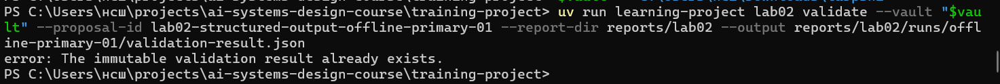
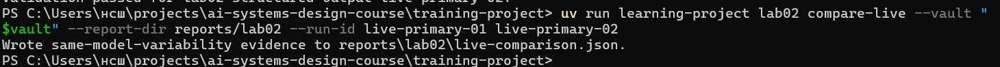
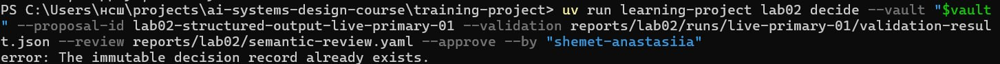
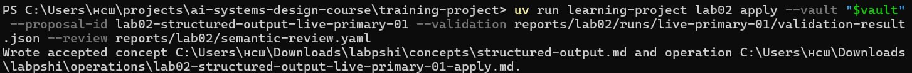
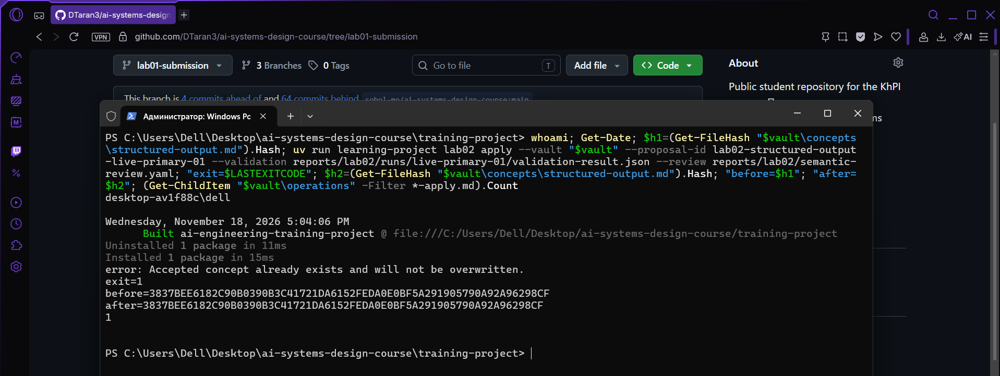
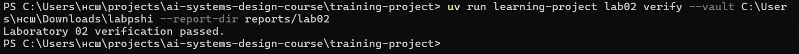

# Лабораторна робота 02

## Ідентифікація подання

- URL форку: https://github.com/DTaran3/ai-systems-design-course
- Назва особистої гілки: lab02/DTaran3
- Повний хеш коміту зі свідченнями: 1a2e8ed0d75a0cbe34eaf09635436c27c690e626

## Мета роботи

Створити керований процес прийняття знання, згенерованого базовою моделлю, з дотриманням меж повноважень: структуроване виведення моделі лише синтаксично й інваріантно перевіряється детермінованими шлюзами, семантична коректність належить людському розгляду, а в канонічне сховище потрапляє лише поняття, що пройшло перевірку, розгляд, явне рішення та одноразове контрольоване застосування з прив’язками SHA-256 до джерела, запиту, відповіді, пропозиції, розгляду й рішення.

## Хід виконання

Свідчення живих запусків, перевірки, семантичного розгляду, рішення й застосування створено 06.10.2026; текст звіту, знімки екрана `02`–`06`, повторну остаточну перевірку та пакувальний коміт виконано 18.11.2026 з наявних збережених артефактів, без повторного виконання живих запусків і без повторного прийняття поняття. Прийняті раніше запуски, рішення й дайджести не змінювалися. Нижче контрольні точки наведено в порядку кроків лабораторної роботи; відповідні знімки розміщено в змістовних розділах звіту.

### Контрольна точка 1. Реєстрація джерела та детерміновані фікстури

Зареєстровано точний фрагмент теорії модуля 02 у зовнішньому сховищі та виконано три затверджені тестові фікстури. Результат наведено на знімку `01-offline-gates.png` (розділ «Детерміновані шлюзи»).

### Контрольна точка 2. Два живі запуски та їх порівняння

Підготовлено один спільний запит і виконано два живі запуски `live-primary-01` та `live-primary-02`, кожен із власним імпортом і перевіркою кандидата; після цього їх порівняно. Результат порівняння наведено на знімку `03-live-comparison.png` (розділ «Живі запуски та порівняння»).

### Контрольна точка 3. Семантичний розгляд і рішення

Кандидата `live-primary-01` розглянуто семантично, вердикт `acceptable`; студент зафіксував рішення `approved`. Збережені файли розгляду та рішення показано на знімку `04-review-decision.png` (розділ «Семантичний розгляд і рішення»).

### Контрольна точка 4. Контрольоване застосування

Одноразовим застосуванням створено канонічне поняття `concepts/structured-output.md` і один запис операції. Записи поняття й операції показано на знімку `05-controlled-apply.png` (розділ «Контрольоване застосування»).

### Контрольна точка 5. Відмова повторного застосування

Повторне застосування відхиляється без зміни прийнятого стану. Результат наведено на знімку `02-refusal-unchanged.png` (розділ «Відмова без зміни прийнятого стану»).

### Контрольна точка 6. Остаточна перевірка

Остаточну перевірку `lab02 verify` виконано проти сховища та каталогу звіту; результат і прийняте поняття в Obsidian показано на знімку `06-final-result.png` (розділ «Остаточна перевірка»).

## Початковий стан і реєстрація джерела

Особисту гілку `lab02/DTaran3` створено від синхронізованого з курсом стану `main` (коміт `140f3708856a7de5d8a3c4fa68504bb8d21b4215`) у форку студента `https://github.com/DTaran3/ai-systems-design-course`. Зовнішнє сховище Markdown-файлів розташовано поза репозиторієм у `C:\Users\Dell\Desktop\Pshi`. Командою `lab02 register-source` у ньому зареєстровано запис `sources/module-02-foundation-models-and-ai-application-architecture.md` для точного фрагмента теорії модуля 02 (`course_path` — `modules/02_Foundation_Models_and_AI_Application_Architecture/02_Foundation_Models_and_AI_Application_Architecture_Theory.md`). Запис містить `course_repository`, `course_commit` та дайджести: `source_file_sha256` — `91c47a450ffb10a4a33b841fefe06c497b66ceef870d872f5554f888f9af1df5` — і `fragment_sha256` фрагмента «1.3 Structured output controls syntax, not meaning» — `7d7d5ce2d33d4852985c2337292fbf257ae554cefbbf7e4b9e4ef8090a797063`.

Значення `course_commit` є базовим станом джерела: воно фіксує версію курсу, з якої взято текст, і дає змогу перевірити, що шляхи, які належать `upstream`, не змінилися відносно цього стану. Воно не є комітом подання, бо коміт зі свідченнями створюється пізніше й не може бути записаний у джерело, що передує пропозиції та рішенню. Тому гілку не синхронізовано з пізнішим станом `upstream`: це змінило б шляхи курсу відносно зареєстрованого базового стану та порушило б перевірку.

## Детерміновані шлюзи

Три затверджені тестові фікстури перевіряються командою `lab02 check-fixtures` без зміни прийнятого стану сховища. Коректна фікстура (`valid-response.json`) проходить синтаксичний шлюз і шлюз інваріантів (обов’язкові поля та значення), але це ще не є семантичним схваленням. Пошкоджена фікстура (`malformed-response.txt`) відхиляється вже на синтаксичному шлюзі під час імпорту, і запис пропозиції не створюється. Семантично непридатна фікстура (`semantic-unsupported-response.json`) структурно коректна й також проходить синтаксичний шлюз і шлюз інваріантів, хоча її зміст не підтверджується джерелом; тому лише людський розгляд може її відхилити. Успішні синтаксична перевірка та перевірка інваріантів доводять лише форму: що відповідь розбирається й має потрібні поля, але не те, що поняття сформульовано правильно та підтримано джерелом.

Рисунок — `01-offline-gates.png`

## Живі запуски та порівняння

Обидва живі запуски (`live-primary-01`, записано 06.10.2026 о 15:04:36 UTC, і `live-primary-02`, записано 06.10.2026 о 15:07:57 UTC) виконано адаптером `openai-compatible` з моделлю `nvidia/nemotron-3-super-120b-a12b:free`; обидва запуски мають `evidence_kind: live` і однаковий `request_sha256` (`950c97a1147c439e4d0ce0ed7f2b29352add66b52feda2f7281aa74c3d47c27b`). Порівняння класифіковано як `same-model-variability`, бо записані метаданні адаптера та моделі збігаються в обох запусках, а запит ідентичний; класифікація випливає з метаданих, а не з того, що відповіді відрізняються. Побайтово відповіді різні (`raw_response_sha256` — `db44526c…` і `f3a1d5a8…`).

Конкретна відмінність між кандидатами: у запуску 01 поле `definition` повторює речення джерела разом із виділеним терміном («Structured output is model output intended…»), а в запуску 02 те саме визначення починається без терміна («Model output intended…»). Відрізняються також `key_points` та цитати `source_support`. Ця відмінність спостережена за того самого адаптера й моделі, але сама по собі не доводить, що її причиною була лише вибірка під час генерування, і з неї не випливає, що модель детермінована чи недетермінована. Для подальшого процесу обрано кандидата `lab02-structured-output-live-primary-01`.

Рисунок — `03-live-comparison.png`

## Семантична коректність і повноваження

Успішний `validate` і схема на стороні постачальника гарантують лише, що відповідь має очікувану форму: розбирається та містить потрібні поля. Вони не перевіряють, що визначення відповідає джерелу, що цитати справді підтримують свої твердження та що кандидат не вигадує зайвого. Тому структурно коректний кандидат може бути семантично неприйнятним.

Повноваження прийняти або відхилити кандидата належить студентові як людині-розглядачу. Модель лише пропонує вміст і не має повноважень змінювати прийнятий стан. Детермінований код перевіряє синтаксис та інваріанти, прив’язує рішення до точних дайджестів і виконує запис лише для рішення `approved`; він не оцінює змісту. Операція застосування не приймає рішень: вона відмовляється працювати без затвердженого рішення, без походження кандидата від живого запуску, за зміненого джерела чи за наявного поняття та лише записує те, що вже було перевірено й затверджено.

## Семантичний розгляд і рішення

Семантичний розгляд (`reports/lab02/semantic-review.yaml`, ревьюер `DTaran3`) дійшов висновків за трьома напрямами: визначення точно передає, що структуроване виведення контролює синтаксис, а не зміст; усі три точні цитати підтримують відповідні види тверджень і розрізняють синтаксичний шлюз, шлюз інваріантів та семантичний шлюз; кандидат утримує межу повноважень пропозиції й не стверджує автоматичного семантичного схвалення. Вердикт — `acceptable`, бо кандидат містить точні визначення й цитати з тексту джерела без непідтриманих тверджень.

Рішення `lab02-structured-output-live-primary-01-decision` (`approved`, записано 06.10.2026 о 15:14:03 UTC студентом `DTaran3`) стосується саме обраного кандидата та результату його перевірки: воно прив’язує `proposal_sha256` (`6f31ba47…`), `validation_sha256` (`b2fda127…`) і `semantic_review_sha256` (`e29d6c0c…`). Тому будь-яка зміна пропозиції, результату перевірки чи розгляду робить рішення недійсним.

Рисунок — `04-review-decision.png`

## Прив’язки SHA-256

- Джерело й фрагмент: `source_file_sha256` та дайджест фрагмента в записі джерела з’єднують сховище з точним текстом теорії курсу в коміті `course_commit`.
- Запит і відповідь: `request_sha256` у метаданих запуску з’єднує запит із записаним виведенням, а `raw_response_sha256` — відповідь із її збереженим сирим текстом; однаковий `request_sha256` в обох запусках підтверджує, що запит ідентичний.
- Пропозиція і перевірка: `proposal_sha256` пов’язує перевірку (`validation_sha256`) з точною пропозицією, яку вона оцінила.
- Розгляд і рішення: розгляд указує `proposal_sha256` і `validation_sha256`, а рішення прив’язує ще й `semantic_review_sha256`.
- Рішення і прийняте поняття: запис операції фіксує `decision_sha256` і `concept_sha256`, а в прийнятому понятті `accepted_from` указує `proposal_sha256` та `decision_sha256`.

Ці дайджести доводять цілісність ланцюга: артефакти не змінювалися після прив’язки й відповідають один одному. Вони не доводять, що зовнішня модель справді виконала виведення (у метаданих запуску прямо зазначено, що задеклароване походження не є криптографічним доказом), і не доводять семантичної правильності поняття.

## Контрольоване застосування

Командою `lab02 apply` для затвердженого кандидата створено канонічне поняття `concepts/structured-output.md` (`concept_sha256` — `3837bee6182c90b0390b3c41721da6152feda0e0bf5a291905790a92a96298cf`) та єдиний запис операції `operations/lab02-structured-output-live-primary-01-apply.md` (`status: applied`, `action: create`, 06.10.2026 о 15:14:51 UTC). Запис стану став можливим, бо кандидат походить від живого запуску, пройшов детерміновану перевірку, має семантичний розгляд `acceptable` і рішення `approved`, яке прив’язує точні дайджести; зареєстроване джерело при цьому не змінювалося, а цільовий файл поняття ще не існував.

Рисунок — `05-controlled-apply.png`

## Відмова без зміни прийнятого стану

Повторне виконання тієї самої команди `lab02 apply` для вже застосованого кандидата (18.11.2026) завершилося відмовою зі статусом виходу 1 і повідомленням, що прийняте поняття вже існує й не буде перезаписане. Дайджест SHA-256 файлу `concepts/structured-output.md` до і після спроби збігається (`3837BEE6182C90B0390B3C41721DA6152FEDA0E0BF5A291905790A92A96298CF`, що дорівнює `concept_sha256` у записі операції), а в каталозі `operations` залишається рівно один успішний запис `*-apply.md`. Отже, відмова не змінила прийнятого стану.

Рисунок — `02-refusal-unchanged.png`

## Проєктний компроміс

Обрано безоплатну модель із квотою (`:free`): вона нічого не коштує, але має змінну поведінку й залежить від одного постачальника. Два запити з однаковим `request_sha256` дали різні відповіді, тож без детермінованих шлюзів і людського розгляду кожен запуск міг би принести інше знання; це платиться вартістю шлюзів і часу студента на розгляд, а не вартістю моделі. Альтернатива — платна модель або кілька постачальників, що підвищує портативність, але додає витрати й складніше порівняння. Простота шлюзів і людський контроль дорожчі за токени для цієї роботи, тому компроміс прийнято на користь дешевого генерування з обов’язковим розглядом.

## Захист облікових і платіжних даних

Облікові дані постачальника не передавалися аргументами команд і не зберігалися в Git, звіті чи свідченнях: пошук типових фрагментів ключів (`sk-or`, `Bearer`, `api_key`) у каталозі свідчень і сховищі нічого не виявив, а перевірка `provider-isolation` підтверджує, що канонічні записи не містять полів постачальника, моделі чи harness. Дані платіжної картки до проєкту не потрапляли; постачальник не вимагав перевірки платіжної картки для цього запуску.

## Канонічний, аудиторський і похідний стан

Канонічним прийнятим знанням є `concepts/structured-output.md` у зовнішньому сховищі. Незмінними свідченнями запусків і аудиту є каталоги `reports/lab02/runs/<run-id>/` (`model-request.json`, `raw-response.txt`, `run-metadata.json`, `validation-result.json`), записи пропозицій `proposals/*.md`, рішення `decisions/*-decision.md`, запис операції `operations/*-apply.md`, а також `reports/lab02/semantic-review.yaml` та `reports/lab02/live-comparison.json`. Похідними результатами, які можна відбудувати, є `reports/lab02/verification-report.json` (його перезаписує `lab02 verify`) і самодостатній `reports/lab02/submission/REPORT.md` (його створює `prepare-report`). Окремо зазначено: запис джерела модуля 01 у сховищі створено 18.11.2026 для лабораторної роботи 01; він не входить до ланцюга лабораторної роботи 02, але потрапляє до карти артефактів сховища.

## Остаточна перевірка

Остаточну перевірку виконано 18.11.2026 командою `uv run learning-project lab02 verify --vault "$vault" --report-dir reports/lab02` проти зовнішнього сховища та каталогу звіту. Результат — `Laboratory 02 verification passed.`, статус виходу `0`, `status: passed` у `verification-report.json`; усі десять перевірок пройдено: `source`, `course-commit`, `approved-fixtures`, `live-comparison`, `selected-candidate`, `accepted-state`, `provider-isolation`, `submission-files`, `artifact-map` (24 артефакти за шляхом і дайджестом) та `vault-read-only`. Знімок нижче показує вивід команди разом із прийнятим поняттям `concepts/structured-output.md` в Obsidian. Після появи остаточних байтів знімка перевірку повторено, і поданий `verification-report.json` походить саме з цього останнього успішного запуску.

Остаточна перевірка доводить, що ланцюг свідчень внутрішньо узгоджений: зареєстроване джерело й фрагмент збігаються з дайджестами, базовий коміт є предком `HEAD`, а шляхи курсу не змінилися відносно нього, три фікстури поводяться очікувано, два живі запуски мають спільний дайджест запиту й коректну класифікацію, обраний кандидат валідний і походить із живого запуску, дайджести пропозиції, перевірки, розгляду, рішення, поняття й операції відповідають один одному, а сховище під час перевірки не змінювалося. Вона не доводить, що зовнішня модель справді виконала виведення, і не оцінює семантичну правильність поняття: це судження зафіксовано в семантичному розгляді, який належить студентові.

Рисунок — `06-final-result.png`

## Висновки

У межах лабораторної роботи 02 зареєстровано джерело модуля 02, виконано три детерміновані фікстури, отримано й імпортовано два живі запуски з однаковим запитом (`same-model-variability`), порівняно їх і виявлено конкретну відмінність, проведено семантичний розгляд кандидата `live-primary-01` (вердикт `acceptable`), зафіксовано рішення `approved` з прив’язкою дайджестів, одноразово застосовано кандидата й створено канонічне поняття `concepts/structured-output.md` з єдиним записом операції, а повторне застосування відхилено без зміни дайджесту поняття (статус виходу 1). Остаточна перевірка `lab02 verify` завершується з `status: passed` і статусом виходу 0 за всіма десятьма перевірками.

Мету роботи досягнуто повністю: модель лише пропонує, детерміновані шлюзи перевіряють форму та інваріанти, повноваження приймати знання залишається за студентом, а канонічний стан змінено один раз через прив’язаний до дайджестів запис. Для повноти слід зазначити обмеження: свідчення запусків, рішення й застосування створено 06.10.2026, а текст звіту та знімки `02`–`06` оформлено 18.11.2026 із збережених артефактів; живі запуски не повторювалися, а метадані запусків не є криптографічним доказом виконання виведення зовнішньою моделлю.
