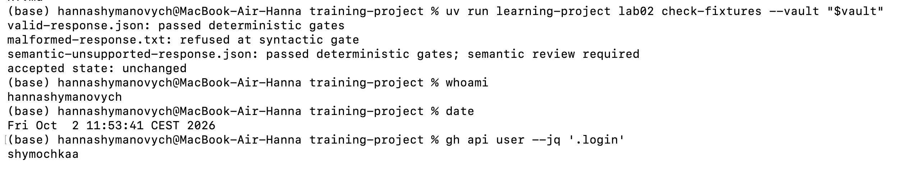
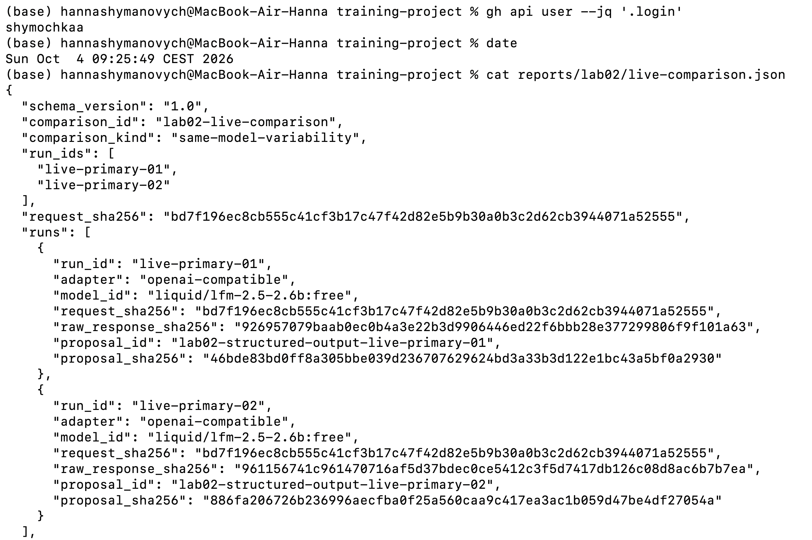
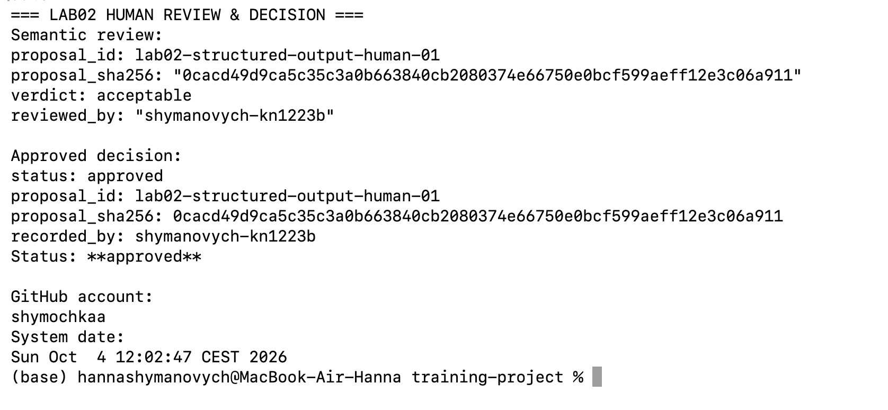
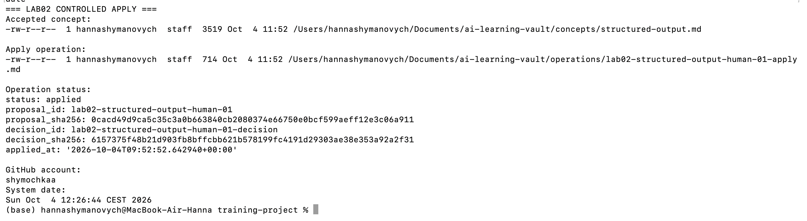
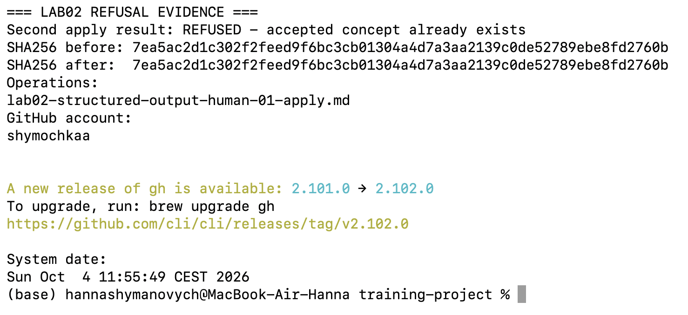
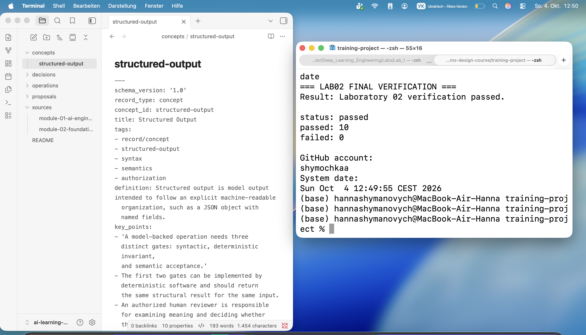

# Лабораторна робота 02

## Ідентифікація подання

- URL форку: https://github.com/shymochkaa/ai-systems-design-course
- Назва особистої гілки: `lab02/shymanovych-kn1223b`
- Повний хеш коміту зі свідченнями: `178d903536f59ea8c5d494c0b0f738bafa19334f`

## Початковий стан і реєстрація джерела

Перед початком лабораторної роботи я перейшла на гілку `main`, отримала актуальні зміни з `upstream`, об’єднала їх зі своєю локальною гілкою та синхронізувала `main` у власному форку. Після цього створила особисту гілку `lab02/shymanovych-kn1223b`. Початковим комітом курсу для цієї роботи був `9f726af26394c43c0ded41ab32b3ebfd392e65cb`.

Зовнішнє сховище знань залишилося поза Git-репозиторієм за шляхом `/Users/hannashymanovych/Documents/ai-learning-vault`. За допомогою `lab02 register-source` у ньому було зареєстровано точний фрагмент теорії модуля 02 про Structured Output. SHA-256 зареєстрованого фрагмента: `7d7d5ce2d33d4852985c2337292fbf257ae554cefbbf7e4b9e4ef8090a797063`.

`course_commit` фіксує конкретну версію навчального матеріалу, з якої було взято джерело. Тому він є базовим станом джерела, а не комітом подання моєї роботи. Коміт зі свідченнями створюється пізніше після виконання лабораторної та містить уже мої результати й звіт.

## Детерміновані шлюзи

Під час `check-fixtures` було перевірено три підготовлені приклади. `valid-response.json` успішно пройшов детерміновані шлюзи. `malformed-response.txt` був відхилений уже на синтаксичному шлюзі, оскільки не відповідав очікуваній структурі. `semantic-unsupported-response.json` пройшов детерміновані перевірки, але потребував семантичного розгляду людиною.

Цей результат показує різницю між трьома рівнями контролю. Синтаксичний шлюз перевіряє, чи можна коректно прочитати структуру результату. Перевірка інваріантів контролює формальні правила та зв’язки між даними. Навіть проходження обох перевірок не означає, що зміст є правильним або прийнятним. Семантичне схвалення залишається окремим рішенням уповноваженої людини.

Рисунок — `01-offline-gates.png`

## Живі запуски та порівняння

Для двох живих запусків `live-primary-01` і `live-primary-02` був використаний адаптер `openai-compatible` та однакова модель `liquid/lfm-2.5-2.6b:free` через OpenRouter. Перед цим я намагалася виконати генерацію через Antigravity, однак успішного структурованого результату отримати не вдалося, тому скористалася передбаченим резервним способом через OpenRouter.

Обидва успішні запуски мали однаковий `request_sha256` — `bd7f196ec8cb555c41cf3b17c47f42d82e5b9b30a0b3c2d62cb3944071a52555`, тобто отримали той самий запит. Оскільки адаптер і модель в обох випадках однакові, порівняння класифіковано як `same-model-variability`. Водночас raw-response та proposal мали різні SHA-256. Зокрема, відрізнялися `key_points` та цитати в `source_support`, хоча визначення залишилося однаковим. Це демонструє спостережену мінливість результатів двох запусків тієї самої моделі без припущення про причину цієї відмінності.

Обидва початкові live-кандидати не пройшли перевірку інваріантів через неточну цитату в `source_support`: перша цитата не збігалася з точним текстом зареєстрованого джерела. Для другого кандидата я створила окрему людську ревізію `human-01`, не змінюючи початкову відповідь моделі. У ревізії було виправлено `source_support`, після чого кандидат `lab02-structured-output-human-01` успішно пройшов `validate`.

Рисунок — `03-live-comparison.png`

## Семантична коректність і повноваження

Успішний `validate` доводить лише те, що кандидат відповідає синтаксичним і детермінованим вимогам, які може перевірити програма. Так само структурована схема на стороні постачальника може забезпечити потрібну форму відповіді, але не може встановити, чи правильно кандидат передає зміст джерела та чи доречно його приймати як канонічне знання.

Повноваження прийняти або відхилити кандидата належать уповноваженій людині-рецензенту. Модель має право лише запропонувати кандидат. Детермінований код перевіряє формальні умови, але не надає семантичного схвалення. Людина оцінює зміст і фіксує рішення, а операція `apply` може змінити прийнятий стан лише після наявності відповідної перевірки та схваленого рішення для конкретного кандидата.

## Семантичний розгляд і рішення

Для фінального кандидата `lab02-structured-output-human-01` я перевірила визначення, ключові положення та всі цитати `source_support` відносно зареєстрованого фрагмента джерела. Визначення коректно описує Structured Output, три контрольні шлюзи розділені, цитати точно підтримують відповідні твердження, а межа повноважень між моделлю, детермінованою перевіркою, людиною та операцією застосування збережена. Непідтвердженого джерелом нового змісту в кандидата не було виявлено.

Тому в `semantic-review.yaml` було зафіксовано вердикт `acceptable`. Рішення було записано зі статусом `approved`. Воно стосується саме кандидата `lab02-structured-output-human-01`, оскільки review і decision містять його точний `proposal_sha256` `0cacd49d9ca5c35c3a0b663840cb2080374e66750e0bcf599aeff12e3c06a911`, а також прив’язку до конкретного результату validation.

Рисунок — `04-review-decision.png`

## Прив’язки SHA-256

SHA-256 використовується для зв’язування конкретних байтових версій артефактів у всьому процесі. Зареєстроване джерело прив’язане до точного фрагмента теорії та конкретного `course_commit`. Однаковий `request_sha256` двох live-запусків підтверджує, що для них використовувався той самий зафіксований запит, тоді як різні дайджести raw-response і proposal дозволяють розрізняти отримані результати.

Proposal SHA-256 і validation SHA-256 пов’язують кандидата з конкретним результатом його детермінованої перевірки. Семантичний review містить SHA-256 обраної пропозиції та validation, а decision, у свою чергу, фіксує схвалення саме цього перевіреного кандидата. Запис операції `apply` містить `proposal_sha256` і `decision_sha256`, тому прийняте поняття можна простежити назад до схваленого рішення та кандидата.

Ці дайджести доводять цілісність і тотожність конкретних артефактів, але самі по собі не доводять авторство зовнішньої моделі та не доводять семантичну правильність тексту. Семантична правильність потребує окремого людського розгляду.

## Контрольоване застосування

Після успішної детермінованої перевірки, семантичного вердикту `acceptable` та рішення `approved` команда `lab02 apply` успішно створила канонічний файл `/Users/hannashymanovych/Documents/ai-learning-vault/concepts/structured-output.md`. Одночасно було створено один запис операції `/Users/hannashymanovych/Documents/ai-learning-vault/operations/lab02-structured-output-human-01-apply.md` зі статусом `applied`.

Запис прийнятого стану став можливим не просто через наявність результату моделі, а через повний контрольований ланцюг: конкретний кандидат, його успішна validation, семантичний review зі статусом `acceptable` та approved decision, прив’язаний до того самого кандидата.

Рисунок — `05-controlled-apply.png`

## Відмова без зміни прийнятого стану

Після успішного застосування я повторно виконала ту саму команду `apply` для того самого кандидата. Система відмовила в операції з повідомленням `Accepted concept already exists and will not be overwritten.` Таким чином уже прийняте канонічне поняття не було перезаписане.

До повторної спроби SHA-256 файлу `structured-output.md` дорівнював `7ea5ac2d1c302f2feed9f6bc3cb01304a4d7a3aa2139c0de52789ebe8fd2760b`. Після відмови дайджест залишився точно таким самим. У каталозі `operations` залишився лише один успішний запис `lab02-structured-output-human-01-apply.md`. Це підтверджує, що відхилена повторна операція не змінила прийнятий стан і не створила другого запису успішного застосування.

Рисунок — `02-refusal-unchanged.png`

## Проєктний компроміс

У цій роботі практичним компромісом стала взаємодія між доступністю моделі, мінливістю її результатів та додатковою вартістю контролю. Використання безкоштовної моделі через OpenRouter дозволило виконати два живі запуски без придбання платного API, але два результати тієї самої моделі відрізнялися, а обидва початкові кандидати мали неточність у цитаті. Детерміновані шлюзи виявили цю проблему автоматично, а людський розгляд забезпечив перевірку змісту. Це збільшує кількість кроків і час виконання, проте зменшує ризик автоматичного запису формально коректного, але неправильного або непідтвердженого знання. Наявність резервного адаптера також підвищує портативність процесу, якщо основний постачальник недоступний.

## Захист облікових і платіжних даних

Для OpenRouter API-ключ вводився локально в прихованому режимі через змінну середовища `OPENROUTER_API_KEY`, а після завершення запуску змінна була видалена з поточного shell-сеансу командою `unset`. Сам ключ не передавався як аргумент команди, не записувався до Git, звіту, скриншотів або інших evidence-файлів. Дані платіжної картки також не додавалися до проєкту, команд, Git або звіту.

Для виконання цієї лабораторної використовувався безкоштовний маршрут моделі OpenRouter. У наявних артефактах лабораторної немає даних платіжної картки. Окремий факт про те, чи вимагав OpenRouter перевірки картки під час налаштування облікового запису, у зафіксованих результатах роботи не підтверджений, тому в звіті я не роблю такого припущення.

## Канонічний, аудиторський і похідний стан

Канонічним прийнятим знанням після успішного `apply` є файл `/Users/hannashymanovych/Documents/ai-learning-vault/concepts/structured-output.md`. Його слід відрізняти від аудиторських свідчень: model request і raw response живих запусків, їхніх metadata та validation results, proposal-файлів, людської ревізії, `semantic-review.yaml`, approved decision і запису операції apply. Ці матеріали зберігають історію того, як саме було отримано, перевірено, розглянуто та прийнято знання.

Похідними є результати, які можна знову сформувати з первинних і аудиторських артефактів, наприклад результати перевірки та підготовлена для подання версія звіту. Вони не замінюють канонічний стан або первинні свідчення процесу.

## Остаточна перевірка

Після створення всіх необхідних артефактів і знімків екрана я виконала `lab02 verify`. Остаточна перевірка завершилася успішно зі статусом `passed`: усі 10 перевірок пройдено, невдалих перевірок немає. На фінальному знімку екрана також зафіксовано прийняте поняття `structured-output` у зовнішньому сховищі Obsidian.

Остаточна перевірка підтверджує цілісність і узгодженість необхідних артефактів лабораторної роботи, правильність ланцюга від зареєстрованого джерела через кандидата, validation, semantic review і approved decision до канонічного поняття та operation record, а також наявність необхідних файлів подання. Водночас автоматична перевірка сама по собі не доводить семантичну правильність знання або авторство зовнішньої моделі: семантична оцінка залишається відповідальністю уповноваженої людини.

Рисунок — `06-final-result.png`