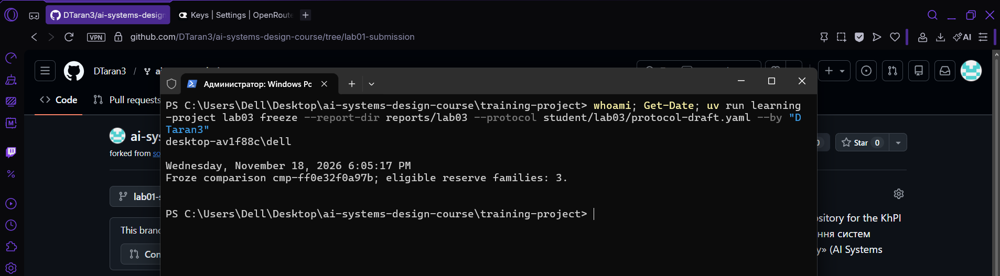
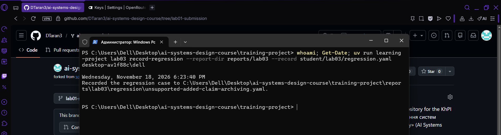

# Лабораторна робота 03

## Ідентифікація подання

- URL форку: https://github.com/DTaran3/ai-systems-design-course
- Назва особистої гілки: lab03/DTaran3
- Статус завершення: `complete`

Повний хеш остаточного коміту та результат його перевірки містяться в окремому згенерованому `verification-report.json`. Їх не вписують у цей звіт до коміту, оскільки така зміна створила б інший коміт.

## Мета роботи

Отримати свідчення, потрібні команді інженерів для рішення, чи має кандидатна конфігурація (варіант B) замінити базову конфігурацію експерименту (варіант A) для оцінюваного використання операції пропозиції поняття з використанням моделі, і записати це рішення як обмежене рішення щодо конфігурації, що спирається на зафіксований протокол, сліпе семантичне оцінювання та перевірювані записи, а не на загальне враження про якість.

## Хід виконання

Контрольні точки нижче подано в порядку опублікованих кроків лабораторної роботи. Для кожної наведено виконану дію, спостережений результат і підставу для переходу до наступної.

### Початковий стан і межа лабораторної роботи 02

Особисту гілку `lab03/DTaran3` створено від гілки `lab02/DTaran3` (коміт `31c14dc`, `docs(lab02): package report for submission`). Після цього в гілку злито `upstream/main` курсу (коміт слиття `abd492e`, стан курсу `c1c6518`); конфлікти не виникли.

Вхідну перевірку лабораторної роботи 02 виконано командою `lab02 verify` на одноразовій копії каталогу `reports/lab02`. Перший запуск, виконаний уже після слиття, завершився повідомленням `Laboratory 02 verification failed.` Причина: перевірка порівнює файли курсу із зареєстрованим коміт-основою лабораторної роботи 02, а після слиття файли платформи, схем і шаблонів, що належать курсові, відрізнялися від цієї основи. Закомічені свідчення лабораторної роботи 02 при цьому не змінювалися. Після повернення на гілку `lab02/DTaran3` ту саму перевірку повторено на одноразовій копії, і вона завершилася повідомленням `Laboratory 02 verification passed.` Тимчасову копію видалено, гілку `lab03/DTaran3` відновлено, робоче дерево залишилося чистим.

Лабораторна робота 03 не змінювала файлів у `reports/lab02` (різниця з комітом `31c14dc` у цьому каталозі порожня) і не зверталася до зовнішнього сховища, тож прийняте поняття `Structured Output` та його аудиторський ланцюг залишилися без змін.

### Калібрування оцінювача

Активний пакет калібрування: `calibration-a`. Чотири авторські фікстури оцінено за абсолютною рубрикою відповідно до підрозділу 2.3 модуля 03: `cal-a-1` — `S`, `cal-a-2` — `I`, `cal-a-3` — `U`, `cal-a-4` — `Q`. Для кожної фікстури обґрунтування посилається на завдання, надане джерело, очікувану поведінку та правило рубрики. Після подання міток порівняння з розглянутими мітками курсу показало збіг у всіх чотирьох парах, тому розбіжностей, що потребують уточнення правил рубрики, немає. Мітки після подання не змінювалися.

Авторські приклади калібрування готують оцінювача й не є свідченням якості моделі.

Рисунок — `01-calibration.png`

### Розробницькі випадки

Курс надає два розробницькі випадки, створені як навчальні (модуль 03, таблиця 4.1, рядки D1 і D2):

- `dev-source-baseline-definition` — свідчень у джерелі достатньо: завдання вимагає визначити, що ідентифікує базовий стан джерела; очікувана відповідь зберігає зв’язок між базовим станом і матеріалом, щодо якого розглядають пропозицію (категорія очікування `S`);
- `dev-approval-authority-absent` — у джерелі бракує факту: джерело повідомляє лише, що запис розгляду зберігає особу рецензента й рішення, а особу, якій дозволено затверджувати пропозицію, не називає; очікувана відповідь повідомляє про відсутність цієї інформації (категорія очікування `Q`).

Походження обох випадків — курс; студент їх не змінював.

### Розробницькі запуски й діагноз варіанта A

Заплановано чотири позиції, усі досягли кінцевого стану «повернено», усі структурно чинні; відмов і незапущених позицій немає. Маршрут — `openrouter` / `openrouter/free`.

Спостереження. На першому випадку варіант A дав відповідь, що збігається за змістом із джерелом, і додав загальне уточнення про еталон чи орієнтир для оцінювання. На другому випадку варіант A відповів, що особа рецензента, записана в журналі розгляду, і є стороною, якій дозволено затверджувати пропозицію. Джерело цього не стверджує. Варіант B на першому випадку відтворив визначення з джерела, а на другому прямо повідомив, що джерело не вказує, хто має право затверджувати.

Діагноз. Відповідь A на другий випадок виводить відсутній факт із сусідньої деталі джерела (хто записаний у журналі), тобто робить непідкріплене твердження замість обмеженої невизначеності. Інструкція варіанта A не містить правила для випадку, коли потрібного факту в джерелі немає. Це діагностичні спостереження на двох випадках розроблення; вони не є фінальним відкладеним порівнянням і не подаються як таке.

Рисунок — `02-development.png`

### Єдина зміна у варіанті B

Змінена одна властивість інструкції: явне правило відповіді для випадку, коли надане джерело не містить факту, якого вимагає завдання. У варіанті B додано одне речення: якщо джерело не повідомляє потрібний факт, у відповіді слід сказати, що джерело його не визначає, замість того щоб виводити його зі спорідненої інформації.

Передбачуваний механізм: правило прямо називає допустиму поведінку за відсутності факту, тому модель, яка за варіанта A заповнювала прогалину сусідньою деталлю, повинна натомість повідомляти про відсутність інформації; це має підвищити підкріплення джерелом на випадках без потрібного факту.

Незмінні умови: формат результату (один JSON-об’єкт з полями `case_id` і `proposed_text`, відповідь одним абзацом), решта тексту інструкції, завдання, надані джерела, маршрут `openrouter/free` і умови запуску. Інші відмінності не додавалися, щоб різницю у виходах можна було пов’язати з одним задуманим фактором. Оголошення зміни та текст варіанта B не редагувалися після перегляду виходів варіанта B.

### Заморожений протокол

Інженерне рішення: чи має варіант B, що додає явне правило для відсутнього в джерелі факту, замінити варіант A для відповідей, підкріплених джерелом, на оцінюваних випадках. Гіпотеза: додане правило зберігає підкріплення та покриття змісту там, де джерело містить факт, і підвищує покриття там, де факту немає, замінюючи виведене твердження (категорія `U`) обмеженою невизначеністю (`Q`).

Умови семантичного прийняття: покриття змісту конфігурації — частка структурно чинних і придатних до оцінювання відповідей, прийнятних за очікуваною поведінкою свого випадку (`S`, коли джерело підтримує відповідь, `Q`, коли потрібного факту немає), від усіх таких відповідей конфігурації (не більше 8); поріг не менший за 0,75 (6 із 8) за відсутності блокувальної відмови. Блокувальна відмова: будь-яка відповідь категорії `U` порушує блокувальну умову конфігурації. Операційна умова: затримка від початку спроби до повернення відповіді не перевищує 120 секунд; відсутнє або невимірюване значення затримки чи використання токенів вважається невідомим і не вважається прийнятним. Правило компромісу: B може замінити прийнятний A лише тоді, коли B семантично прийнятний, не має блокувальної відмови, а покриття B вище за покриття A щонайменше на 0,125 або A має блокувальну відмову, якої немає в B; перевага B за невідомим виміром не стверджується.

Правило рішення з чотирьох результатів: `recommend-b`, `retain-a`, `reject-both`, `seek-more-evidence`, кожен із записаною умовою. Маршрут: `openrouter` / `openrouter/free`. Часова межа: час від початку однієї запланованої спроби до повернення відповіді, виміряний однаково для обох конфігурацій. Бюджет спроб: 16.

Порядок запланованих спроб і операційне вікно відновлення (48 годин) призначає робочий процес курсу, а не студент; вони не є додатковими умовами прийняття або правилами рішення. Ідентифікатор заморожування: `cmp-ff0e32f0a97b`. Заморожений маніфест прив’язує точні інструкції A і B, оголошення зміни, протокол, маршрут, розробницькі спроби та схеми курсу, тому змінити вміст під цим самим ідентифікатором неможливо.

Рисунок — `03-freeze.png`

### Вибір відкладеної родини та виконання

Робочий процес курсу автономно вибрав відкладену родину `reserve-criteria-chain` із чотирма випадками: `plain`, `distractor`, `rubric-absent`, `ambiguous-acceptance`. У журналі експозиції родина має події `revealed-after-freeze` і `used-in-comparison` з ідентифікатором `cmp-ff0e32f0a97b`; до заморожування вона не відкривалася. Заплановано шістнадцять позицій: чотири випадки × дві конфігурації × дві спроби.

Усі шістнадцять позицій виконано по одному разу, у порядку, виведеному `list-positions`; усі досягли стану «повернено», відмов, незапущених позицій, переривань, проб відновлення та змін маршруту не було, жодну позицію не запускали повторно. Структурна перевірка визнала чинними п’ятнадцять відповідей; відповідь позиції `pos-criterion-metric-chain-distractor-b-1` структурно нечинна, оскільки значення поля `proposed_text` не взято в лапки (помилка розбору JSON). Вона залишилась у підрахунку повернених відповідей, але не входить до структурно чинних і не оцінювалася.

Під час першого запуску циклу виконання команда `run` завершилася помилкою читання службового файлу виявленої родини ще до звернення до провайдера: цей файл, створений командою `select-family`, потрапив до помилкового каталогу. Файли (`revealed-family.json` і `_internal/held-out-references.json`) перенесено до каталогу порівняння з однаковими контрольними сумами; жодна позиція на той момент не була розпочата, після цього цикл виконано заново. Це операційний інцидент, який не змінив ні свідчень, ні історії позицій.

Рисунок — `04-held-out-execution.png`

### Сліпе семантичне оцінювання

Подання для оцінювання, побудоване командою `build-scoring`, містить п’ятнадцять записів з анонімними мітками `blind-001`…`blind-015` без ідентичності варіанта, порядку виконання та розподілу за зрізами. Оцінювач бачив лише завдання, надане джерело, очікувану поведінку і запропонований текст, а відповідність мітки варіанту було приєднано лише після того, як усі судження записано. Це знижує ризик упередження на користь варіанта B, який є кандидатом.

Розподіл категорій: `S` — 6, `Q` — 8, `U` — 1, `I`, `R` і `X` — 0. До `S` віднесено відповіді на випадки `plain` і `distractor`, що зберігають зв’язок «критерій задає властивість якості, метрика є визначеним вимірюванням, значення якого порівнюють із критерієм»; у жодній з них сторонні відомості про резервні копії з відволікаючої частини джерела не використано. До `Q` віднесено відповіді на випадки `rubric-absent` (джерело не називає рубрики департаменту й кількості категорій) та `ambiguous-acceptance` (джерело не каже, до якого з двох записаних значень застосовано межу): усі вони називають відсутню або нерозв’язану інформацію і не вигадують значення. Категорію `U` отримала відповідь `blind-006`: вона зберігає основне відношення, але додає приклади властивостей якості, приклад критерію й метрики та твердження про прийнятний діапазон значень, яких немає в наданому джерелі. Для кожного судження записано точне посилання на уривок наданого джерела та обґрунтування за правилом рубрики.

### Агрегати, зрізи й операційні свідчення

П’ять послідовних кількостей (кожна наступна є частиною попередньої):

| Конфігурація | `attempted` | `returned` | `structurally_valid` | `assessable` | `rubric_acceptable` |
|---|---|---|---|---|---|
| A | 8 | 8 | 8 | 8 | 7 |
| B | 8 | 8 | 7 | 7 | 7 |

Побічні свідчення, що не є додатковими знаменниками.

- Відмови: 0 для A і 0 для B. Незапущені позиції: 0 і 0.
- Критичні непідкріплені результати (`U`): 1 для A і 0 для B.
- Зрізи: випадок із достатніми свідченнями — A 2 із 2 прийнятних, B 2 із 2; відволікаючий — A 1 із 2 прийнятних (одна `U`), B 1 із 1 (одна відповідь структурно нечинна); відсутній факт — A 2 із 2, B 2 із 2; явна неоднозначність — A 2 із 2, B 2 із 2.
- Відмінності між першою і другою спробами одного випадку: у кожної конфігурації відповіді двох спроб на всі три випадки, де обидві спроби оцінювано, відрізняються за формулюванням, але мають однакову категорію (`S`, `Q`, `Q`).
- Затримка (від початку спроби до повернення відповіді): для A від 1,66 до 6,35 с, для B від 1,58 до 17,28 с; усі значення в межах 120 с.
- Маршрут `openrouter/free` вибирав різні моделі для різних спроб; серед спостережених у A і B названо різні моделі, лише `nvidia/nemotron-3.5-lightning:free` трапилася в обох конфігураціях.
- Невідомі значення: використання токенів, використання квоти й грошова вартість.

Невелика спроєктована вибірка створює вибіркову невизначеність; відмінності між двома спробами для того самого випадку показують мінливість генерування, а судження одного студента не вимірюють мінливості оцінювача.

### Обмежене рішення щодо конфігурації

Зафіксований результат: `recommend-b`.

Обґрунтування за замороженим правилом. Конфігурація A має одну критичну відповідь `U`, що порушує блокувальну умову, тому A не є прийнятною попри покриття 7 із 8. Конфігурація B не має відповідей `U`, покриття змісту дорівнює 7 із 7 (поріг 0,75 досягнуто), а всі виміряні затримки в межах 120 с. Оскільки A має блокувальну відмову, якої немає в B, правило компромісу виконано, а рішення відповідає умові `recommend-b`: B задовольняє всі блокувальні та семантичні умови й обґрунтовує зміну. Перевагу за використанням токенів, квотою і вартістю не стверджується, бо ці виміри невідомі.

Записані обмеження: мала спроєктована вибірка; `openrouter/free` спрямовував спроби на різні моделі; одна відповідь варіанта B структурно нечинна; використання токенів і вартість невідомі; оцінювач один.

Рішення не дозволяє розгортання конфігурації й не дозволяє запису в прийняте знання; воно є лише обмеженим свідченням для інженерного рішення на цьому наборі.

Рисунок — `05-scoring-recommendation.png`

### Регресійний запис

Обрано чітко позначену авторську помилкову відповідь, а не спостережену відмову: фікстура курсу `authored-failure-supported-plus-invented`, виробленої не моделлю (`model_authorship_claim: none`). Спостережену відповідь категорії `U` у варіанті A не перетворено на регресійний випадок, бо повне простеження не відокремлює дефект конфігурації від різниці моделей: маршрут `openrouter/free` підставляв різні моделі на різних спробах, тож причину відмови не можна однозначно віднести до інструкції варіанта A.

Діагностована межа: перша частина авторської відповіді (базовий стан ідентифікує вихідний матеріал, за яким перевіряють пропозицію) підкріплена, а додане твердження про автоматичне архівування кожної відхиленої пропозиції джерело не містить, тому вся відповідь отримує `U`. Перевірена очікувана поведінка: підкріплена відповідь зберігає зв’язок перевірки між базовим станом і джерелом розгляду та не додає поведінки архівування чи затвердження; сформульовану межу звірено з джерелом фікстури. Регресійний випадок зберігає розглянуту межу відомої відмови для подальшої регресійної перевірки й не є свіжим відкладеним свідченням.

Рисунок — `06-regression.png`

### Обмеження й статус завершення

Невідомі величини: використання токенів, використання квоти й грошова вартість. Межі вибірки: вісім запланованих спроб на конфігурацію на чотирьох відкладених випадках однієї родини; одна відповідь B не оцінювалася через структурну нечинність; використано один маршрут `openrouter/free`, що змінював модель між спробами; оцінювання виконував один оцінювач, тож мінливість оцінювача не виміряно.

Заборонені твердження: що варіант B кращий за варіант A загалом або для інших завдань; що рішення дозволяє розгортання чи запис прийнятого знання; що калібрувальні та авторські регресійні фікстури вимірюють якість моделі; що відмінність у `U` між A і B доводить причинний вплив інструкції на всіх моделях маршруту.

Статус завершення: `complete`. Усі кроки до запису про завершення виконано без дострокової зупинки; запис `completion-status.yaml` має статус `complete`.

### Остаточна перевірка

Базовий коміт курсу — стан репозиторію, злитий із `upstream/main` (`c1c6518`) у коміті слиття `abd492e`; остаточний студентський коміт створюється після нього командою `feat(lab03): evaluate one instruction change` і містить лише каталоги `reports/lab03` та `student/lab03`. Точний хеш цього коміту та результат `passed-complete` або `passed-partial` з’являться в окремому `verification-report.json` після остаточного коміту. Студентські свідчення після коміту не змінюватимуться; від остаточного коміту можуть відрізнятися лише ігнорований Git файл `verification-report.json`, знімок екрана 07 і згенерований `submission/REPORT.md`.

Рисунок — `07-final-verification.png`

## Висновки

У межах лабораторної роботи 03 виконано вхідну перевірку допуску, калібрування оцінювача (чотири мітки збіглися з розглянутими), два розробницькі випадки з діагнозом варіанта A, єдину зміну у варіанті B, заморожений протокол, виконання шістнадцяти запланованих позицій відкладеної родини, сліпе оцінювання п’ятнадцяти структурно чинних відповідей, агрегацію й обмежене рішення `recommend-b`, а також регресійний запис на авторській фікстурі. За свідченнями A мав одну критичну відповідь `U`, B — жодної, покриття змісту B дорівнює 7 із 7.

Мету роботи досягнуто повністю: отримано свідчення, потрібні команді інженерів, і записано обмежене рішення щодо конфігурації, прив’язане до зафіксованих умов. Рішення має чіткі обмеження (мала вибірка, змінна модель маршруту, невідомі токени й вартість, один оцінювач) і не дозволяє ні розгортання, ні запису прийнятого знання.
