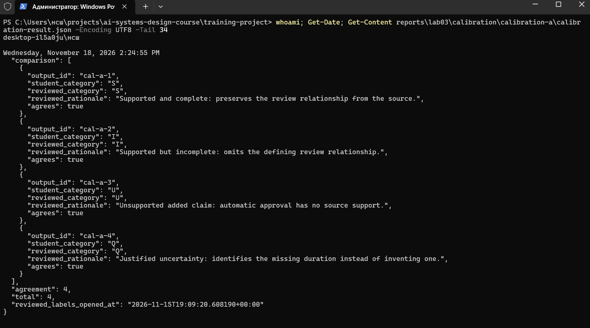
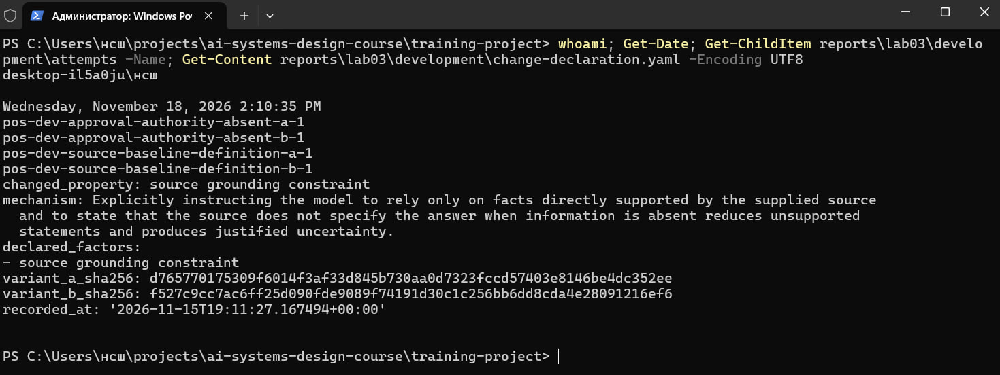
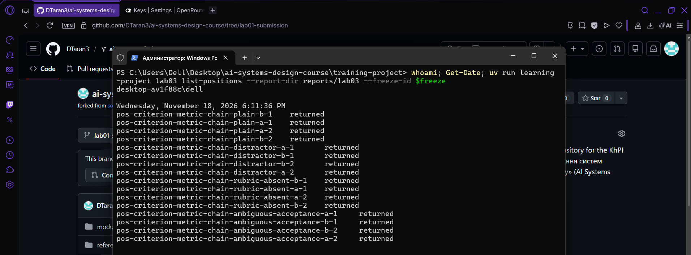
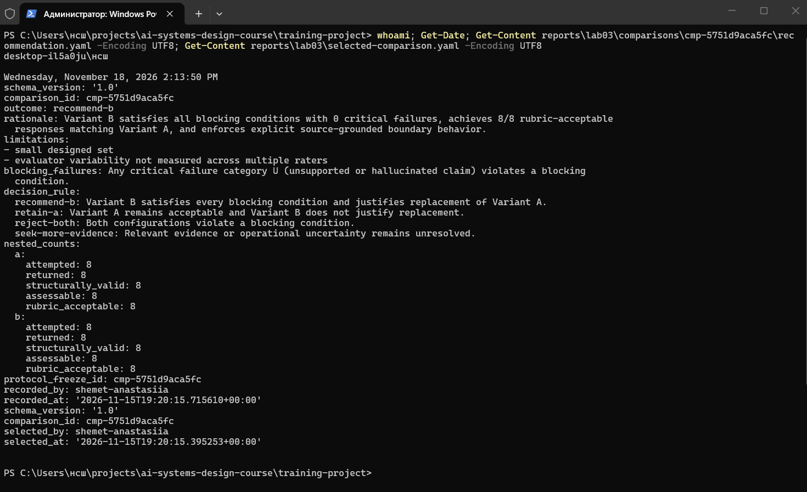

# Лабораторна робота 03

## Ідентифікація подання

- URL форку: https://github.com/ashemet3/ai-systems-design-course
- Назва особистої гілки: lab03/shemet-anastasiia
- Статус завершення: complete

Повний хеш остаточного коміту та результат його перевірки містяться в окремому згенерованому `verification-report.json`. Їх не вписують у цей звіт до коміту, оскільки така зміна створила б інший коміт.

## Мета роботи

Отримати об'єктивні емпіричні та семантичні свідчення, необхідні інженерній команді для ухвалення рішення про те, чи повинна кандидатна конфігурація (варіант B) замінити базову конфігурацію (варіант A) для операції пропозиції понять за допомогою моделі на основі наданих джерел.

## Початковий стан і межа лабораторної роботи 02

Гілку `lab03/shemet-anastasiia` створено від завершеної гілки лабораторної роботи 02; до неї влито актуальний стан `upstream/main` (коміт `6fbc05e`). Перед початком лабораторної роботи 03 на тимчасовій копії каталогу свідчень лабораторної роботи 02 виконано вхідну перевірку допуску `learning-project lab02 verify`. Лабораторна робота 03 зберігає встановлену межу: прийняте поняття `Structured Output` та файли рішень і операцій у зовнішньому сховищі Markdown-файлів не змінювалися. Це підтверджує перевірка `accepted-state` у `lab03 verify` («Laboratory 02 accepted state not modified by this workflow»). Файли гілок `lab01/*` і `lab02/*` у межах лабораторної роботи 03 не змінювалися.

## Калібрування оцінювача

Для калібрування оцінювача застосовано авторський пакет `calibration-a`, що містить чотири фікстури (`cal-a-1` … `cal-a-4`). Застосовано абсолютну рубрику оцінювання (`S`, `I`, `U`, `Q`, `R`, `X`). Студент записав мітки до `student-labels.yaml` і подав їх командою `calibrate-submit`; лише після цього відкрито розглянуті мітки курсу (`labels-opened.json`). У `calibration-result.json` зафіксовано узгодженість 4 з 4 (`agreement: 4`, `total: 4`, для кожної фікстури `agrees: true`):

| Фікстура | Мітка студента | Розглянута мітка | Зміст оцінки |
|---|---|---|---|
| `cal-a-1` | `S` | `S` | усі твердження підкріплені джерелом, зв'язок із розглядом пропозицій збережено |
| `cal-a-2` | `I` | `I` | відповідь підкріплена, але не містить визначального зв'язку розгляду |
| `cal-a-3` | `U` | `U` | додано непідкріплене твердження про автоматичне затвердження |
| `cal-a-4` | `Q` | `Q` | відповідь вказує на відсутній у джерелі строк замість вигадування значення |

Авторські фікстури калібрування узгоджують застосування рубрики і не є свідченням якості жодної моделі. Підставою для переходу до розробницьких запусків є повна узгодженість міток.

Рисунок — `01-calibration.png`

## Розробницькі випадки

Використано два випадки для розроблення, які надає й контролює курс:

1. `dev-source-baseline-definition` — завдання «Define what a source baseline identifies.»; джерело: «A source baseline identifies the material against which a proposal is reviewed.» Джерело містить повну відповідь.
2. `dev-approval-authority-absent` — завдання «State who is permitted to approve a proposal.»; джерело: «The review record stores the reviewer's identity and decision.» Джерело не називає суб'єкта, якому дозволено затверджувати пропозицію, тому очікувана поведінка — пряма вказівка на відсутність цієї інформації в джерелі.

## Розробницькі запуски й діагноз варіанта A

Виконано чотири спроби на випадках для розроблення: дві для варіанта A (`pos-dev-source-baseline-definition-a-1`, `pos-dev-approval-authority-absent-a-1`) і дві для варіанта B (`pos-dev-source-baseline-definition-b-1`, `pos-dev-approval-authority-absent-b-1`). Усі чотири спроби завершилися станом `returned`, а перевірка `dev-structural-check` для кожної зафіксувала `valid: true`.

Спостереження за відповідями варіанта A:

- На `dev-source-baseline-definition` відповідь варіанта A складається з кількох речень і додає до єдиного підкріпленого твердження джерела формулювання про «встановлену або авторитетну версію» матеріалу та про «визначений корпус матеріалу». Джерело цих тверджень не містить. Відповідь варіанта B на тому самому випадку збігається зі змістом речення джерела.
- На `dev-approval-authority-absent` відповідь варіанта A повідомляє, що жодна конкретна особа не названа, проте обґрунтовує це посиланням на ідентифікатор випадку («the case identifier indicates…»), а не на відсутність відомостей у джерелі. Відповідь варіанта B прямо стверджує, що джерело не визначає, хто має право затверджувати пропозицію.

Діагноз: інструкція варіанта A не містить явного обмеження на використання лише підкріплених джерелом фактів і не вимагає прямої констатації відсутності відповіді в джерелі. На двох випадках розроблення це проявилося як додавання тверджень поза джерелом (перший випадок) і як неточне обґрунтування відсутності відомостей (другий випадок). Вибірка складається з двох відповідей варіанта A, тому діагноз має попередній характер і використовується лише для визначення задуманого фактора; результати розроблення не змішано з відкладеним порівнянням.

Фактор, що спотворює порівняння. Маршрут `openrouter/free` не фіксує модель: у `run-metadata.json` кожної спроби поле `observed_model` містить модель, яку фактично обрав постачальник. У розробницьких запусках це були `baidu/ernie-5.5-flash-preview:free` і `liquid/lfm-3-1.7b:free` для варіанта A та `nvidia/nemotron-3.5-super-vl:free` і `nvidia/nemotron-3-ultra-550b-a55b:free` для варіанта B. Отже, модель у двох варіантах відрізнялася, і розробницькі відповіді не можна приписати лише відмінності інструкцій. Заморожено ідентифікатор маршруту, а не модель; цей фактор не контролюється протоколом і врахований в обмеженнях.

Рисунок — `02-development.png`

## Єдина зміна у варіанті B

У варіанті B змінено рівно одну властивість інструкції — обмеження підкріплення джерелом (`source grounding constraint`; `changed_property`, `declared_factors` у `change-declaration.yaml`). Базову фразу «Answer the task about the supplied source.» замінено на вимогу відповідати, використовуючи лише факти, безпосередньо підтверджені наданим джерелом, і, якщо джерело не містить відповіді, прямо вказувати, що джерело її не визначає. Механізм впливу, оголошений у `change-declaration.yaml`: явна вимога спиратися лише на підкріплені факти та вказувати на відсутність відомостей має зменшити непідкріплені твердження і зумовити обґрунтовану невизначеність. Контракт виходу (JSON з полями `case_id` і `proposed_text`) залишено без змін. У прочитаних запитах (`request.json`) параметрів генерації, зокрема температури, не задано; про їх значення цей звіт не стверджує нічого. SHA-256 інструкцій записано в `change-declaration.yaml` для варіанта A (`d7657701…52ee`) і варіанта B (`f527c9cc…ef6`). Значення для варіанта A обчислено за вмістом файлу з нормалізованими закінченнями рядків (LF); у `freeze-manifest.json` хеш варіанта A (`69f0f1d6…8d91`) відповідає тому самому файлу з закінченнями рядків робочої копії Windows (CRLF).

## Заморожений протокол

До розкриття відкладених випадків створено й зафіксовано протокол `student/lab03/protocol-draft.yaml` командою `lab03 freeze`; ідентифікатор порівняння — `cmp-5751d9aca5fc`. Протокол визначає:

- інженерне рішення: чи має варіант B замінити варіант A для оцінюваної операції пропозиції поняття;
- гіпотезу: додавання обмеження підкріплення джерелом усуне непідкріплені твердження (`U`) і зумовить обґрунтовану невизначеність (`Q`) для непідкріплених випадків, зберігши підкріплені визначення (`S`);
- семантичне прийняття: усі придатні до оцінювання відповіді мають категорії `S` або `Q` без критичних відмов;
- блокувальну умову: будь-яка критична категорія `U`;
- операційне прийняття: затримка від початку спроби до повернення відповіді менша за 30 с; невідомі значення затримки або використання вважаються допоміжними спостереженнями;
- правило компромісу: варіант B може замінити варіант A, якщо виконує всі блокувальні умови й має не нижче семантичне прийняття без регресій;
- межу часу «від надсилання запиту до кінцевої відповіді», бюджет 16 спроб і маршрут `openrouter` / `openrouter/free`.

Статус `lab03 status` для порівняння `cmp-5751d9aca5fc`: 16 позицій у стані `returned`, наступної незапущеної позиції немає, зупинки маршруту немає.

Рисунок — `03-freeze.png`

## Вибір відкладеної родини та виконання

Після заморозки протоколу командою `lab03 select-family` призначено родину `reserve-criteria-chain` із чотирма випадками: `criterion-metric-chain-plain`, `criterion-metric-chain-distractor`, `criterion-metric-chain-rubric-absent`, `criterion-metric-chain-ambiguous-acceptance`. Подію розкриття та використання зафіксовано в `exposure-ledger.json` (дві події, лише додавання). Розклад містить 16 позицій: 4 випадки × 2 конфігурації × 2 повтори. Усі 16 позицій виконано через маршрут `openrouter/free`; `lab03 list-positions` показує стан `returned` для кожної, а `structural-check` — чинність відповідей. Замін позицій не було («sixteen terminal positions without replacement»).

Фактичні моделі. Для 16 відкладених позицій `observed_model` набуває восьми різних значень: для варіанта A — шість (`baidu/ernie-5.5-flash-preview:free`, `dots-studio/dots-3-note-preview:free`, `nvidia/nemotron-3.5-lightning:free`, `nvidia/nemotron-3.5-super-vl:free`, `particle-ai/particle-1:free`, `recursive/flint-v1.0:free`), для варіанта B — також шість (`baidu/ernie-5.5-flash-preview:free`, `cohere/north-mini-code:free`, `dots-studio/dots-3-note-preview:free`, `inclusionai/ling-3.2-flash:free`, `particle-ai/particle-1:free`, `recursive/flint-v1.0:free`). Модель змінювалася від позиції до позиції в межах одного варіанта і відрізнялася між варіантами. Порівняння A і B тому поєднує зміну інструкції зі зміною фактичної моделі, яку маршрут обирає самостійно.

Рисунок — `04-held-out-execution.png`

## Сліпе семантичне оцінювання

Команда `lab03 build-scoring` сформувала знеособлене подання `scoring-view.json` із 16 записами (`blind-001` … `blind-016`), у якому не вказано належності відповіді до варіанта A чи B. Оцінювач-студент записав по одному оцінюванню (`lab03 assess`) для кожного запису із зазначенням категорії, точної цитати джерела (`source_pointer`) і обґрунтування:

- `blind-001` … `blind-008` — категорія `S` (випадки з достатніми свідченнями та з дистрактором: відповідь підкріплена джерелом, дистрактор не використано);
- `blind-009` … `blind-016` — категорія `Q` (випадки з відсутнім фактом і з явною неоднозначністю: відповідь вказує на відсутність або неоднозначність даних замість вигадування значень).

Категорій `U`, `R`, `I` і `X` не призначено.

## Агрегати, зрізи й операційні свідчення

Команда `lab03 aggregate` (`scoring/aggregate.json`, `generated_at` 2026-11-15T19:19:39Z) повідомила п'ять послідовних підрахунків для кожної конфігурації:

| Підрахунок | Варіант A | Варіант B |
|---|---|---|
| `attempted` | 8 | 8 |
| `returned` | 8 | 8 |
| `structurally_valid` | 8 | 8 |
| `assessable` | 8 | 8 |
| `rubric_acceptable` | 8 | 8 |

Допоміжні свідчення:

- критичних непідкріплених відповідей (`U`): 0 в обох варіантах; відмов: 0; незапущених позицій: 0;
- зрізи `sufficient-evidence`, `distractor`, `missing-fact`, `explicit-ambiguity`: у кожному зрізі по 2 відповіді кожного варіанта, усі прийнятні за рубрикою;
- повторні спроби: для кожного з чотирьох випадків агрегат фіксує, що тексти двох спроб однієї конфігурації відрізняються, а категорії в межах пари збігаються (`S` для перших двох випадків, `Q` для двох інших);
- затримка на оголошеній межі часу: для варіанта A — від 1,6 с до 16,3 с; для варіанта B — від 1,7 с до 37,8 с. Позиція `pos-criterion-metric-chain-plain-b-2` (37,8 с) перевищила межу 30 с, визначену операційним прийняттям протоколу; решта 15 позицій вклалися в неї;
- невідомі значення: вартість, використання квоти й використання токенів позначено як `unknown`.

Перевищення межі затримки однією позицією варіанта B зафіксовано як операційне спостереження. Правило компромісу протоколу зіставляє заміну з блокувальними умовами та семантичним прийняттям, тому рішення нижче ґрунтується на них, а затримку розглянуто як допоміжне свідчення без впливу на підрахунки.

## Обмежене рішення щодо конфігурації

За зафіксованим протоколом і наведеними підрахунками записано рішення `recommend-b` (`recommendation.yaml`, пов'язане з `protocol_freeze_id: cmp-5751d9aca5fc`; обране порівняння — `selected-comparison.yaml`). Обґрунтування: варіант B не порушує жодної блокувальної умови (0 критичних відмов), має 8 із 8 відповідей, прийнятих за рубрикою, що відповідає варіанту A, і явно містить обмеження підкріплення джерелом. Обидві конфігурації мають однакові підрахунки (8/8/8/8/8), тому різниця на користь B не підтверджена даними відкладеного порівняння: рішення спирається на відсутність порушень блокувальних умов і на правило компромісу, а не на перевагу в кількості прийнятних відповідей. Записані обмеження: мала спроєктована вибірка; мінливість оцінювача не виміряно між кількома оцінювачами. Рішення є інженерною рекомендацією щодо конфігурації інструкції й не уповноважує розгортання або запис до прийнятого стану знань.

Рисунок — `05-scoring-recommendation.png`

## Регресійний запис

Під час відкладеного порівняння критичних відмов не виявлено, тому для регресійної перевірки використано авторську фікстуру курсу `authored-failure-supported-plus-invented` (`regression_id: reg-baseline-added-archival`, `source_kind: authored-fixture`, `model_authorship_claim: none`). Діагноз: відповідь додає твердження про автоматичне архівування відхилених пропозицій, яке не має підстав у наданому джерелі. Очікувана поведінка за розглядом: підкріплена відповідь має лише вказувати, що базовий стан джерела спрямовує до джерела розгляду для перевірки пропозицій, без доданих механізмів архівування чи затвердження. Запис розглянув `shemet-anastasiia`. Регресійний запис не є свідченням поведінки жодної моделі в цьому експерименті.

Рисунок — `06-regression.png`

## Обмеження й статус завершення

Статус завершення — `complete` (`completion-status.yaml`, `stopped_at_step: "Step 10"`). Обмеження експерименту:

- мала вибірка відкладених випадків (4 випадки, 16 позицій), тому результат не узагальнюється на інші випадки чи предметні області;
- оцінювання виконував один оцінювач, тому мінливість оцінювання не виміряно;
- маршрут `openrouter/free` не фіксує модель: у 16 відкладених позиціях зафіксовано вісім різних значень `observed_model`, а у двох варіантах вони відрізнялися; різницю між A і B не можна цілком віднести до зміни інструкції;
- одна позиція варіанта B (37,8 с) перевищила межу затримки 30 с;
- обидві конфігурації мають однакові підрахунки прийнятності, тому дані не показують переваги B за кількістю прийнятних відповідей;
- записи оцінювання `blind-002` … `blind-016` створено командою `lab03 assess` з інтервалом близько 0,3 с (`recorded_at`), запис `blind-001` — приблизно на 20 с раніше; обґрунтування `blind-001` записано латиницею, а обґрунтування в межах груп категорій `S` і `Q` мають однотипні формулювання. Записи оцінювання одноразові й не змінювалися. Часові мітки не підтверджують окремого розгляду кожної відповіді в момент запису, тому якість і незалежність оцінювання потребують повторної перевірки іншим оцінювачем або на іншій резервній родині;
- вартість, квота й використання токенів невідомі.

Оцінка відповіді на рівні відкладених випадків не є валідацією наскрізного процесу роботи зі знаннями.

## Остаточна перевірка

Остаточний коміт гілки містить свідчення студента (`student/lab03`, `reports/lab03`), декларацію зміни, протокол, оцінювання й цей звіт. Перевірку виконано за процедурою commit-first командою `learning-project lab03 verify --report-dir reports/lab03 --final-commit <хеш остаточного коміту>`; хеш коміту та результат (`passed-complete` або інший) записує згенерований `verification-report.json`, тому їх не вписано в цей звіт. Перевірка охоплює дев'ять складників: `final-commit`, `completion-status`, `exposure-ledger`, `selected-comparison`, `positions`, `recommendation`, `regression`, `accepted-state`, `report` (сім відносних посилань на знімки та шість закомічених знімків). Після коміту допускаються лише `verification-report.json`, знімок `07-final-verification.png` та згенерований `submission/REPORT.md`. Результат фінальної перевірки видно на знімку екрана.

Рисунок — `07-final-verification.png`

## Висновки

Виконано кроки лабораторної роботи 03: відкалібровано застосування рубрики (4 з 4 збігів); на двох випадках для розроблення виконано варіант A і визначено один задуманий фактор — обмеження підкріплення джерелом; заморожено протокол `cmp-5751d9aca5fc` до розкриття відкладених випадків; виконано 16 позицій відкладеного порівняння із сліпим оцінюванням (8 відповідей `S` і 8 відповідей `Q`, критичних відмов немає); повідомлено п'ять послідовних підрахунків (8/8/8/8/8 для обох конфігурацій); записано рішення `recommend-b` і один регресійний випадок. Мету роботи — отримати свідчення для рішення щодо заміни варіанта A варіантом B — досягнуто повністю в межах зафіксованого протоколу. Висновок обмежений малою вибіркою, одним оцінювачем (часові мітки записів оцінювання не підтверджують окремого розгляду кожної відповіді), невизначеною фактичною моделлю маршруту `openrouter/free` та одним перевищенням межі затримки; за кількістю прийнятних відповідей конфігурації не відрізняються.
