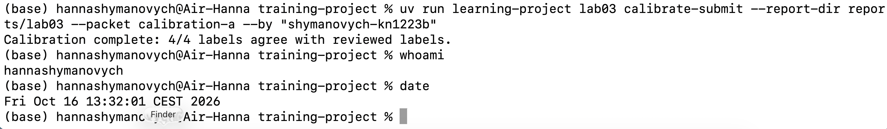
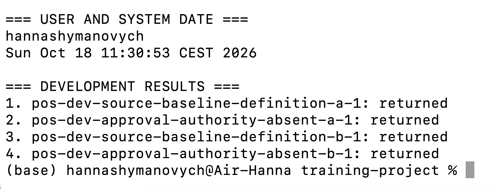
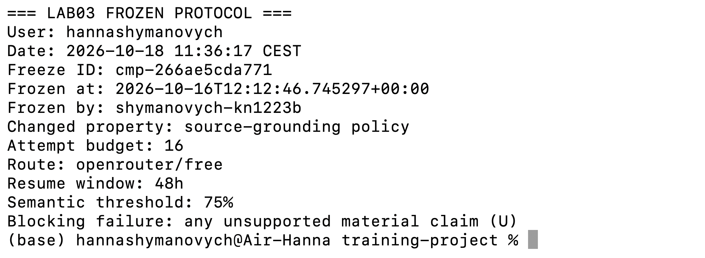
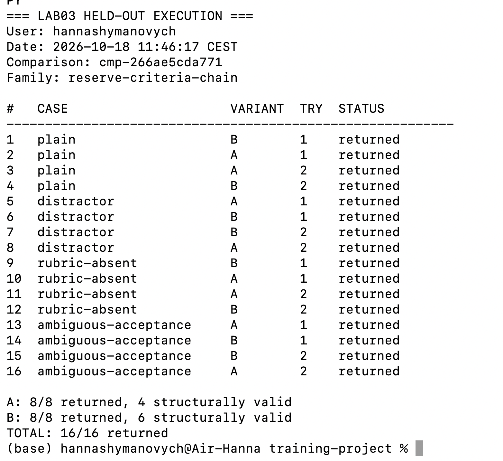
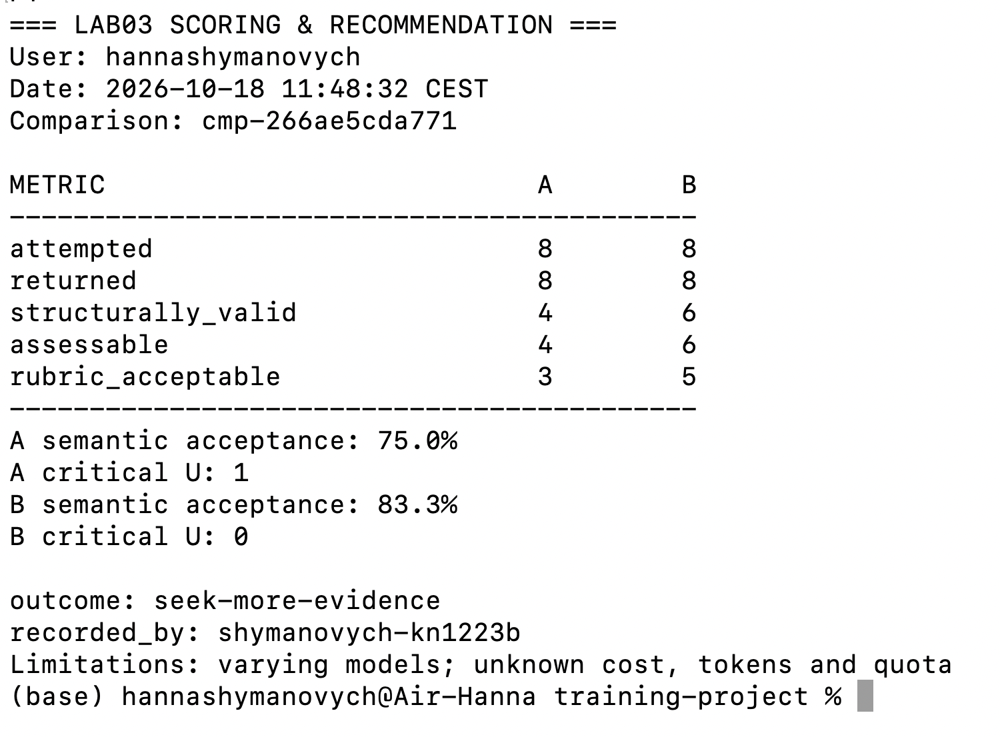
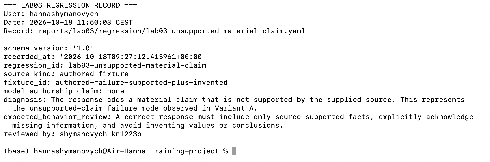

# Лабораторна робота 03

## Ідентифікація подання

- URL форку: https://github.com/shymochkaa/ai-systems-design-course
- Назва особистої гілки: `lab03/shymanovych-kn1223b`
- Статус завершення: `complete` (підлягає підтвердженню остаточною перевіркою).

Повний хеш остаточного студентського коміту та результат перевірки фіксуються в окремому `verification-report.json` після створення коміту.

## Мета роботи

Сформувати доказово обґрунтоване рішення щодо вибору конфігурації інструкції для відповіді на основі наданого джерела. Рішення має спиратися на відкалібровану абсолютну рубрику, контрольовану зміну однієї властивості інструкції, попередньо заморожений протокол, незалежне відкладене порівняння та оцінювання як семантичних, так і операційних обмежень. За недостатності доказів система оцінювання повинна дозволяти утриматися від рекомендації.

## Початковий стан і межа лабораторної роботи 02

Робота виконувалася в особистому форку репозиторію курсу, з налаштованими `origin` та `upstream`, в окремій гілці Lab03. Синхронізація з основним репозиторієм належить до підготовки робочого середовища; у межах Lab03 не передбачалося змінювати прийняті результати попередньої роботи.

Вхідний стан підтверджено файлом `reports/lab02/verification-report.json`: статус Lab02 — `passed`, успішно пройдено 10 із 10 перевірок, невдалих перевірок немає. Прийнятим результатом Lab02 є `lab02-structured-output-human-01` з походженням `human-revision`. Перевірки прийнятого стану, аудиторського ланцюга та незмінності Vault завершилися успішно.

Лабораторна робота 03 досліджувала поведінку інструкцій та порівняння конфігурацій. Вона не передбачала внесення змін до прийнятого поняття `Structured Output` або його аудиторського ланцюга. Остаточне підтвердження незмінності належить до фінальної перевірки.

## Калібрування оцінювача

Активний пакет калібрування — `calibration-a`. Власні мітки було зіставлено з контрольними після їх відкриття. Результат — 4 збіги з 4, розбіжностей немає.

- `cal-a-1` — `S`: повна відповідь із належною підтримкою джерелом.
- `cal-a-2` — `I`: підтримана, але неповна відповідь, що пропускає суттєвий зв'язок.
- `cal-a-3` — `U`: відповідь містить додане суттєве твердження про автоматичне схвалення, якого джерело не підтверджує.
- `cal-a-4` — `Q`: обґрунтована невизначеність щодо строку зберігання, який не зазначено у джерелі.

Оскільки розбіжностей не було, уточнення правил через виправлення помилкових власних міток не знадобилося. Авторські калібрувальні приклади призначені для підготовки оцінювача та не є свідченням якості моделі.

Рисунок — `01-calibration.png`

## Розробницькі випадки

Для розробницького етапу використано два надані навчальним процесом випадки, а не довільно підібрані після перегляду відкладених результатів.

1. `dev-source-baseline-definition` — перевірка здатності відтворити визначення та зв'язок із наданого джерела без додаткових непідтверджених тверджень.
2. `dev-approval-authority-absent` — перевірка поведінки за відсутності в джерелі відомостей про повноваження або схвалення.

Ці випадки використовувалися для діагностики та розроблення зміни інструкції. Вони не входять до незалежного відкладеного порівняння.

## Розробницькі запуски й діагноз варіанта A

Було виконано всі чотири заплановані розробницькі позиції: спочатку дві для варіанта A, потім дві для варіанта B. Усі чотири позиції повернули відповіді; завершених відмов та незапущених позицій у цьому етапі не зафіксовано.

Спостереження: у випадку `dev-approval-authority-absent` варіант A додав суттєве твердження без підтвердження наданим джерелом. Варіант B у відповідному випадку належно позначив невизначеність.

Інженерний діагноз: вихідна інструкція A недостатньо обмежувала формулювання висновків, коли джерело не містило потрібного факту. Це створювало ризик категорії `U`. Розробницький етап слугував підставою для локальної зміни інструкції, але його результати не використовувалися як фінальний доказ переваги B.

Рисунок — `02-development.png`

## Єдина зміна у варіанті B

Між A та B змінено одну властивість інструкції — політику опори на джерело (`source-grounding policy`). Варіант B посилює вимогу відокремлювати підтверджені факти від відсутніх у джерелі відомостей і не додавати непідтверджених суттєвих тверджень.

Очікуваний механізм впливу: зменшення кількості відповідей категорії `U` та збільшення кількості коректних відповідей категорії `Q` там, де джерело не дозволяє зробити висновок.

Інші властивості порівнюваної інструкції не змінювалися навмисно, щоб не змішувати вплив кількох редакцій. Водночас сталість фактично вибраної провайдером моделі не була гарантована, тому вона окремо враховується як обмеження експерименту.

## Заморожений протокол

Інженерне рішення полягало у визначенні, чи достатньо доказів для рекомендації варіанта B замість A.

Гіпотеза: посилення політики опори на джерело зменшить кількість критичних непідтверджених тверджень, не погіршуючи прийнятність відповідей за абсолютною рубрикою.

Протокол заморожено до відкладеного оцінювання:

- Ідентифікатор: `cmp-266ae5cda771`.
- Маршрут: `openrouter/free`.
- Бюджет спроб: 16 позицій.
- Максимально допустима затримка: 60 секунд.
- Фіксоване вікно відновлення: 48 годин.
- Семантичний поріг: щонайменше 75% прийнятних відповідей серед придатних до оцінювання.
- Критичне блокування: наявність хоча б однієї відповіді категорії `U`.
- Операційні показники, які неможливо встановити, мають позначатися як невідомі та не можуть підтверджувати операційну перевагу.

Протокол передбачає чотири результати рішення: `recommend-b`, `retain-a`, `reject-both`, `seek-more-evidence`. Вибір має відповідати заздалегідь визначеним умовам прийняття й блокування, а не лише порівнянню відсотків.

Порядок позицій та вікно відновлення задавалися робочим процесом курсу. Заморожений протокол є незмінним для цього ідентифікатора; його редагування заднім числом під тим самим ідентифікатором неприпустиме.

Рисунок — `03-freeze.png`

## Вибір відкладеної родини та виконання

Для незалежного порівняння вибрано родину `reserve-criteria-chain`. Її використано як відкладену родину, відокремлену від двох розробницьких випадків; її експозиція в межах експерименту фіксувалася робочим процесом курсу.

Було заплановано 16 позицій: 8 для A та 8 для B. Усі 16 позицій повернули відповіді. Завершених відмов — 0, незапущених позицій — 0. Структурно коректними виявилися 4 відповіді A та 6 відповідей B.

Повторних запусків для заміни невдалих результатів не виконували. Відсутні підстави вважати, що історію запусків було замінено або переписано. Спостережені результати збережено в матеріалах порівняння.

Рисунок — `04-held-out-execution.png`

## Сліпе семантичне оцінювання

Семантичне оцінювання проводилося за прихованої належності відповіді до A або B. Це обмежувало ризик того, що оцінювач надаватиме перевагу варіанту, який очікувалося покращити.

Абсолютна рубрика розрізняла `S` — підтриману й повну відповідь, `I` — підтриману, але неповну, `U` — суттєве непідтверджене твердження, `Q` — обґрунтовану невизначеність, а також `R` і `X` відповідно до правил пакета оцінювання. Для семантичних висновків використовувалися посилання на джерела, а не лише загальне враження від відповіді.

Оцінено всі 10 структурно коректних і придатних до семантичного оцінювання відповідей. Шість структурно некоректних відповідей не зараховувалися як семантично прийнятні й не включалися до знаменника семантичної частки.

## Агрегати, зрізи й операційні свідчення

П'ять послідовних кількостей наведено окремо для кожного варіанта:

| Показник | A | B |
|---|---:|---:|
| `attempted` | 8 | 8 |
| `returned` | 8 | 8 |
| `structurally_valid` | 4 | 6 |
| `assessable` | 4 | 6 |
| `rubric_acceptable` | 3 | 5 |

Семантична прийнятність серед придатних до оцінювання відповідей: A — 3/4 (75%), B — 5/6 (83,3%). Ці частки не можна підміняти частками від усіх восьми спроб.

Критичні непідтверджені відповіді: A — 1, B — 0. Завершені відмови: A — 0, B — 0. Незапущені позиції: A — 0, B — 0. Зафіксованих відмінностей між повторними спробами немає.

За зрізами спостерігалися такі результати:

- `sufficient-evidence`: A — 0 придатних до оцінювання, B — 1/1 прийнятна.
- `distractor`: A — 2/2, B — 1/1 прийнятна.
- `missing-fact`: A — 0/1 прийнятна й одна критична `U`, B — 2/2 прийнятні.
- `explicit-ambiguity`: A — 1/1, B — 1/2 прийнятна.

Максимальна зафіксована затримка: A — 30,823 с, B — 15,705 с. Обидва варіанти вкладалися в межу 60 с. Відомості про грошову вартість, використання квоти та кількість токенів залишилися невідомими. Крім того, маршрут `openrouter/free` міг використовувати різні фактично вибрані моделі, що створює додаткову змінну й обмежує причинне порівняння конфігурацій.

## Обмежене рішення щодо конфігурації

Зафіксоване рішення — `seek-more-evidence`.

Спостереження: B має вищу семантичну прийнятність серед придатних відповідей (83,3% проти 75%) та не має зафіксованих критичних `U`, тоді як A має одну таку відповідь. Обидва варіанти дотрималися часової межі.

Інженерний висновок: результати підтримують припущення про користь посиленої політики опори на джерело, але не доводять контрольованої переваги B. Кількість придатних відповідей мала, частина позицій структурно некоректна, фактичні моделі могли відрізнятися, а показники використання та вартості невідомі.

Тому за умовами замороженого протоколу доказів недостатньо для безумовної рекомендації заміни конфігурації. Рішення `seek-more-evidence` не дозволяє розгортання варіанта B або запис нового прийнятого знання.

Рисунок — `05-scoring-recommendation.png`

## Регресійний запис

Зареєстровано випадок `lab03-unsupported-material-claim` з походженням `authored-fixture` та ідентифікатором `authored-failure-supported-plus-invented`. Авторство відповіді моделлю не заявляється (`model_authorship_claim: none`).

Діагностована межа: до підтриманої джерелом частини відповіді додається суттєве твердження, для якого в джерелі немає підтвердження. Цей тип помилки відповідає ризику, спостереженому у варіанті A.

Очікувана правильна поведінка: використовувати лише підтверджені джерелом факти, прямо зазначати відсутню інформацію та не вигадувати значення чи висновки. Регресійний запис пройшов передбачений перегляд, але залишається авторським прикладом, а не новим незалежним запуском моделі. Його не можна додавати до відкладених результатів як свіже свідчення.

Рисунок — `06-regression.png`

## Обмеження й статус завершення

Усі передбачені етапи порівняння та фіксації рішення виконано. Статус `complete` має бути підтверджений остаточною перевіркою подання.

Головні обмеження: лише 4 придатні до оцінювання відповіді A та 6 відповідей B; шість структурно некоректних відповідей; неоднакова кількість придатних відповідей у тематичних зрізах; потенційна зміна фактично вибраної моделі на безкоштовному маршруті; невідомі вартість, токени й використання квоти.

Отримані дані не дозволяють стверджувати статистично надійну або причинно ізольовану перевагу B, гарантувати її поведінку в інших задачах чи підтверджувати операційну економічність. Також вони не дозволяють вважати авторський регресійний приклад незалежним експериментальним спостереженням.

## Остаточна перевірка

Базовий коміт курсу визначає перевірюваний стан навчальних матеріалів і не тотожний остаточному студентському коміту. Остаточний студентський коміт має зафіксувати підготовлені артефакти Lab03.

Точний хеш цього коміту та результат `passed-complete` або `passed-partial` повинні з'явитися в окремому згенерованому `verification-report.json` після створення коміту. Вносити хеш до `REPORT.md` перед комітом не потрібно, оскільки це змінить вміст і відповідно хеш коміту. Після остаточного коміту студентські свідчення не повинні змінюватися.

Рисунок — `07-final-verification.png`

## Висновки

У лабораторній роботі відкалібровано оцінювача (4/4 збігів), досліджено два розробницькі випадки, виконано чотири розробницькі запуски, внесено одну контрольовану зміну до інструкції та заморожено протокол порівняння. Відкладений експеримент охопив 16 повернутих відповідей, з яких 10 були придатні до сліпого семантичного оцінювання.

Варіант B показав 5/6 прийнятних відповідей і не мав критичних непідтверджених тверджень; варіант A — 3/4 прийнятних відповідей та одну критичну помилку. Зафіксовано рішення `seek-more-evidence` та створено окремий авторський регресійний запис.

Мету роботи щодо побудови доказового процесу оцінювання й обмеженого інженерного рішення досягнуто на рівні виконаних експериментальних етапів. Доказів для рекомендації заміни конфігурації недостатньо через малу вибірку, структурні втрати, невизначені операційні показники та потенційну неоднорідність моделей. Остаточний статус завершення лабораторної визначить фінальна перевірка.