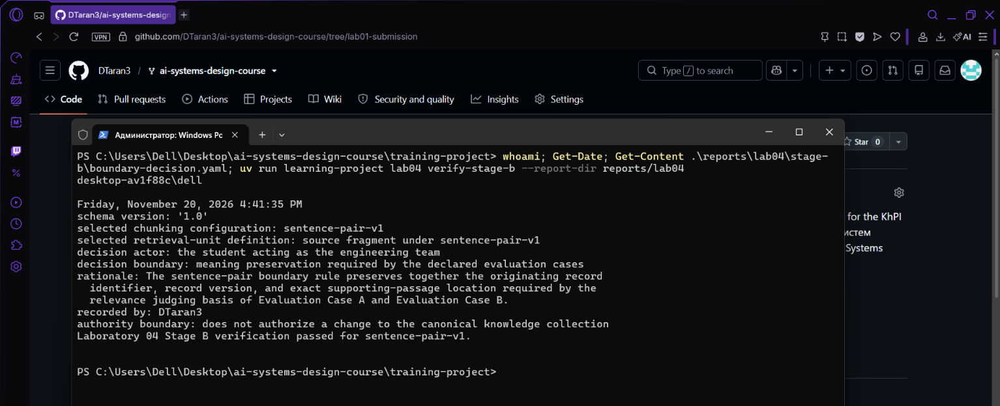
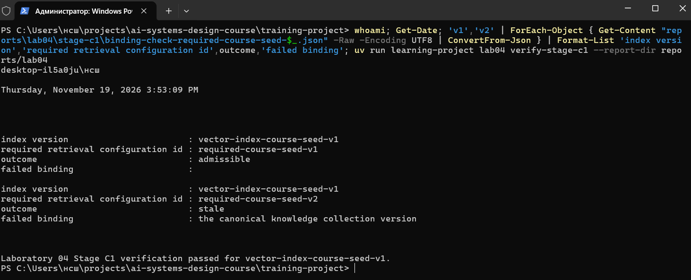
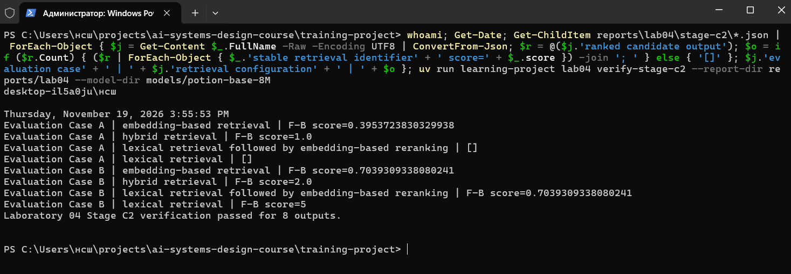

# Лабораторна робота 04

## Ідентифікація

- Прізвище та ім’я студента: Шемет Анастасія
- Ідентифікатор студента: shemet-anastasiia
- URL форка: https://github.com/ashemet3/ai-systems-design-course
- Особиста гілка: lab04/shemet-anastasiia
- Статус завершення: `complete`

Повний хеш остаточного коміту та результат перевірки містяться в окремому згенерованому `verification-report.json`. Їх не вписують у цей звіт до коміту, оскільки така зміна створила б інший коміт.

## Мета роботи

Отримати свідчення, потрібні інженерній команді, щоб вирішити, чи має кандидатна конфігурація інформаційного пошуку на основі ембедингів замінити базову конфігурацію експерименту, лексичний пошук, для оцінюваної операції інформаційного пошуку над канонічною колекцією знань `course-seed-v1`.

## Хід виконання

### Вибір межі одиниці інформаційного пошуку

Гілку `lab04/shemet-anastasiia` створено від завершеної гілки `lab03/shemet-anastasiia`, у каталозі `reports/lab04` ініціалізовано вихідний звіт і каталог знімків екрана. Командою `lab04 prepare-boundaries` обидві надані конфігурації розбивки на фрагменти застосовано до канонічних записів знань `R-A` і `R-B`; результат записано до `stage-b/boundary-comparison.json`. Файл містить версію колекції `course-seed-v1`, обидва записи з ознаками `student_generated: false` і `student_approved: false`, а також контракт інформаційного пошуку, у якому очікуваний результат, призначений лише для оцінювача, не входить до жодного об’єкта `operation_input`.

Конфігурація `sentence-pair-v1` створила дві одиниці: `F-A` (символи 1–215 запису `R-A`) і `F-B` (символи 1–143 запису `R-B`). Конфігурація `fixed-72-v1` створила шість: `F-A-72-1` … `F-A-72-4` (діапазони 1–71, 73–140, 142–203, 205–215) та `F-B-72-1`, `F-B-72-2` (діапазони 1–71 і 73–143). Кожен фрагмент має стабільний ідентифікатор пошуку, зв’язок походження (запис, версія запису, підтвердне джерело, версія джерела, діапазон символів) і класифікацію належності «derived retrieval-side artifact; not a canonical knowledge collection member».

Оголошена підстава для судження про релевантність вимагає, щоб одна одиниця пояснювала, які дані ідентифікують первинний запис, його версію та точне місце підтвердного уривка. Одиниця `F-A` зберігає цілісне пояснення зв’язку походження в одному фрагменті, тоді як `fixed-72-v1` розрізає той самий текст на чотири частини по 11–71 символ без урахування меж речень, тому жоден окремий фрагмент не містить пояснення повністю. На цій підставі командою `lab04 record-boundary-decision` зафіксовано `sentence-pair-v1` із визначенням одиниці «source fragment under sentence-pair-v1» і обмеженням, що рішення не уповноважує зміну канонічної колекції знань. Команда `lab04 verify-stage-b` завершилася повідомленням про успішну перевірку для `sentence-pair-v1`. Описане відповідає файлам `boundary-comparison.json`, `boundary-decision.yaml` і знімку.

Рисунок — `01-boundary-selection.png`

### Ембединги та векторний індекс

Залежності лабораторної роботи встановлено командою `uv sync --extra lab04`, оголошену модель отримано одноразовою командою `lab04 fetch-embedding-model` у каталог `models/potion-base-8M` (походження моделі записано в `model-provenance.json`). Командою `lab04 prepare-embeddings` створено по одному ембедингу для `F-A` і `F-B`: модель `minishlab/potion-base-8M`, ревізія `bf8b056651a2c21b8d2565580b8569da283cab23`, версія представлення `course-static-embed-v1`, розмірність 256, простір `potion-base-8M@bf8b056651a2c21b8d2565580b8569da283cab23/course-static-embed-v1`. Командою `lab04 prepare-index` підготовлено маніфест індексу з версією `vector-index-course-seed-v1`, прив’язаною до `course-seed-v1` і `sentence-pair-v1`, з метаданими прив’язки для двох проіндексованих одиниць.

Перевірка прив’язок для `required-course-seed-v1` класифікувала індекс як придатний (`admissible`), усі прив’язки збіглися. Перевірка для `required-course-seed-v2` класифікувала той самий індекс як застарілий (`stale`): не збіглася прив’язка до версії канонічної колекції знань (`course-seed-v1` проти `course-seed-v2`), а умову перебудови названо без перебудови індексу. Придатний результат дозволив виконувати інформаційний пошук за `required-course-seed-v1`, а застарілий результат для `required-course-seed-v2` ніде далі не використовувався. Команда `lab04 verify-stage-c1` завершилася успішно для `vector-index-course-seed-v1`. Описане відповідає файлам `retrieval-unit-embeddings.json`, `index-manifest.json`, двом записам `binding-check-required-course-seed-v1.json` і `binding-check-required-course-seed-v2.json` та знімку.

Рисунок — `02-embedding-index.png`

### Порівняння конфігурацій інформаційного пошуку

Командою `lab04 execute-retrieval` виконано обидва випадки для оцінювання за всіма чотирма конфігураціями (вісім запусків, `k = 1`). Спостережені ранжовані кандидатні виходи:

| Випадок | Конфігурація | Вихід |
|---|---|---|
| Evaluation Case A | lexical retrieval | порожній (`[]`) |
| Evaluation Case A | embedding-based retrieval | `F-B`, бал 0,3954 |
| Evaluation Case A | hybrid retrieval | `F-B`, бал 1,0 |
| Evaluation Case A | lexical retrieval followed by embedding-based reranking | порожній (`[]`) |
| Evaluation Case B | lexical retrieval | `F-B`, бал 5 |
| Evaluation Case B | embedding-based retrieval | `F-B`, бал 0,7039 |
| Evaluation Case B | hybrid retrieval | `F-B`, бал 2,0 |
| Evaluation Case B | lexical retrieval followed by embedding-based reranking | `F-B`, бал 0,7039 |

Порожній вихід лексичної конфігурації та конфігурації з переранжуванням для випадку A означає відсутність спільних змістових слів із запитом; це не відмова виконання, жодної помилки `WorkflowError` не виникло. Команда `lab04 verify-stage-c2` завершилася успішно для восьми виходів, тому можна було переходити до суджень про релевантність. Ранжований вихід характеризує лише ці два випадки й не свідчить про загальну перевагу будь-якого механізму інформаційного пошуку. Описане відповідає восьми файлам у `stage-c2/`, результату `verify-stage-c2` і знімку.

Рисунок — `03-retrieval-comparison.png`

### Судження про релевантність і метрики

Студент як призначений оцінювач-людина застосував оголошену підставу до кожної поверненої одиниці. У обох випадках повернуто лише `F-B`, і для обох випадків зафіксовано судження «not relevant». Одиниця `F-B` описує квитанцію запуску пропозиції, яка фіксує джерело та версію моделі й прямо зазначає, що не локалізує підтвердний уривок; отже вона не ідентифікує первинний запис, його версію і місце уривка (для випадку A), а також джерело й версію, що ідентифікують підтвердний уривок (для випадку B). Судження записано командою `lab04 record-relevance-judgments`, метрики обчислено командою `lab04 compute-retrieval-metrics`.

Метрики за випадками (`k = 1`, формат «чисельник/знаменник»):

| Конфігурація | Випадок A: precision@1 | Випадок A: recall@1 | Випадок B: precision@1 | Випадок B: recall@1 |
|---|---|---|---|---|
| lexical retrieval | 0/0, `undefined` | 0/1 | 0/1 | 0/1 |
| embedding-based retrieval | 0/1 | 0/1 | 0/1 | 0/1 |
| hybrid retrieval | 0/1 | 0/1 | 0/1 | 0/1 |
| lexical retrieval followed by embedding-based reranking | 0/0, `undefined` | 0/1 | 0/1 | 0/1 |

Агреговані метрики: lexical retrieval — precision@1 0/1, recall@1 0/2; embedding-based retrieval — 0/2 і 0/2; hybrid retrieval — 0/2 і 0/2; lexical retrieval followed by embedding-based reranking — 0/1 і 0/2. Значення precision@1 для порожнього виходу позначено як `undefined`, а не нулем, бо жодної повернутої одиниці для судження не було, тоді як recall@1 залишається визначеним, оскільки очікувана релевантна одиниця входить до знаменника. Судження охоплюють усі повернені одиниці й жодних зайвих, арифметика перевірена командою обчислення, тому можна було вимірювати операційні свідчення. Очікуваний результат, призначений лише для оцінювача, зчитує лише команда обчислення метрик; операції інформаційного пошуку його не отримували. Описане відповідає `relevance-judgments.json`, `retrieval-metrics.json` і знімку.

Рисунок — `04-relevance-metrics.png`

### Операційні свідчення та обмежене рішення

Командою `lab04 measure-operational-evidence --runs 3` виміряно п’ять операційних пунктів для кожної конфігурації. Вартість побудови індексу не вимірювалася повторно: використано записану підготовку індексу з кроку створення векторного індексу. Середня затримка виконання обох оголошених запитів за три запуски в одному процесі: lexical retrieval 0,0298 с; embedding-based retrieval 0,4044 с; hybrid retrieval 0,2479 с; lexical retrieval followed by embedding-based reranking 0,2497 с. Вартість запиту для конфігурацій із моделлю виражена кількістю операцій кодування (запит плюс повторне кодування проіндексованих одиниць для перевірки), споживання ресурсів обмежене локальною моделлю та процесорним часом без доступу до мережі, помилок виконання в жодній конфігурації не зафіксовано. Жодне з цих вимірювань не входить до чисельників чи знаменників метрик релевантності.

Командою `lab04 record-configuration-decision` зафіксовано рішення: обрати `lexical retrieval`. Підстава: за двома оголошеними випадками при `k = 1` жодна конфігурація не повернула релевантну одиницю (агрегований recall@1 дорівнює 0 з 2 для кожної), кандидатна конфігурація на основі ембедингів не дає приросту результату за вищої затримки, тому свідчення не підтримують заміну базової лексичної конфігурації. Межа рішення: випадки A і B, версія колекції `course-seed-v1`, межа `sentence-pair-v1`, оголошена підстава для судження, `k = 1`. Межа повноважень: рішення не встановлює якості кандидатного визначення поняття на подальшому етапі, не доводить досягнення результату всім робочим процесом користувача й не уповноважує жодних змін канонічної колекції знань. Команда `lab04 verify-stage-c3` перевіряє арифметику метрик за зафіксованими судженнями й вісьмома виходами. Описане відповідає `operational-evidence.json`, `configuration-decision.json` і знімку.

Рисунок — `05-operational-decision.png`

### Остаточна перевірка

Звіт завершено, публічні тести та команду `lab04 validate-report` виконано до коміту, усі свідчення каталогу `reports/lab04` закомічено одним комітом `feat(lab04): compare retrieval configurations`. Після цього командою `lab04 verify` із повним хешем поточного HEAD гілки виконано остаточну перевірку, результат якої записується до `verification-report.json`; точний повний хеш залишається в цьому машинному файлі. Підставою для формування матеріалів подання є успішна перевірка доменних артефактів, структури звіту, шести знімків і незмінності закомічених свідчень після коміту. Знімок показує статус і коміт, що відповідають записам у `verification-report.json`; закомічені свідчення після перевірки не редагувалися.

Рисунок — `06-final-verification.png`

## Висновки

Виконано всі кроки лабораторної роботи: обрано межу `sentence-pair-v1`, підготовлено векторний індекс `vector-index-course-seed-v1` із придатним і застарілим результатами перевірки прив’язок, отримано вісім ранжованих кандидатних виходів, зафіксовано судження про релевантність, обчислено метрики з явними чисельниками й знаменниками, виміряно операційні свідчення та ухвалено обмежене рішення щодо конфігурації. Рішення полягає в збереженні лексичного пошуку як базової конфігурації для двох оголошених випадків: жодна з чотирьох конфігурацій не повернула релевантну одиницю (агрегований recall@1 дорівнює 0 з 2), а кандидатна конфігурація на основі ембедингів має вищу затримку (0,4044 с проти 0,0298 с) без приросту результату.

Мету роботи досягнуто повністю: отримано свідчення, достатні для обмеженого рішення про заміну базової конфігурації кандидатною, і це рішення зафіксовано разом із межею рішення та межею повноважень. Обмеження висновку: вибірка складається з двох випадків, одна повернена одиниця `F-B` в усіх непорожніх виходах, `k = 1`, тому результат не узагальнюється на інші запити й колекції.
