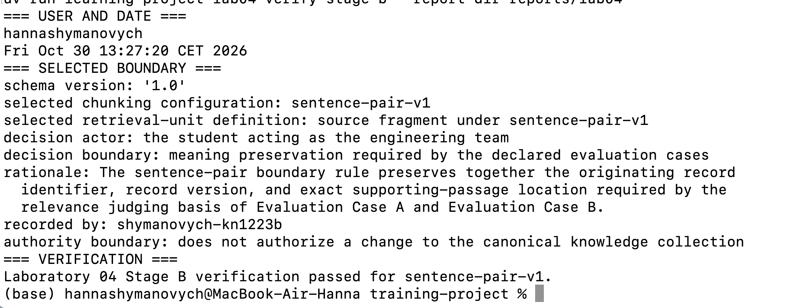
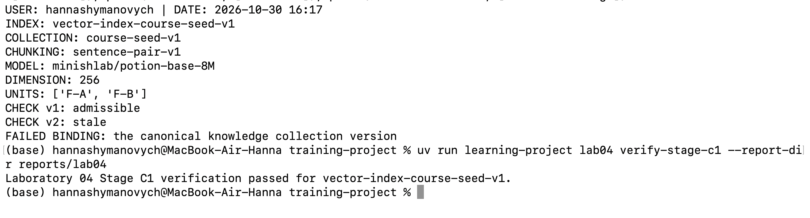
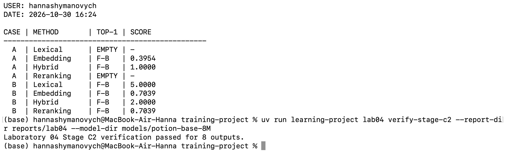
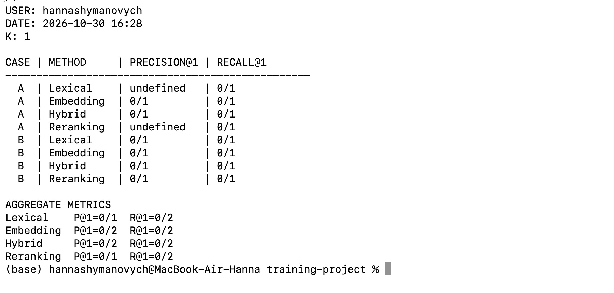
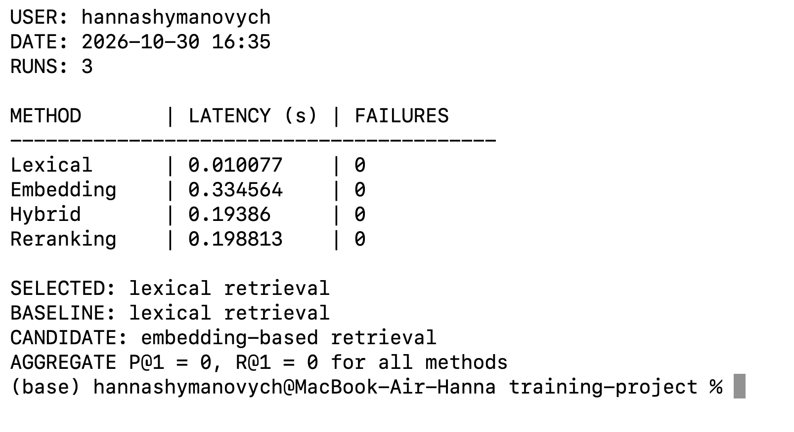

# Лабораторна робота 04

## Ідентифікація

- Прізвище та ім’я студента: Шиманович Ганна.
- Ідентифікатор студента: `shymanovych-kn1223b`.

- GitHub-форк: https://github.com/shymochkaa/ai-systems-design-course
- Особиста гілка: `lab04/shymanovych-kn1223b`
- Статус завершення: `honest-partial`

## Мета роботи

Забезпечити перевірюваний вибір конфігурації інформаційного пошуку для канонічної колекції знань на основі порівняння лексичного, векторного, гібридного пошуку та лексичного пошуку з векторним переранжуванням. Система має підтримувати простежуваність походження одиниць пошуку, перевірку сумісності векторного індексу, відтворюване оцінювання релевантності ранжованих кандидатних виходів та обмежене інженерне рішення з урахуванням якості й операційних витрат.

## Хід виконання

### Межа спостереження та початковий стан

Експеримент обмежено канонічною колекцією знань `course-seed-v1`, записами `R-A` і `R-B`, двома оголошеними випадками оцінювання (`Evaluation Case A`, `Evaluation Case B`) та чотирма конфігураціями інформаційного пошуку. Спостерігалися результати розбивки, метадані похідного індексу, ранжовані кандидатні виходи, судження про релевантність, метрики та операційні вимірювання. Безпосереднім спостережуваним виходом операції інформаційного пошуку є лише ранжований кандидатний вихід; проміжні оцінки ранжування слугують діагностичними свідченнями, але не є окремими кінцевими результатами.

Поза межею спостереження залишаються якість сформованого далі кандидатного визначення поняття, успішність повного робочого процесу користувача та узагальнення результатів на інші запити чи колекції. Канонічна колекція знань у лабораторній роботі не змінювалася. Фрагменти, ембединги та індекс розглядалися як похідні артефакти інформаційного пошуку.

### Вибір конфігурації розбивки на фрагменти та межі одиниці інформаційного пошуку

На етапі підготовки меж пошуку порівняно дві надані конфігурації: `sentence-pair-v1` та `fixed-72-v1`. За зафіксованим результатом підготовки меж `sentence-pair-v1` сформувала дві одиниці пошуку — `F-A` для канонічного запису `R-A` та `F-B` для `R-B`; `fixed-72-v1` сформувала шість дрібніших фрагментів загалом. Стабільні ідентифікатори всіх шести фрагментів альтернативної конфігурації у наявному виводі не наведені, тому не приписуються довільно.

Для `Evaluation Case A` використовувався запит «How can an auditor trace an excerpt to its origin and revision?», а для `Evaluation Case B` — «Which source and version identify the supporting passage for a concept proposal?». Оголошена підстава для судження про релевантність вимагає одночасної наявності ідентифікатора первинного запису, версії запису та точного місця підтвердного уривка. Конфігурація `sentence-pair-v1` обрана тому, що зберігає ці пов’язані відомості в межах однієї одиниці `F-A`, тоді як дрібніша фіксована розбивка може розділити контекст, необхідний для такого судження.

У маніфесті індексу для `F-A` зафіксовано `canonical_knowledge_record_id = R-A`, `record_version = 1`, `supporting_source_id = course-source-a`, `supporting_source_version = 1`, `character_span = 1-215`. Для `F-B` відповідні значення становлять `R-B`, `1`, `course-source-b`, `1`, `1-143`. Обидві одиниці належать до похідних артефактів пошуку, а не до канонічних записів: `derived retrieval-side artifact; not a canonical knowledge collection member`. Рішення зафіксовано в `stage-b/boundary-decision.yaml`; `verify-stage-b` завершилася успішно.

### Ембединги одиниць інформаційного пошуку та підготовка векторного індексу

На етапі підготовки векторного індексу підготовлено ембединги одиниць `F-A` і `F-B` та векторний індекс `vector-index-course-seed-v1`. Використано модель `minishlab/potion-base-8M`, ревізію `bf8b056651a2c21b8d2565580b8569da283cab23` і версію представлення `course-static-embed-v1`. Розмірність ембедингу — **256**; простір ембедингів — `potion-base-8M@bf8b056651a2c21b8d2565580b8569da283cab23/course-static-embed-v1`.

Маніфест `stage-c1/index-manifest.json` пов’язує індекс із колекцією `course-seed-v1`, конфігурацією розбивки `sentence-pair-v1`, зазначеною моделлю, версією представлення, простором ембедингів і стабільними ідентифікаторами `F-A` та `F-B`. Для кожної одиниці збережено зв’язок із канонічним записом, версією джерела та діапазоном символів. Статус повноти індексу — `complete` для оголошеної конфігурації розбивки.

Перевірка `required-course-seed-v1` повернула `admissible`: необхідні прив’язки збігаються. Перевірка `required-course-seed-v2` повернула `stale`, оскільки не збігається `the canonical knowledge collection version` (`course-seed-v2` замість `course-seed-v1`). Для використання з новою версією колекції потрібна підготовка нового відповідно прив’язаного індексу. Векторний індекс є похідним станом інформаційного пошуку, а не членом канонічної колекції знань. `verify-stage-c1` завершилася повідомленням `verification passed for vector-index-course-seed-v1`.

### Виконання чотирьох конфігурацій інформаційного пошуку

На етапі порівняння конфігурацій пошуку виконано по чотири конфігурації для кожного з двох оголошених випадків. Налаштована кількість кінцевих результатів — `k = 1`. Фактичні ранжовані кандидатні виходи наведено нижче; бал належить відповідному методу та не є універсально порівнюваною оцінкою між різними конфігураціями.

| Випадок | Конфігурація інформаційного пошуку | Ранжований кандидатний вихід (Top-1) | Бал |
|---|---|---|---:|
| A | `lexical retrieval` | Порожній (`[]`) | — |
| A | `embedding-based retrieval` | `F-B` | 0.3953723830 |
| A | `hybrid retrieval` | `F-B` | 1.0000000000 |
| A | `lexical retrieval followed by embedding-based reranking` | Порожній (`[]`) | — |
| B | `lexical retrieval` | `F-B` | 5.0000000000 |
| B | `embedding-based retrieval` | `F-B` | 0.7039309338 |
| B | `hybrid retrieval` | `F-B` | 2.0000000000 |
| B | `lexical retrieval followed by embedding-based reranking` | `F-B` | 0.7039309338 |

Порожній ранжований вихід означає успішно виконану операцію без повернених кандидатів, а не збій виконання. Зокрема, для Case A лексичний пошук і лексичний пошук із переранжуванням повернули `[]`; у решті шести запусків повернуто `F-B`. Перевірка `verify-stage-c2` завершилася повідомленням `verification passed for 8 outputs`. Наведені спостереження стосуються лише двох оголошених запитів і не доводять загальної переваги чи непридатності будь-якого механізму пошуку.

### Судження про релевантність

Підстава для судження: одиниця пошуку має дозволяти встановити **ідентифікатор первинного запису, версію запису та точне місце підтвердного уривка**. За матеріалами оцінювання очікуваною релевантною одиницею для обох випадків є `F-A`. Одиниця `F-B` описує запис про виконання пропозиції (`proposal-run receipt`), але не надає необхідної локалізації доказового уривка.

| Випадок оцінювання | Фактично повернена одиниця | Судження | Обґрунтування |
|---|---|---|---|
| Evaluation Case A | `F-B` | `not relevant` | Опис запису про виконання пропозиції не встановлює разом первинний запис, його версію та точне місце уривка для аудиторської простежуваності. |
| Evaluation Case B | `F-B` | `not relevant` | Фрагмент не визначає джерело, версію й точне розташування підтвердного уривка, яких вимагає запит. |

Ці судження охоплюють рівно множину одиниць, фактично повернених у кінцевих ранжованих виходах усіх порівнюваних конфігурацій: для кожного випадку це `F-B`; порожні виходи не породжують суджень. `F-A`, присутній у деяких проміжних рейтингах, не був кінцевим поверненим результатом, тому до запису людських суджень щодо повернених одиниць не включався. Очікувані результати, призначені лише для оцінювача, не передавалися операції пошуку як вхідні дані. Судження зареєстровано в `stage-c3/relevance-judgments.json`.

### Метрики інформаційного пошуку

Для обох випадків застосовано `k = 1`. У таблиці наведено **чисельник/знаменник**, а не лише кінцеве значення метрики.

| Випадок | Конфігурація | `precision@1` | `recall@1` |
|---|---|---|---|
| A | Lexical | `0/0 = undefined` | `0/1 = 0` |
| A | Embedding-based | `0/1 = 0` | `0/1 = 0` |
| A | Hybrid | `0/1 = 0` | `0/1 = 0` |
| A | Lexical + reranking | `0/0 = undefined` | `0/1 = 0` |
| B | Lexical | `0/1 = 0` | `0/1 = 0` |
| B | Embedding-based | `0/1 = 0` | `0/1 = 0` |
| B | Hybrid | `0/1 = 0` | `0/1 = 0` |
| B | Lexical + reranking | `0/1 = 0` | `0/1 = 0` |

Для порожнього ранжованого виходу `precision@1` є `undefined`, а не нулем: кількість повернених одиниць дорівнює нулю, тому знаменник становить `0`. `Recall@1` при цьому визначений як `0/1`, оскільки для кожного випадку існує одна очікувана релевантна одиниця, але вона не повернута.

**Агреговані метрики для обох випадків:**

| Конфігурація | Агрегована `precision@1` | Агрегована `recall@1` |
|---|---|---|
| Lexical | `0/1 = 0` | `0/2 = 0` |
| Embedding-based | `0/2 = 0` | `0/2 = 0` |
| Hybrid | `0/2 = 0` | `0/2 = 0` |
| Lexical + reranking | `0/1 = 0` | `0/2 = 0` |

Правило агрегації підсумовує кількість релевантних повернених одиниць та кількість оцінених повернених одиниць за двома випадками. Порожній вихід не збільшує знаменник агрегованої точності, але випадок з очікуваною релевантною одиницею враховується у знаменнику повноти. Отже, нульові агреговані значення не приховують різницю між нерелевантним і порожнім виходом. Дані записано в `stage-c3/retrieval-metrics.json`.

### Операційні свідчення

Операційні свідчення отримано для чотирьох конфігурацій із параметром `--runs 3`. Межа вимірювання затримки: **настінний час виконання двох оголошених текстових запитів за один запуск**, усереднений за трьома запусками в одному процесі.

| Конфігурація | Середня затримка двох запитів, с | Помилки виконання (`WorkflowError`) |
|---|---:|---:|
| Lexical | 0.010077 | 0 (`[]`) |
| Embedding-based | 0.334564 | 0 (`[]`) |
| Hybrid | 0.193860 | 0 (`[]`) |
| Lexical + reranking | 0.198813 | 0 (`[]`) |

П’ять пунктів операційних свідчень та їхні межі вимірювання:

1. **Вартість побудови або оновлення підготовленого індексу.** Для всіх чотирьох конфігурацій використано індекс, один раз підготовлений у підготовки векторного індексу. Повторна побудова в цьому вимірюванні не проводилася; її вартість зазначена як `not re-measured`, а доказ підготовки взято з архівованого підготовки векторного індексу.
2. **Затримка запиту.** Наведені в таблиці значення є середнім часом виконання обох запитів за три повторення в одному процесі. Найменшу затримку в цьому експерименті зафіксовано для `lexical retrieval` — `0.010077` с.
3. **Вартість запиту.** Межа обліку охоплює модельне кодування кожного текстового запиту та повторне кодування індексованих одиниць для перевірки індексу під час `execute-retrieval`; лексичне оцінювання на CPU не додає окремої вартості модельного кодування. Артефакт описує вартість як кількість кодувань за виконання, але не наводить окремої грошової оцінки або числового підсумку кодувань для кожного методу.
4. **Споживання ресурсів.** Використано закріплену локальну модель, її пам’ять під час завантаження та процесорний час; модель повторно використовувалася в одному процесі, без мережевого доступу й додаткового обладнання. Пікове споживання пам’яті всередині процесу не інструментувалося, тому кількісне значення не заявляється.
5. **Помилки виконання.** Межа спостереження — винятки `WorkflowError` під час виконання двох оголошених запитів у кожній конфігурації. Для всіх чотирьох методів зафіксовано порожні списки помилок (`[]`).

Операційні свідчення описують витрати й надійність виконання, але **жоден із цих показників не входить до чисельника чи знаменника `precision@1` або `recall@1`**. Дані збережено в `stage-c3/operational-evidence.json`.

### Обмежене рішення щодо конфігурації

За результатами порівняння обрано **`lexical retrieval`** як **тимчасову базову конфігурацію**, а не як підтверджене рішення для виробничого використання. Усі чотири конфігурації мають агреговані `precision@1 = 0` і `recall@1 = 0`; водночас `lexical retrieval` показав найменшу середню затримку — `0.010077` с для двох запитів за три повторення. Додаткова складність векторного, гібридного пошуку та переранжування не забезпечила підвищення релевантності в межах наявного експерименту. Для отримання релевантного результату потрібні подальші зміни або налаштування пошуку та повторне оцінювання.

**Межа рішення:** лише `Evaluation Case A` і `Evaluation Case B`, колекція `course-seed-v1`, межа одиниці пошуку `sentence-pair-v1`, оголошена підстава для судження про релевантність та `k = 1`. Результати не переносяться автоматично на інші запити, дані чи конфігурації.

**Межа повноважень:** рішення стосується виключно конфігурації інформаційного пошуку. Воно не встановлює якість кандидатного визначення поняття, не доводить успішність повного робочого процесу користувача та не уповноважує зміну канонічної колекції знань. Рішення зафіксовано в `stage-c3/configuration-decision.json`.

### Остаточна верифікація

Перевірки `verify-stage-b`, `verify-stage-c1` та `verify-stage-c2` завершилися успішно. Команда `verify-stage-c3 --report-dir reports/lab04 --model-dir models/potion-base-8M` повернула: `Laboratory 04 оцінювання релевантності verification passed for 8 metric entries.` Верифікатор незалежно переобчислює арифметику метрик із зафіксованих суджень про релевантність і перевірених восьми ранжованих кандидатних виходів, зокрема відмінність між `undefined` та нульовою точністю для порожнього результату.

Цей результат підтверджує коректність перевірених артефактів етапу C3. Загальна фінальна перевірка подання, прив’язана до остаточного Git-коміту, виконується окремо після оформлення та фіксації звіту; її результат на момент підготовки цього тексту ще не заявляється.

### Ілюстрації контрольних результатів

## Висновки

У лабораторній роботі порівняно конфігурації розбивки `sentence-pair-v1` і `fixed-72-v1`; обрано `sentence-pair-v1` із похідними одиницями пошуку `F-A` і `F-B`. Підготовлено ембединги моделі `minishlab/potion-base-8M` розмірності 256 і векторний індекс `vector-index-course-seed-v1`; підтверджено його сумісність із `required-course-seed-v1` та застарілість щодо `required-course-seed-v2`. Виконано вісім запусків чотирьох конфігурацій пошуку для двох випадків оцінювання, зафіксовано судження про релевантність поверненого `F-B`, обчислено метрики та отримано операційні свідчення. На їхній основі записано обмежене рішення на користь `lexical retrieval` як тимчасової базової конфігурації.

**Мету досягнуто частково:** відтворюваний процес підготовки, порівняння, оцінювання та перевірки конфігурацій реалізовано й підтверджено успішними перевірками етапів. Водночас бажаної здатності повертати релевантну одиницю на першій позиції не досягнуто: жоден із восьми кінцевих виходів не містив очікуваного `F-A`, тому агреговані `precision@1` та `recall@1` дорівнюють нулю. Для досягнення якісного пошуку потрібні подальше налаштування механізмів отримання кандидатів і перевірка на ширшому наборі запитів без зміни канонічної колекції знань у межах цієї роботи.
