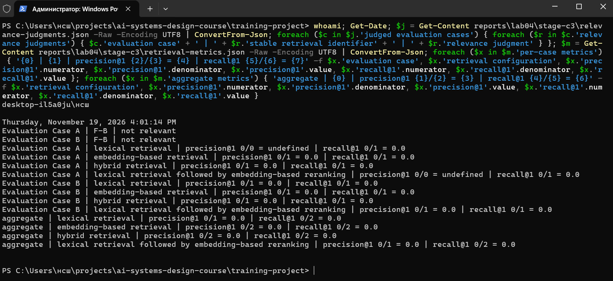
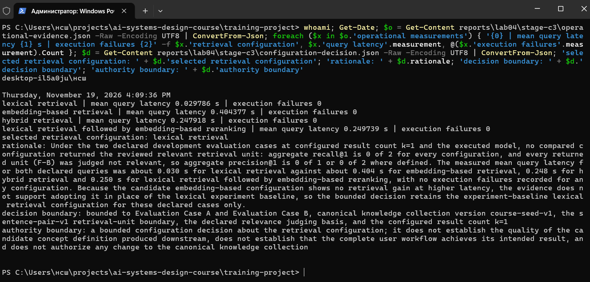

# Лабораторна робота 04

## Ідентифікація

- URL форка: https://github.com/DTaran3/ai-systems-design-course
- Особиста гілка: lab04/DTaran3
- Статус завершення: `complete`

Повний хеш остаточного коміту та результат перевірки містяться в окремому згенерованому `verification-report.json`. Їх не вписують у цей звіт до коміту, оскільки така зміна створила б інший коміт.

## Мета роботи

Отримати свідчення, потрібні команді інженерів, щоб вирішити, чи має кандидатна конфігурація інформаційного пошуку — пошук на основі ембедингів — замінити базову конфігурацію експерименту — лексичний пошук — для оцінюваного використання операції інформаційного пошуку над канонічною колекцією знань `course-seed-v1`, і записати це як обмежене рішення щодо конфігурації, що спирається на межу одиниці пошуку, векторний індекс, ранжовані виходи, судження про релевантність, метрики та операційні вимірювання.

## Хід виконання

Контрольні точки нижче подано в порядку кроків лабораторної роботи. Для кожної наведено виконану дію, спостережений результат, підставу для переходу далі та узгодженість із машинними свідченнями.

### Вибір межі одиниці інформаційного пошуку

Дія. До канонічних записів знань `R-A` і `R-B` колекції `course-seed-v1` застосовано дві надані конфігурації розбивки на фрагменти: `sentence-pair-v1` (межі лише на межах речень, до двох сусідніх речень у фрагменті, без перекриття) і `fixed-72-v1` (до 72 символів, розрив перед останнім пробілом у межах ліміту, без перекриття). Отримані фрагменти переглянуто, після чого командою `record-boundary-decision` зафіксовано вибір `sentence-pair-v1`.

Спостережений результат. Конфігурація `sentence-pair-v1` дала дві одиниці інформаційного пошуку: `F-A` (запис `R-A`, версія 1, джерело `course-source-a`, версія джерела 1, символи 1–215) і `F-B` (запис `R-B`, версія 1, джерело `course-source-b`, версія джерела 1, символи 1–143). Конфігурація `fixed-72-v1` дала шість фрагментів: чотири для `R-A` (`F-A-72-1` … `F-A-72-4`, символи 1–71, 73–140, 142–203, 205–215) і два для `R-B` (`F-B-72-1`, `F-B-72-2`, символи 1–71, 73–143). Усі фрагменти класифіковано як похідні артефакти боку пошуку, що не є членами канонічної колекції знань. Перший фрагмент `F-A-72-1` закінчується словами про зв’язок «до первинного запису», а ідентифікатор, версія запису й розташування речення опиняються вже в наступних фрагментах.

Підстава для продовження. Правило пари речень зберігає разом ідентифікатор первинного запису, версію запису й точне місце підтвердного уривка, які потрібні підставі для судження про релевантність обох оголошених випадків для оцінювання; фіксована довжина 72 символи розносить ці дані по різних фрагментах. Тому вибрано `sentence-pair-v1`. Це рішення не уповноважує жодної зміни канонічної колекції знань.

Узгодженість машинних свідчень. Опис і знімок відповідають файлам `stage-b/boundary-comparison.json` і `stage-b/boundary-decision.yaml`; `verify-stage-b` завершилася повідомленням про успішну перевірку для `sentence-pair-v1`.

Рисунок — `01-boundary-selection.png`

### Ембединги та векторний індекс

Дія. Завантажено локальну модель ембедингів у каталог `models/potion-base-8M`, створено ембединги одиниць інформаційного пошуку (`prepare-embeddings`) і підготовлено векторний індекс (`prepare-index`). Перед використанням індексу виконано дві перевірки прив’язок командою `check-index-bindings`: для потрібної конфігурації `required-course-seed-v1` і для `required-course-seed-v2`. Після цього виконано `verify-stage-c1`.

Спостережений результат. Модель `minishlab/potion-base-8M`, ревізія `bf8b056651a2c21b8d2565580b8569da283cab23`, версія представлення `course-static-embed-v1`, розмірність 256, простір ембедингів `potion-base-8M@bf8b056651a2c21b8d2565580b8569da283cab23/course-static-embed-v1`. Індекс має версію `vector-index-course-seed-v1`, прив’язаний до колекції `course-seed-v1` і до `sentence-pair-v1`, та містить одиниці `F-A` і `F-B`. Перевірка для `required-course-seed-v1` визнала індекс придатним. Перевірка для `required-course-seed-v2` визнала його застарілим: не збігається прив’язка до версії канонічної колекції знань (потрібна `course-seed-v2`, записана `course-seed-v1`); умовою відновлення є підготовка замінного індексу, прив’язаного до потрібних входів. `verify-stage-c1` завершилася повідомленням про успіх для `vector-index-course-seed-v1`.

Підстава для продовження. Індекс придатний для `required-course-seed-v1`, тобто саме для тієї колекції й межі, з якими працюють оголошені випадки, тому виконання інформаційного пошуку дозволено. Застарілий результат для `required-course-seed-v2` не використано: індекс не застосовувався до конфігурації, з якою його прив’язки не збігаються.

Узгодженість машинних свідчень. Опис і знімок відповідають файлам `stage-c1/retrieval-unit-embeddings.json`, `stage-c1/index-manifest.json`, `stage-c1/binding-check-required-course-seed-v1.json`, `stage-c1/binding-check-required-course-seed-v2.json` та результату `verify-stage-c1`.

Рисунок — `02-embedding-index.png`

### Порівняння конфігурацій інформаційного пошуку

Дія. Командою `execute-retrieval` виконано обидва випадки для оцінювання за чотирма конфігураціями (лексичний пошук, пошук на основі ембедингів, гібридний пошук, лексичний пошук із наступним переранжуванням ембедингами) із кількістю результатів `k = 1`. Випадок A: «How can an auditor trace an excerpt to its origin and revision?». Випадок B: «Which source and version identify the supporting passage for a concept proposal?». Усі вісім виходів перевірено командою `verify-stage-c2`.

Спостережений результат. Ранжовані кандидатні виходи (перша позиція):

| Випадок | Конфігурація | Вихід |
|---|---|---|
| A | лексичний пошук | порожній (лексичний ранг порожній) |
| A | на основі ембедингів | `F-B`, 0,3954 (`F-A` — 0,3941) |
| A | гібридний | `F-B`, 1,0 |
| A | лексичний + переранжування | порожній (обмежений набір кандидатів порожній) |
| B | лексичний пошук | `F-B`, 5 (`F-A` — 3) |
| B | на основі ембедингів | `F-B`, 0,7039 (`F-A` — 0,5937) |
| B | гібридний | `F-B`, 2,0 |
| B | лексичний + переранжування | `F-B`, 0,7039 |

Порожній ранжований вихід для випадку A у лексичній і переранжованій конфігураціях є результатом пошуку (жоден термін запиту не збігся з одиницями), а не відмовою виконання: помилок виконання не зафіксовано. У випадку B лексичний ранг ставить `F-B` перед `F-A` (5 проти 3), і всі чотири конфігурації повертають `F-B`.

Підстава для продовження. Успішна перевірка всіх восьми виходів показала, що вони відтворюються за закоміченим індексом і не пошкоджені, тому їх можна передавати на судження про релевантність. Жодної конфігурації не названо загалом кращою: порівняння спирається лише на оголошені випадки й `k = 1`.

Узгодженість машинних свідчень. Опис і знімок відповідають восьми файлам `stage-c2/evaluation-case-*.json` і результату `verify-stage-c2` («passed for 8 outputs»).

Рисунок — `03-retrieval-comparison.png`

### Судження про релевантність і метрики

Дія. До повернених одиниць застосовано оголошену підставу для судження: одиниця має пояснювати, які дані ідентифікують первинний запис, його версію та точне місце підтвердного уривка. Судження записано командою `record-relevance-judgments`, метрики `precision@1` і `recall@1` обчислено командою `compute-retrieval-metrics`. Очікуваний результат, відомий лише оцінювачу, операції інформаційного пошуку не передавався.

Спостережений результат. Єдина повернена одиниця в обох випадках — `F-B`; обидва судження — «не релевантна». Обґрунтування: `F-B` описує квитанцію запуску пропозиції, що фіксує джерело й версію моделі, яка створила пропозицію поняття, і прямо зазначає, що вона не локалізує підтвердний уривок; тож вона не пояснює дані про первинний запис, його версію та місце уривка. Метрики за записами (чисельник/знаменник):

| Випадок | Конфігурація | precision@1 | recall@1 |
|---|---|---|---|
| A | лексичний пошук | `undefined` (0/0) | 0/1 |
| A | на основі ембедингів | 0/1 = 0,0 | 0/1 |
| A | гібридний | 0/1 = 0,0 | 0/1 |
| A | лексичний + переранжування | `undefined` (0/0) | 0/1 |
| B | лексичний пошук | 0/1 = 0,0 | 0/1 |
| B | на основі ембедингів | 0/1 = 0,0 | 0/1 |
| B | гібридний | 0/1 = 0,0 | 0/1 |
| B | лексичний + переранжування | 0/1 = 0,0 | 0/1 |

Агреговані метрики: лексичний пошук — `precision@1` 0/1 = 0,0, `recall@1` 0/2 = 0,0; пошук на основі ембедингів — 0/2 = 0,0 і 0/2 = 0,0; гібридний — 0/2 = 0,0 і 0/2 = 0,0; лексичний із переранжуванням — 0/1 = 0,0 і 0/2 = 0,0. Порожній вихід не додає одиниць до знаменника `precision@1`, але очікувана релевантна одиниця `F-A` входить у знаменник `recall@1`.

Підстава для продовження. Судження покривають усі повернені одиниці, а арифметику метрик відтворено з перевірених виходів і записаних суджень, тому можна переходити до операційних вимірювань і рішення. Значення нульові: релевантна одиниця `F-A` не потрапила на першу позицію в жодній конфігурації.

Узгодженість машинних свідчень. Опис і знімок відповідають файлам `stage-c3/relevance-judgments.json` і `stage-c3/retrieval-metrics.json`.

Рисунок — `04-relevance-metrics.png`

### Операційні свідчення та обмежене рішення

Дія. Командою `measure-operational-evidence` з `--runs 3` виміряно операційні свідчення для кожної конфігурації, після чого командою `record-configuration-decision` записано одне обмежене рішення щодо конфігурації. Перевірку арифметики метрик виконано командою `verify-stage-c3`.

Спостережений результат. Середня затримка виконання обох запитів за три запуски в одному процесі: лексичний пошук — 0,035 с, на основі ембедингів — 0,634 с, гібридний — 0,375 с, лексичний із переранжуванням — 0,391 с. Помилок виконання в жодній конфігурації не зафіксовано. Вартість побудови індексу не вимірювалася повторно (використано записане свідчення підготовки індексу); вартість запиту подано кількістю кодувань на виконання; споживання ресурсів — локальна модель, без доступу до мережі й без додаткового обладнання; піковий обсяг пам’яті не інструментовано. Обрано конфігурацію `lexical retrieval`. Межа рішення: випадки A і B, колекція `course-seed-v1`, межа `sentence-pair-v1`, оголошена підстава для судження, `k = 1`. Межа повноважень: рішення стосується лише конфігурації інформаційного пошуку, не встановлює якості кандидатного визначення поняття, не засвідчує досягнення мети повного користувацького процесу й не уповноважує змін канонічної колекції знань.

Підстава для продовження. Жодна конфігурація не повернула релевантну одиницю (агрегований `recall@1` дорівнює 0 з 2), а кандидатний пошук на основі ембедингів мав найбільшу затримку (0,634 с проти 0,035 с) без виграшу в релевантності. Тому свідчення не підтримують заміну базового лексичного пошуку кандидатним, і базову конфігурацію збережено в оголошеній межі. Операційних даних достатньо для остаточної перевірки: усі п’ять вимірюваних пунктів мають записану межу вимірювання.

Узгодженість машинних свідчень. Опис і знімок відповідають файлам `stage-c3/operational-evidence.json` і `stage-c3/configuration-decision.json`; операційні вимірювання не входять до чисельників і знаменників метрик релевантності.

Рисунок — `05-operational-decision.png`

### Остаточна перевірка

Дія. Заповнений звіт перевірено командою `validate-report`, усі свідчення лабораторної роботи закомічено в гілку `lab04/DTaran3`, після чого виконано `lab04 verify` для точного HEAD гілки; перед комітом запущено публічні тести.

Спостережений результат. Статус перевірки та повний хеш остаточного коміту записано в `verification-report.json`; знімок показує той самий результат і той самий коміт.

Підстава для завершення. Успішна перевірка доменних артефактів, структури звіту, шести знімків і незмінності закомічених свідчень дозволяє сформувати матеріали для подання.

Узгодженість машинних свідчень. Знімок відповідає `verification-report.json`; після остаточної перевірки закомічені свідчення не редагувалися.

Рисунок — `06-final-verification.png`

## Висновки

Виконано вибір межі одиниці пошуку `sentence-pair-v1`, підготовлено векторний індекс `vector-index-course-seed-v1` для колекції `course-seed-v1`, отримано вісім ранжованих кандидатних виходів, записано судження про релевантність, обчислено метрики й виміряно операційні свідчення. Мету роботи досягнуто в оголошеній межі: отримано свідчення для рішення про заміну базової конфігурації й записано обмежене рішення зберегти лексичний пошук. Водночас свідчення слабкі в одному відношенні: на двох розробницьких випадках при `k = 1` жодна конфігурація не повернула релевантну одиницю `F-A` (у випадку A оцінки ембедингів для `F-A` і `F-B` майже збігаються: 0,3941 і 0,3954), тому рішення спирається на відсутність виграшу та на вищу затримку кандидатної конфігурації, а не на доведену перевагу лексичного пошуку.
