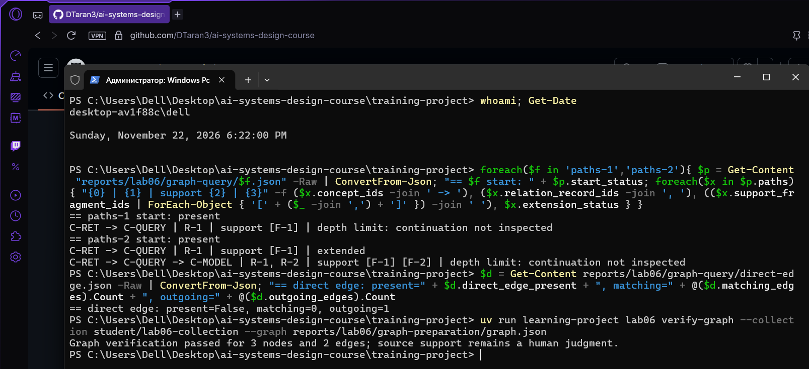
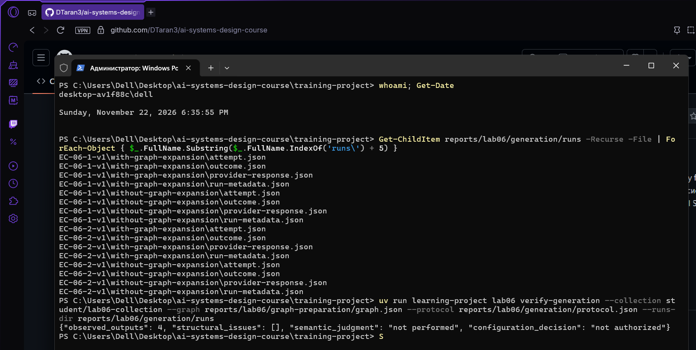
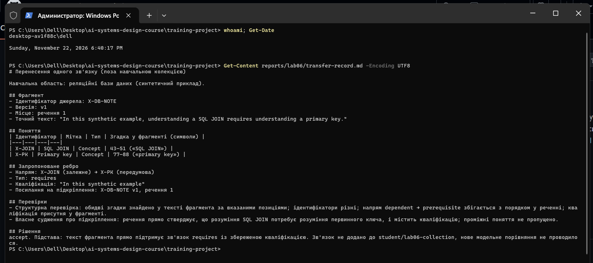

# Лабораторна робота 06

## Ідентифікація

- URL форка: https://github.com/DTaran3/ai-systems-design-course
- Особиста гілка: lab06/DTaran3
- Статус завершення: `complete`

Повний хеш остаточного коміту та результат перевірки містяться в окремому згенерованому `verification-report.json`. Їх не вписують у цей звіт до коміту, оскільки така зміна створила б інший коміт.

## Мета роботи

Отримати свідчення, потрібні команді інженерів, щоб вирішити, чи має конфігурація з розширенням графа знань (проходження за прийнятими зв’язками `requires` від початкового поняття) замінити конфігурацію без розширення графа в операції пояснення передумов на двох розробницьких навчальних випадках. Для цього перевірено згадки понять і напрями зв’язків, зібрано прийнятий граф, виконано обмежені запити, підготовлено парні джерельні свідчення в межах бюджету контексту, отримано чотири виходи моделі, незалежно оцінено їх за рубрикою й записано обмежене рішення щодо конфігурації; окремо розглянуто перенесення одного зв’язку на іншу предметну область.

## Хід виконання

### Підготовка прийнятого графа

Дія. Для захопленого набору пропозицій перевірено згадки понять і напрями зв’язків. Усі п’ять згадок, що належать поняттям, зіставлено з вузлами `C-RET`, `C-QUERY` і `C-MODEL` (дві згадки `query embedding` у `F-2` віднесено до одного й того самого вузла `C-QUERY`); згадку `embedding` у `F-3` визнано нерозв’язаною, бо контекст не вказує, яке прийняте поняття мається на увазі. Пропозицію `P-3` (обернений напрям: `query embedding` потребує `embedding-based retrieval`) відхилено, бо `F-1` такого не стверджує; пропозицію `P-4` заблоковано через нерозв’язану початкову згадку. Пропозиції `P-1` і `P-2` прийнято.

Спостережений результат. Прийнятий граф має три вузли (`C-RET`, `C-QUERY`, `C-MODEL`) і два ребра: `R-1` (`C-RET` requires `C-QUERY`, підкріплення `F-1`) і `R-2` (`C-QUERY` requires `C-MODEL`, підкріплення `F-2`), обидва з кваліфікацією «In this teaching route». Команда `verify-graph` завершилася повідомленням про успішну перевірку 3 вузлів і 2 ребер.

Підстава для продовження. Структурна перевірка встановлює лише узгодженість ідентифікаторів, напрямів, посилань і кваліфікації; чи підкріплює джерело зв’язок, залишається судженням людини, яке записано в `review.json` окремо для кожної згадки та пропозиції. Результат узгоджено з `graph-preparation/review.json`, прийнятим `accepted.json` і `graph-preparation/graph.json`.

### Обмежені запити до графа

Дія. Виконано запит довжиною до одного ребра від `C-RET`, запит довжиною до двох ребер і перевірку прямого ребра `C-RET` → `C-MODEL`. Запити відповідають шаблону Cypher `MATCH p = (start:Concept {id: 'C-RET'})-[:requires*1..2]->(prerequisite:Concept)` із забороною повторного вузла в шляху; сам Cypher не виконувався, оскільки лабораторна використовує еквівалентний обмежений структурний запит курсу.

Спостережений результат. Однореберний запит повернув шлях `C-RET` → `C-QUERY` (запис `R-1`, підкріплення `F-1`) зі станом продовження «depth limit: continuation not inspected». Двореберний запит повернув той самий шлях зі станом «extended» і шлях `C-RET` → `C-QUERY` → `C-MODEL` (записи `R-1`, `R-2`, підкріплення `F-1` і `F-2`) також із станом «depth limit: continuation not inspected». Перевірка прямого ребра: обидва вузли присутні, `direct_edge_present = false`, збігів немає, вихідне ребро одне (`R-1`).

Підстава для продовження. Неоглянуте продовження означає лише межу глибини запиту, відсутнє збережене пряме ребро означає лише те, що прийняте ребро не записано, а не те, що прямої залежності немає в предметній області; проміжне поняття `C-QUERY` збережено в обох шляхах. Результат узгоджено з `graph-query/paths-1.json`, `paths-2.json` і `direct-edge.json`.

### Підготовка джерельних свідчень

Дія. Для двох навчальних входів підготовлено парні вибірки без розширення графа та з розширенням графа з бюджетом контексту 250 символів (`F-1` — 105, `F-2` — 133, `F-3` — 49 символів), а також два додаткові перевірочні входи політик.

Спостережений результат. Вхід `support-addition`: без розширення подано `F-1` (залишок бюджету 145), з розширенням розв’язано вхідний вузол і подано `F-1` та `F-2` (залишок 12). Вхід `budget-exclusion`: без розширення подано `F-1` і `F-3` (залишок 96); з розширенням кандидатами стали `F-1`, `F-3`, `F-2`, але `F-2` виключено за критерієм `context-budget fit`, залишок 96. Перевірочні входи: `duplicate-only` дає однаковий набір `F-1`, `F-2` в обох конфігураціях (дублікат усунено, залишок 12); `unresolved-target` зі станом пошуку вхідного вузла «unresolved» зберігає початкового кандидата `F-2` без змін (залишок 117). Обмежений запит до моделі має три обов’язкові поля (`task instruction`, `supplied source evidence`, `output contract`); оцінювальний матеріал (еталон, рубрика, судження) до запиту не потрапляє.

Підстава для продовження. Обидві перевірки `verify-evidence` завершилися успішно для 2 навчальних входів і 4 запитів без виводу моделі та без перевіреного судження про підкріплення. Результат узгоджено з `evidence-preparation/evidence-preparation.json` і `policy-probes.json`.

### Спостережені виходи операції

Дія. Після заморожування протоколу `generation/protocol.json` (модель `gemini-3.8-flash-low`, адаптер `agy`, одна спроба на позицію) виконано чотири запуски: випадки `EC-06-1-v1` і `EC-06-2-v1`, у кожному конфігурації без розширення графа та з розширенням графа. Усі чотири позиції мають стан `observed`, переривань чи імпорту не було.

Спостережений результат. Усі чотири виходи є поясненнями передумов. `EC-06-1-v1` без розширення: одне твердження з цитатою `F-1` (подано лише `F-1`). `EC-06-1-v1` з розширенням: два твердження з цитатами `F-1` і `F-2`. `EC-06-2-v1` в обох конфігураціях: два твердження з цитатами `F-1` і `F-2`. Виміряний час запитання, с: без розширення — 11,203 і 8,469; з розширенням — 8,485 і 22,781. Звітні токени за конвертами AGY: 13 299 і 13 550 (разом 26 849) без розширення; 13 502 і 15 907 (разом 29 409) з розширенням. У конверті `EC-06-1-v1` з розширенням зафіксовано відхилену спробу виконати команду (`denied_actions`); вона не вплинула на вихід.

Підстава для продовження. Команда `verify-generation` повідомила 4 спостережені виходи, порожній перелік структурних проблем, судження не виконано, рішення щодо конфігурації не дозволено. Структурна перевірка цитат лише підтверджує, що ідентифікатори вказують на подані одиниці, а чи підкріплює текст твердження, оцінено окремо. Результат узгоджено з `generation/protocol.json` і `generation/runs/`.

### Незалежні судження та обмежене рішення

Дія. Як оцінювач-людина оцінено кожну з чотирьох позицій окремо для охоплення в допущених свідченнях і для якості відповіді. Далі виконано `assess-comparison` і як команда інженерів записано рішення `record-decision`.

Спостережений результат. Без розширення графа: 1 пропуск із 2 судженими виходами, частка проходження рубрики 0,5. На `EC-06-1-v1` подано лише `F-1`, тому другий обов’язковий зв’язок (`query embedding` → `embedding model`) не мав підкріплення в допущеному тексті, і єдине, хоч і підкріплене, твердження не виражає всіх зв’язків; позицію оцінено як невдалу, непідкріплених тверджень немає. З розширенням графа: 2 пропуски із 2, частка 1,0. Умови прийняття: мінімальна частка 1,0 виконана лише з розширенням; блокувальних невдач немає в обох конфігураціях; найбільший час запитання 22,781 с проти межі 360 с; зусилля рецензування 2 хв на вихід проти межі 10 хв; токени 26 849 і 29 409 проти межі 200 000. Порівняння повне (`complete = true`), допущена гілка — `adopt with graph expansion`, зафіксоване рішення — `adopt with graph expansion` (лише для двох відкритих розробницьких випадків).

Підстава для продовження. Частки обчислено окремо для кожної конфігурації, бо кожна є повною конфігурацією операції. З навчальним прогнозом збігається напрям: розширення графа додає `F-2` для другого ребра там, де однореберний шлях зупиняється на `F-1`. Розбіжність у тому, що різницю спостережено лише на одному з двох випадків: на `EC-06-2-v1` обидві конфігурації подали `F-1` і `F-2` та пройшли з однаковими твердженнями. Компроміс підготовки графа: виграш у покритті (шлях `C-RET` → `C-QUERY` → `C-MODEL` знайшов `F-2`) потребує ручної перевірки згадок і напрямів, компіляції та підтримки при зміні джерел; час підготовки не вимірювався, тому не стверджується; крім того, у перевірці бюджетного виключення `F-2` знайдено, але виключено бюджетом у 250 символів, тобто виграш не безумовний. Результат узгоджено з `judgments.json`, `comparison.json` і `decision.json`.

### Перенесення одного зв’язку

Дія. Розглянуто область реляційних баз даних і синтетичний фрагмент `X-DB-NOTE`, версія `v1`, речення 1: «In this synthetic example, understanding a SQL JOIN requires understanding a primary key.» Поняття: `X-JOIN` (мітка «SQL JOIN», тип `Concept`, згадка в позиціях 43–51) і `X-PK` (мітка «Primary key», тип `Concept`, позиції 77–88). Запропоноване ребро: `X-JOIN` (залежне) → `X-PK` (передумова), тип `requires`, кваліфікація «In this synthetic example», підкріплення — `X-DB-NOTE` `v1`, речення 1.

Спостережений результат. Структурна перевірка: обидві згадки знайдено в тексті за вказаними позиціями, ідентифікатори різні, напрям збігається з порядком у реченні, кваліфікація присутня. Власне судження про підкріплення: речення прямо стверджує потребу розуміти первинний ключ для розуміння `SQL JOIN` із кваліфікацією, проміжні поняття не пропущено. Рішення — `accept`.

Підстава для продовження. Зв’язок не додавався до `student/lab06-collection`, нове модельне порівняння не проводилося, тому це розгляд одного зв’язку, а не зміна колекції. Запис збережено в `transfer-record.md`.

### Остаточна перевірка

Дія. Виконано перевірку звіту (`validate-report`) і остаточну перевірку (`lab06 verify`) для точного остаточного коміту гілки `lab06/DTaran3`; вона повторює детерміновані перевірки графа, запитів, підготовки свідчень, запусків, суджень, порівняння й рішення без нового виклику моделі та без повторного судження. Повний хеш коміту й результат записує згенерований `verification-report.json`; їх не додано до закоміченого звіту.

Спостережений результат. Увесь шлях завершено, стан `complete`; знімок остаточної перевірки наведено нижче.

Підстава для продовження. Свідчення, закомічені до перевірки, після неї не змінювалися; перевірка не судить про підкріплення джерелами, якість пояснень чи досягнення мети.

### Межа зупинки

Не застосовується.

## Висновки

Виконано підготовку й перевірку прийнятого графа (три вузли, два ребра), обмежені запити з перевіркою відсутнього прямого ребра, парну підготовку джерельних свідчень у бюджеті 250 символів, чотири спостережені виходи моделі, незалежні судження за рубрикою, порівняння з умовами прийняття, обмежене рішення та розгляд одного перенесеного зв’язку. Мету досягнуто повністю в оголошеній межі: конфігурація з розширенням графа отримала частку проходження 1,0 проти 0,5 і виконала всі умови прийняття, тому записано рішення `adopt with graph expansion`. Відсутніх результатів немає. Рішення стосується лише двох відкритих розробницьких випадків, спирається на різницю в одному з них і не є дозволом на застосування системи, на зміну прийнятої колекції чи твердженням про вигоду на нових даних.
