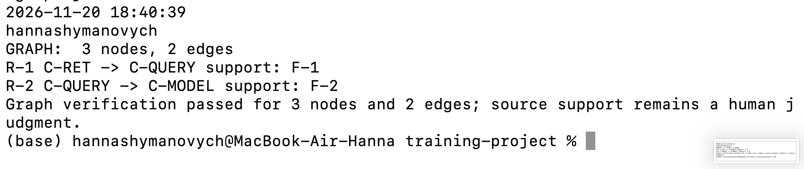
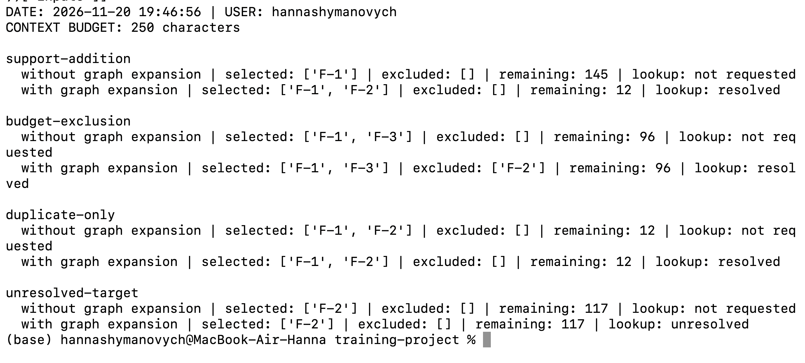

# Лабораторна робота 06

## Ідентифікація

- Прізвище та ім'я студента: Шиманович Ганна
- Ідентифікатор студента: `shymanovych-kn1223b`
- URL форка: https://github.com/shymochkaa/ai-systems-design-course
- Особиста гілка: `lab06/shymanovych-kn1223b`
- Статус завершення: `complete`

## Мета роботи

Метою лабораторної роботи є набуття практичних навичок побудови та перевірки графа знань із простежуваним джерельним підкріпленням, виконання обмежених графових запитів і підготовки доказів для GraphRAG. Очікуваним результатом є отримання відтворюваного порівняння конфігурацій генерації відповідей із розширенням графа та без нього, оцінювання якості відповідей за визначеними критеріями й ухвалення обґрунтованого інженерного рішення в межах досліджених навчальних сценаріїв.

## Хід виконання

### Підготовка прийнятого графа

**Виконана дія.** Проведено ручний перегляд зафіксованих пропозицій виділення понять і зв’язків із навчальних фрагментів `F-1`, `F-2` та `F-3`. Згадки `M-1`–`M-5` зіставлено з поняттями `C-RET`, `C-QUERY` і `C-MODEL`; згадку `M-6` залишено нерозв’язаною, оскільки текст `F-3` не дозволяє однозначно визначити поняття. Для зв’язків перевірено тип `requires`, напрям `dependent → prerequisite`, кваліфікацію `In this teaching route` та джерельне підкріплення.

**Спостережений результат.** Сформовано граф із трьома вузлами типу `Concept`: `C-RET` — Embedding-based retrieval, `C-QUERY` — Query embedding, `C-MODEL` — Embedding model. Прийнято два ребра: `R-1: C-RET → C-QUERY` із підкріпленням `F-1` (`S-TEACH`, `v1`, `sentence 1`) та `R-2: C-QUERY → C-MODEL` із підкріпленням `F-2` (`S-TEACH`, `v1`, `sentence 2`). Пропозицію `P-3` відхилено: хоча вона структурно відповідає схемі, фрагмент `F-1` підтримує протилежний напрям залежності. Пропозицію `P-4` заблоковано через нерозв’язаний вихідний вузол `M-6`.

**Підстава для продовження або зупинки.** Структурна відповідність перевіряє форму запису, типи та можливість розв’язати кінцеві вузли, але сама по собі не доводить правильності твердження. Окреме ручне судження про підкріплення встановлює, чи підтверджує конкретний фрагмент заявлений напрям залежності. Тому до графа допущено лише `P-1` і `P-2`; перевірка скомпільованого графа завершилася успішно, що дозволило перейти до запитів шляхів.

**Узгодженість із машинними свідченнями.** Рішення `accept`, `reject` і `blocked` зафіксовано у `graph-preparation/review.json`; прийнятий стан колекції та `graph-preparation/graph.json` відображають лише два дозволені ребра. У `graph.json` наявні три вузли, два ребра та п’ять розв’язаних асоціацій згадок; `M-6`, `R-3` і `R-4` не включені до графа.

### Обмежені запити до графа

**Виконана дія.** Для прийнятого графа виконано обмежений пошук вихідних зв’язків типу `requires` від поняття `C-RET` із максимальною довжиною шляху один і два ребра. Додатково перевірено наявність прямого ребра `C-RET → C-MODEL`. Пошук проводився в напрямі `dependent → prerequisite` без повторення вузлів у межах одного шляху. Така постановка відповідає логіці шаблону Cypher для спрямованого обходу зв’язків `requires` із заданою верхньою межею довжини шляху.

**Спостережений результат.** За обмеження `max_edges = 1` отримано шлях `C-RET → C-QUERY` через запис `R-1` із підкріпленням `F-1`. Статус `depth limit: continuation not inspected` означає, що подальше продовження не перевірялося. За обмеження `max_edges = 2` отримано як однореберний шлях через `R-1`, так і двореберний шлях `C-RET → C-QUERY → C-MODEL` через `R-1` і `R-2`, із підкріпленнями `F-1` та `F-2` відповідно. Обидва ребра мають кваліфікацію `In this teaching route`. Однореберний шлях отримав статус `extended`, а двореберний — `depth limit: continuation not inspected`. Перевірка прямого ребра повернула `direct_edge_present = false` і порожній список `matching_edges`, хоча обидва кінцеві поняття присутні в графі.

**Підстава для продовження або зупинки.** Відсутність продовження за досягнення межі глибини не означає відсутності наступного ребра: його просто не оглянуто. Натомість перевірка прямого зв’язку встановлює відсутність конкретного збереженого ребра `C-RET → C-MODEL`. Жоден із цих результатів не доводить відсутності відповідного знання в усій предметній області. Наявність підтвердженого двореберного шляху дозволила перейти до підготовки джерельних свідчень.

**Узгодженість із машинними свідченнями.** Файл `graph-query/paths-1.json` містить один шлях і статус обмеження глибини; `graph-query/paths-2.json` містить два шляхи з ідентифікаторами вузлів, записів зв’язків, фрагментів і кваліфікацій. Файл `graph-query/direct-edge.json` підтверджує наявність початкового й цільового понять, вихідного ребра `R-1` та відсутність прямого ребра до `C-MODEL`. Усі результати узгоджуються з двома ребрами у `graph-preparation/graph.json`.

### Підготовка джерельних свідчень

**Виконана дія.** Підготовлено джерельні свідчення для конфігурацій `without graph expansion` і `with graph expansion` із бюджетом контексту 250 символів. Використано надані курсом ранжовані навчальні входи, а не результати нового пошуку. Для розширеної конфігурації перевірено пошук початкового вузла, проходження зв’язків графа, виявлення додаткових фрагментів, усунення дублікатів і допуск свідчень за критеріями `RUS-05-v1`: розв’язуваність посилання на джерело та відповідність бюджету.

**Спостережений результат.** У випадку `support-addition` без розширення допущено лише `F-1` (105 символів), а з розширенням додано `F-2` (133 символи), отримавши два фрагменти із залишком бюджету 12 символів. У випадку `budget-exclusion` початкові `F-1` і `F-3` займають 154 символи; знайдений через граф `F-2` не допущено, оскільки його довжина 133 символи перевищує залишок 96 символів. Виявлення фрагмента, таким чином, не означає його автоматичного включення до контексту. Контрольний випадок `duplicate-only` підтвердив, що вже наявні `F-1` і `F-2` не дублюються. У випадку `unresolved-target` пошук початкового вузла завершився статусом `unresolved`; розширення не виконувалося, але початковий фрагмент `F-2` залишився доступним.

**Підстава для продовження або зупинки.** В обох конфігураціях сформовано обмежений запит до моделі з трьох полів: `task instruction`, `supplied source evidence` та `output contract`. Інструкція вимагає пояснення залежностей у межах двох ребер, збереження проміжних понять і кваліфікацій та відмови за недостатніх або конфліктних свідчень. Контракт визначає структуру JSON-відповіді й посилань на допущені фрагменти. Матеріали оцінювання та правильні відповіді не включено до запиту моделі. Усі перевірені правила допуску дозволили перейти до генерації, не змінюючи прийняту колекцію знань.

**Узгодженість із машинними свідченнями.** `evidence-preparation/evidence-preparation.json` містить навчальні випадки `support-addition` і `budget-exclusion`, їхні конфігурації, виявлені та допущені фрагменти, виключення й обмежені запити. `evidence-preparation/policy-probes.json` містить окремі перевірки `duplicate-only` та `unresolved-target`; вони не є додатковими випадками оцінювання чи новими позиціями генерації. Структурна перевірка обох артефактів завершилася успішно.

### Спостережені виходи операції

**Виконана дія.** За протоколом `generation/protocol.json` виконано чотири живі модельні запуски: два навчальні випадки `EC-06-1-v1` і `EC-06-2-v1` у конфігураціях `without graph expansion` та `with graph expansion`. Використано адаптер `agy`, модель `gemini-3.8-flash-low` і тайм-аут 5 хвилин. Для кожної позиції збережено повну відповідь провайдера, структурований результат і метадані виконання.

**Спостережений результат.** Усі чотири запуски мають статус `observed`, тип відповіді `generated prerequisite explanation`; відмов і зафіксованих помилок виконання немає. У випадку `EC-06-1-v1` без розширення отримано одне твердження: «In this teaching route, understanding embedding-based retrieval requires understanding a query embedding» із посиланням на `F-1`; час запиту становив 58,403 с. Із розширенням отримано це саме твердження та друге: «In this teaching route, understanding a query embedding requires understanding the embedding model that produces the query embedding» із посиланням на `F-2`; час запиту — 21,283 с. Для `EC-06-2-v1` обидві конфігурації повернули ті самі два твердження з посиланнями відповідно на `F-1` і `F-2`; час запиту становив 10,339 с без розширення та 13,815 с із розширенням. У всіх випадках повна структурована відповідь містить перелічені твердження; окремих пояснень або відмов поза ними не зафіксовано.

**Підстава для продовження або зупинки.** Перевірка генерації підтвердила наявність чотирьох результатів і відсутність структурних проблем. Відповідність формату JSON та наявність посилань на допущені фрагменти не є автоматичним доказом змістової правильності. Окреме людське судження має встановити, чи підтримує джерело кожне твердження і чи охоплено необхідні залежності. Переривань або імпортованих результатів у цих чотирьох позиціях не було, тому час успішних запитів не замінювався часом невдалих спроб. Це дозволило перейти до незалежного оцінювання.

**Узгодженість із машинними свідченнями.** `generation/protocol.json` визначає модель, конфігурації та межі виконання. Каталоги `generation/runs/` містять для кожної з чотирьох позицій файли `provider-response.json`, `outcome.json` і `run-metadata.json`. Метадані позначають результати як `live`, а поле `semantic_judgment` — як `not performed`, що узгоджується з необхідністю окремого ручного оцінювання. За відсутності даних провайдера про використання ресурсів такі значення не трактуються як нульові.

### Незалежні судження та обмежене рішення

**Виконана дія.** Після отримання чотирьох модельних відповідей виконано окреме ручне оцінювання за навчальною рубрикою. Для кожної позиції перевірено підкріплення обох необхідних залежностей наданими фрагментами, повноту відповіді, збереження кваліфікації `In this teaching route`, коректність посилань, відсутність непідкріплених тверджень і конфліктних інструкцій. Оцінки зафіксовано в `judgments.json`; результати зіставлено з умовами прийняття в `comparison.json`, після чого записано інженерне рішення.

**Спостережений результат.** У випадку `EC-06-1-v1` без розширення графа свідчення `F-1` підтримувало першу залежність, але `F-2` не було надано. Модель сформувала часткове пояснення замість відмови за недостатніх свідчень, тому отримано `fail`. З розширенням обидві залежності були підкріплені `F-1` і `F-2`, а відповідь отримала `pass`. Для `EC-06-2-v1` обидві конфігурації мали достатні свідчення та отримали `pass`. Таким чином, без розширення пройдено 1 із 2 перевірок (50 %), із розширенням — 2 із 2 (100 %). Загальна кількість токенів за даними порівняння становила відповідно 58 640 і 43 658; максимальний час одного запиту — 58,403 с і 21,283 с. На ручний перегляд зафіксовано сумарно 2,5 хвилини для кожної конфігурації, розподілені приблизно по 1,25 хвилини на позицію.

**Підстава для продовження або зупинки.** Конфігурація без розширення не виконала умову мінімальної частки успішних оцінок, хоча інші перевірки часу, зусиль оцінювання, використання токенів і блокувальних помилок пройдено. Конфігурація з розширенням виконала всі встановлені умови прийняття. Тому зафіксовано рішення `adopt with graph expansion`. Воно узгоджується з навчальним припущенням: обмежене розширення може покращити повноту пояснення, якщо початковим свідченням бракує необхідної залежності. Водночас підготовка графа потребує ручного перегляду понять і зв’язків, компіляції, перевірки та обмеженого обходу. Додаткові фрагменти не завжди потрапляють до контексту через бюджетні обмеження.

**Узгодженість із машинними свідченнями.** `judgments.json` містить чотири окремі людські оцінки та їхні причини. `comparison.json` підтверджує повноту оцінювання (`complete = true`), відсутність пропущених свідчень, частки успішних оцінок 0,5 і 1,0 та відповідність умовам прийняття лише розширеної конфігурації. `decision-input.json` і `decision.json` містять однакове рішення та його обґрунтування. Межа висновку — тільки два відкриті навчальні випадки; рішення не є дозволом на розгортання системи чи твердженням про загальну перевагу GraphRAG.

### Перенесення одного зв’язку

**Виконана дія.** Для перевірки можливості перенесення підходу на іншу навчальну область розглянуто синтетичний приклад із кібербезпеки. Створено навчальний фрагмент із такими реквізитами: ідентифікатор джерела `SYN-CYBER-01`, версія `1.0`, місце — синтетичний навчальний матеріал, абзац 1. Точний текст фрагмента: «У межах цього навчального курсу для розуміння хешування паролів необхідно спочатку засвоїти принцип роботи криптографічних хеш-функцій».

Виділено два поняття з міткою та типом `Concept`: `C-CYBER-01` — «Хешування паролів» (згадка «хешування паролів»); `C-CYBER-02` — «Криптографічні хеш-функції» (згадка «криптографічних хеш-функцій»). Запропоновано зв’язок `C-CYBER-01 → C-CYBER-02` з типом `requires`, напрямом `dependent → prerequisite`, кваліфікацією «У межах цього навчального курсу» та посиланням на підкріплення `SYN-CYBER-01`, версія `1.0`, абзац 1.

**Спостережений результат.** Ручна структурна перевірка підтвердила наявність двох різних ідентифікаторів понять, типів `Concept`, відповідних згадок у фрагменті, правильного напряму залежності, типу `requires` і посилання на конкретний фрагмент. Окреме судження про підкріплення встановило, що точний текст синтетичного джерела безпосередньо підтримує запропоновану навчальну залежність із зазначеною кваліфікацією. Рішення за результатом ручного аналізу — `accept`.

**Підстава для продовження або зупинки.** Прийняття зв’язку обґрунтовано явним формулюванням передумови у фрагменті. Водночас цей результат є локальним ручним прикладом, а не автоматичною перевіркою чи новим експериментом. Зв’язок не додано до навчальної колекції; нового модельного порівняння не проводилося.

**Узгодженість із машинними свідченнями.** Приклад демонструє ті самі правила визначення напрямку `dependent → prerequisite` та розмежування структурної перевірки і судження про підкріплення, що застосовувалися під час підготовки `graph-preparation/review.json` і `graph-preparation/graph.json`. Синтетичний зв’язок відсутній у цих машинних артефактах, оскільки перенесення виконано окремо без зміни прийнятого графа.

### Остаточна перевірка

**Виконана дія.** Підготовлено звіт із результатами перевірки графа знань, обмежених запитів, підготовки свідчень, чотирьох модельних запусків, незалежного оцінювання, інженерного рішення та ручного перенесення зв’язку. Перед фіксацією остаточного стану гілки виконано попередню перевірку структури звіту й наявності необхідних матеріалів. Після усунення виявлених недоліків передбачено повторну перевірку звіту та перевірку точного остаточного `HEAD` гілки.

**Спостережений результат.** Попередня перевірка підтвердила правильний порядок заголовків, наявність ідентифікаційних даних, семи посилань на скриншоти, шести файлів скриншотів до остаточної перевірки та необхідних машинних свідчень. Було виявлено незаповнений статус завершення й залишкові інструкції шаблону; статус встановлено як `complete`, а службові інструкції видалено. Остаточний результат перевірки коміту на момент підготовки цього розділу ще не отримано.

**Підстава для продовження або зупинки.** Для підтвердження завершення роботи необхідно успішно пройти повторну перевірку звіту, зафіксувати підготовлені матеріали в особистій гілці та перевірити точний остаточний коміт. Повний хеш коміту й результат перевірки мають зберігатися в окремому `verification-report.json`, без внесення хешу до вже зафіксованого звіту.

**Узгодженість із машинними свідченнями.** Звіт посилається на підготовлені JSON-артефакти всіх попередніх етапів і сім контрольних скриншотів. Остаточне підтвердження незмінності зафіксованих свідчень після перевірки має бути отримане під час перевірки `HEAD`; результат не підмінюється попередньою перевіркою структури звіту.

### Межа зупинки

Не застосовується. Виконано всі передбачені етапи підготовки графа, обмежених запитів, підготовки свідчень, генерації, ручного оцінювання, інженерного рішення та перенесення зв’язку. Остаточна перевірка звіту й зафіксованого стану гілки виконується окремо.

## Висновки

У лабораторній роботі підготовлено та перевірено граф знань із трьох понять і двох підтверджених зв’язків типу `requires`. Проведено ручний перегляд пропозицій, відхилено зв’язок із неправильним напрямом і заблоковано зв’язок із нерозв’язаним поняттям. Виконано обмежені графові запити, перевірено відсутність прямого ребра між початковим і кінцевим поняттями та підготовлено джерельні свідчення з бюджетом 250 символів.

Проведено чотири модельні генерації для двох навчальних випадків у двох конфігураціях. За результатами незалежного ручного оцінювання конфігурація без розширення графа отримала одну успішну оцінку з двох (50 %), а конфігурація з розширенням — дві з двох (100 %). На цій підставі зафіксовано інженерне рішення `adopt with graph expansion`. Окремо виконано ручний приклад перенесення зв’язку на синтетичний навчальний матеріал із кібербезпеки без зміни прийнятого графа.

Основні практичні результати роботи отримано; остаточне підтвердження повноти виконання залежить від фінальної перевірки звіту та стану Git-гілки. Висновок про перевагу розширення графа обмежується двома дослідженими навчальними випадками й не означає дозволу на розгортання системи, зміни прийнятої колекції або узагальнення результатів на інші дані.
