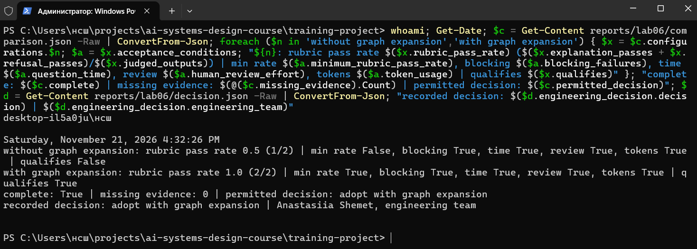

# Лабораторна робота 06

## Ідентифікація

- Прізвище та ім’я студента: Шемет Анастасія
- Ідентифікатор студента: shemet-anastasiia
- URL форка: https://github.com/ashemet3/ai-systems-design-course
- Особиста гілка: lab06/shemet-anastasiia
- Статус завершення: `complete`

Повний хеш остаточного коміту та результат перевірки містяться в окремому згенерованому verification-report.json. Хеш не вписують у джерельний звіт після коміту.

## Мета роботи

Отримати свідчення, потрібні інженерній команді, щоб вирішити, чи має конфігурація підготовки джерельних свідчень із розширенням вибірки вузлів графа замінити конфігурацію без розширення для операції пояснення передумов із використанням моделі на двох відкритих для порівняння випадках розроблення. Для цього потрібно мати перевірений прийнятий граф передумов без вигаданих ребер, обмежені шляхи й відсутнє пряме ребро без логічного виведення, парні надані джерельні свідчення та обмежені запити до моделі в межах бюджету контексту, фактичні результати моделі, незалежні судження про свідчення та відповідь і одне обмежене рішення щодо конфігурації, яке не уповноважує розгортання, запис до колекції чи висновки на утриманому наборі.

## Хід виконання

### Підготовка прийнятого графа

Дія: перевірено пропозиції зв’язків передумов щодо наданих фрагментів `F-1`, `F-2` і `F-3`, розв’язано згадки понять і завершено людський розгляд у `review.json`, після чого прийняті відповідності та відношення збережено в `student/lab06-collection/accepted.json`, а граф скомпільовано в `graph-preparation/graph.json`. Спостережений результат: згадки `M-1`–`M-5` розв’язано до трьох прийнятих понять (`C-RET`, `C-QUERY`, `C-MODEL`), згадку `M-6` («embedding» у `F-3`) залишено нерозв’язаною; пропозиції `P-1` і `P-2` прийнято, обернену пропозицію `P-3` відхилено, пропозицію `P-4` заблоковано через нерозв’язану початкову кінцеву точку; граф містить три вузли та два ребра `R-1` (`C-RET` → `C-QUERY`, підкріплення `F-1`) і `R-2` (`C-QUERY` → `C-MODEL`, підкріплення `F-2`) з кваліфікацією «In this teaching route», а перевірка повідомила про успіх для трьох вузлів і двох ребер. Підстава для продовження: структурна перевірка встановила лише відповідність схемі (`P-1`–`P-3` — `conforms`, `P-4` — `unresolved endpoint`) і не встановила підкріплення джерелом, тому обернену пропозицію відхилено саме за людським судженням: `F-1` не стверджує зворотного напряму, а нерозв’язана згадка не надає прийнятої кінцевої точки. Узгодженість машинних свідчень: опис і знімок відповідають `review.json`, `accepted.json` (три поняття, п’ять асоціацій згадок, відношення `R-1` і `R-2`) та `graph.json`, а прямого ребра від `C-RET` до `C-MODEL` у графі немає.

### Обмежені запити до графа

Дія: виконано запити `requires` від `C-RET` на одне та на два ребра та окрему перевірку прямого вихідного ребра від `C-RET` до `C-MODEL`, після чого повторно виконано верифікатор графа. Спостережений результат: `paths-1.json` містить один шлях `C-RET` → `C-QUERY` (`R-1`, `F-1`) зі статусом продовження «depth limit: continuation not inspected»; `paths-2.json` містить два шляхи — `C-RET` → `C-QUERY` зі статусом `extended` і `C-RET` → `C-QUERY` → `C-MODEL` (`R-1`, `R-2`; підкріплення `[F-1]`, `[F-2]`) зі статусом межі глибини; у `direct-edge.json` множина відповідних ребер порожня, `direct_edge_present` має значення `false`, єдине вихідне ребро від `C-RET` веде до `C-QUERY`. Підстава для продовження: шаблон Cypher `MATCH` з діапазоном `*1..2` відповідає двом запитам (діапазон `*1..1` — запиту на одне ребро), умова `WHERE` виключає повтори вузлів у межах шляху, а `RETURN` зберігає проміжне поняття `C-QUERY` і записи `R-1`, `R-2`, які зникли б за повернення лише кінцевих точок. Шлях на одне ребро залишає продовження неінспектованим, окрема перевірка встановлює лише відсутність збереженого прямого ребра, а шлях на два ребра через `C-QUERY` залишається; жодне зі спостережень не доводить відсутності передумови в предметній області і не є логічним виведенням нового прийнятого ребра. Узгодженість машинних свідчень: опис і знімок відповідають файлам `graph-query/paths-1.json`, `paths-2.json`, `direct-edge.json` і повідомленню успішної перевірки графа.

### Підготовка джерельних свідчень

Дія: підготовлено парні надані джерельні свідчення й обмежені запити до моделі без розширення вибірки вузлів графа та з ним для двох основних входів (`support-addition`, `budget-exclusion`) і двох політичних проб (`duplicate-only`, `unresolved-target`) за бюджету контексту 250 символів, після чого виконано обидві перевірки. Спостережений результат: у `support-addition` без розширення свідчення `[F-1]` (залишок 145), з розширенням `C-RET` розв’язано однозначно й свідчення становлять `[F-1, F-2]` (залишок 12); у `budget-exclusion` з розширенням кандидати `[F-1, F-3, F-2]`, а `F-2` не проходить `context-budget fit` за залишку 96, тому свідчення лишаються `[F-1, F-3]`; у `duplicate-only` розширення нічого не додає (`added_fragment_ids` порожній, обидва запити однакові, залишок 12); в `unresolved-target` пошук вхідного вузла нерозв’язаний, розширення не зберігає шляхів, а запит будується з оригінального кандидата `[F-2]` (залишок 117). Підстава для продовження: виявлення фрагмента через граф не є допуском, бо допуск визначають розв’язання походження та вміщення в бюджет, тому `F-2` виявлено, але вилучено, а виявлення лише дублікатів не змінює запит; нерозв’язаний пошук не є відмовою й не створює нового зіставлення понять. Обмежений запит до моделі містить лише три поля (інструкцію завдання, надані джерельні свідчення та контракт виходу) і не містить шляхів у графі та закритого оцінювального матеріалу (очікуваних результатів, підстав судження про релевантність, рубрик, невідібраних одиниць, прихованих відповідей). Узгодженість машинних свідчень: опис і знімок відповідають `evidence-preparation.json`, `policy-probes.json` і двом повідомленням «Evidence preparation verification passed for 2 teaching inputs and 4 requests», що підтверджують відсутність виходу моделі й суджень про підкріплення.

### Спостережені виходи операції

Дія: заморожено спільний протокол експерименту з моделлю `gemini-3.8-flash-low` та виконано чотири позиції (випадки `EC-06-1-v1`, `EC-06-2-v1` за двома конфігураціями) зі збереженням повних відповідей провайдера, після чого виконано структурну перевірку походження. Спостережений результат: усі чотири запуски завершилися успішно й дали згенеровані пояснення передумов (відмов немає): `EC-06-1-v1` без розширення — одне твердження з цитатою `F-1`, з розширенням — два твердження з цитатами `F-1` і `F-2`; `EC-06-2-v1` в обох конфігураціях — два твердження з цитатами `F-1` і `F-2`; перевірка повідомила `observed_outputs: 4`, `structural_issues: []`, `semantic_judgment: not performed`, `configuration_decision: not authorized`. Переривань, повторних викликів чи офлайн-імпорту не було, час запитання виміряно на живому шляху. Підстава для продовження: структурна перевірка цитат лише встановлює, що ідентифікатори фрагментів розв’язуються й поля мають потрібну форму, а підкріплення твердження допущеним текстом залишається судженням оцінювача-людини, виконаним на наступному кроці. Узгодженість машинних свідчень: опис і знімок відповідають `generation/protocol.json` і чотирьом каталогам `generation/runs/` (`attempt.json`, `provider-response.json`, `outcome.json`, `run-metadata.json`).

### Незалежні судження та обмежене рішення

Дія: оцінювач-людина окремо судив про покриття допущених свідчень і про відповідь для кожної з чотирьох позицій у `judgments.json`; після цього обчислено частки проходження рубрики оцінювання окремо для кожної конфігурації й оцінено заморожені умови прийняття в `comparison.json`, а інженерна команда записала обмежене рішення в `decision.json`. Спостережений результат: без розширення частка становить 1/2 = 0,50 (пояснення для `EC-06-1-v1` не пройшло, бо допущено лише `F-1`, а зв’язок від `C-QUERY` до `C-MODEL` не підкріплений допущеним текстом і відсутній у відповіді), з розширенням — 2/2 = 1,00; умови для конфігурації з розширенням виконано повністю (блокувальних невдач немає, час запитання 14,344 с і 16,5 с за межі 360 с, зусилля рецензування 2 хв за межі 10 хв, 27 160 повідомлених токенів за межі 200 000), конфігурація без розширення не досягає мінімальної частки 1,0; порівняння повне (`complete: true`, відсутніх свідчень немає), дозволене й записане рішення — `adopt with graph expansion`. Підстава для продовження: частки обчислюють окремо для кожної конфігурації, бо кожна має власні виходи та знаменник, і спільна частка приховала б невдачу однієї з них; невдале пояснення залишається записаним і не замінюється. Порівняння з навчальним прогнозом: частки 0,50 і 1,00 збігаються з ілюстрацією теорії, а розширення змінило допущені свідчення лише для `EC-06-1-v1`, проте рішення протилежне ілюстративному, бо там кандидат перевищував умовну межу затримки 2,5 с, а тут спостережена затримка далеко в межах 360 с. Компроміс підготовки графа: розширення надало бракуючий другий зв’язок (`F-2`) і підвищило покриття, але потребує підготовленого графа з людським розглядом згадок і зв’язків та супроводу, а в пробі з бюджетом виявлений `F-2` усе одно вилучено, тобто граф не звільняє від бюджету; час підготовки графа не вимірювано й не заявлено. Рішення стосується лише двох відкритих випадків розроблення й не уповноважує розгортання, запис до колекції чи висновки на утриманому наборі. Узгодженість машинних свідчень: опис і знімок відповідають `judgments.json`, `comparison.json` і `decision.json`.

### Перенесення одного зв’язку

Дія: до одного синтетичного зв’язку з іншої навчальної області (програмування мовою Python) застосовано ту саму межу представлення та розгляду, що й для навчального графа: окремо виконано структурну перевірку пропозиції та окремо записано судження про підкріплення джерелом. Навчальна колекція `student/lab06-collection` і прийнятий граф не змінювалися, нового порівняння конфігурацій із викликом моделі не проводилося. Спостережений результат: запропоноване ребро `requires` від поняття «List comprehension» до поняття «For loop» структурно відповідає схемі й підкріплене фрагментом `T-1`; прийнято рішення `accept`. Підстава для продовження: фрагмент прямо стверджує передумову в тому самому напрямі та з тією самою кваліфікацією, а структурна відповідність сама по собі підкріплення не встановлює, тому судження виконано окремо за текстом джерела. Узгодженість машинних свідчень: перенесення є письмовим записом у цьому звіті та не має окремого машиночитаного файлу; жоден файл навчальної колекції, графа чи генерування не змінювався, що підтверджується незмінністю закомічених свідчень під час остаточної перевірки.

Запис перенесення:

1. Область і фрагмент: початковий курс програмування мовою Python; синтетичний фрагмент `T-1`, джерело `S-PY-TEACH`, версія `v1`, розташування `sentence 1`, точний текст: “In this teaching route, understanding list comprehension requires understanding a for loop.” Фрагмент є авторським навчальним прикладом, а не зовнішньою цитатою.
2. Поняття та згадки: `C-LISTCOMP` («List comprehension», тип `Concept`) зі згадкою `M-T1` у `T-1`, символи 38–56 (кінцева позиція виключена); `C-FORLOOP` («For loop», тип `Concept`) зі згадкою `M-T2` у `T-1`, символи 82–90.
3. Запропоноване ребро: `requires` від залежного поняття `C-LISTCOMP` до поняття-передумови `C-FORLOOP`, кваліфікація «In this teaching route», фрагмент підкріплення `T-1`.
4. Структурна перевірка: обидві кінцеві точки є різними поняттями типу `Concept`; діапазони згадок збігаються з підрядками «list comprehension» і «for loop» у тексті `T-1`; напрям задано від залежного до передумови; посилання на підкріплювальний фрагмент розв’язується. Ця перевірка відокремлена від судження про підкріплення.
5. Судження про підкріплення та рішення: `accept`. Текст `T-1` стверджує, що в цьому навчальному маршруті розуміння генераторів списків потребує розуміння циклу `for`, тобто підкріплює точний напрям і кваліфікацію. Рішення не виводить універсального порядку вивчення понять і не дозволяє додати ребро до навчальної колекції.

### Остаточна перевірка

Дія: звіт завершено й перевірено командою `lab06 validate-report`, усі свідчення каталогів `reports/lab06` і `student/lab06-collection` закомічено одним комітом, після чого командою `lab06 verify` із повним хешем поточного HEAD гілки виконано остаточну перевірку; повний хеш і результат записуються лише до окремого `verification-report.json` і не вносяться до закоміченого звіту. Спостережений результат: статус перевірки фіксується в `verification-report.json` та на знімку. Підстава для завершення: успішна перевірка структури звіту, збігу особистої гілки, наявності свідчень до рішення та перенесення й відтворення детермінованих перевірок предметної області щодо записаних людських входів дозволяє сформувати матеріали для подання; ця перевірка не пересуджує підкріплення й не змінює рішення. Узгодженість машинних свідчень: знімок показує той самий статус і остаточний коміт, що записані в `verification-report.json`, а закомічені свідчення після перевірки не редагувалися.

### Межа зупинки

Не застосовується.

## Висновки

Виконано всі кроки лабораторної роботи: розглянуто й прийнято два зв’язки передумов із чотирьох поданих пропозицій (обернену відхилено, одну заблоковано через нерозв’язану згадку), скомпільовано граф із трьох вузлів і двох ребер, виконано обмежені запити й перевірку відсутнього прямого ребра, підготовлено парні надані джерельні свідчення та обмежені запити до моделі, отримано чотири фактичні пояснення передумов, зафіксовано незалежні судження, обчислено частки 0,50 без розширення та 1,00 з розширенням, оцінено умови прийняття й записано обмежене рішення `adopt with graph expansion`, а також виконано перенесення одного синтетичного зв’язку з іншої області.

Мету роботи досягнуто повністю: наявні всі потрібні свідчення від графа до рішення та контрольна точка перенесення, порівняння повне. Обмеження висновку: рішення спирається на два відкриті випадки розроблення, на одну модель і по одному запуску кожної пари без повторів, тому воно не узагальнюється на інші запити, моделі й колекції; відмов не спостерігалося, тож перевірку відмови не застосовано; час підготовки графа не вимірювано. Обмежене рішення щодо конфігурації не є дозволом на розгортання системи, на запис до прийнятої колекції чи на твердження про утриманий набір.
